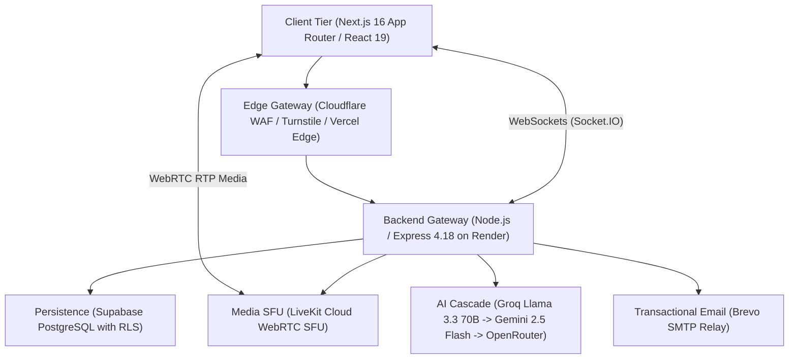

# ProjectHive 🐝 — System Architecture Overview

> **Official Documentation Portal:** For complete technical specifications, sequence diagrams, and database schemas, refer to [**docs/architecture/SYSTEM_ARCHITECTURE.md**](./docs/architecture/SYSTEM_ARCHITECTURE.md).

---

## 1. Master System Topology

ProjectHive integrates a Next.js 16 App Router frontend, a stateful Node.js/Express and Socket.IO real-time backend, Supabase PostgreSQL persistence, LiveKit Cloud SFU WebRTC calling, and a 4-tier multimodal AI cascade.

---

## 2. Core Architectural Principles

1. **Strict Administrative Isolation:** The administrative operations platform resides at a dedicated physical route `/admin/*`, protected by un-cached live database role checks (`role IN ('admin', 'super_admin')`) to eliminate token staleness attacks.
2. **Server-Authoritative SFU Calling:** Peer-to-peer connection degradation is replaced with LiveKit Cloud SFU, featuring adaptive simulcast downscaling and dynamic bandwidth adaptation.
3. **Cascading AI Resiliency:** The HiveMind AI engine routes prompts through Groq Cloud (Llama 3.3 70B @ 300 tps) with automated circuit-breaker failover to Google Gemini 2.5 Flash and OpenRouter.
4. **Zero-FOUC Theme Synchronization:** Pre-hydration inline script execution combined with reactive OS media queries ensures seamless transition between obsidian slate dark mode and clean light mode without visual flicker.

---

## 3. Comprehensive Documentation Links

- [Complete Architecture Specifications](./docs/architecture/SYSTEM_ARCHITECTURE.md)
- [Database Schema & ERD](./docs/architecture/DATA_MODELS_AND_ERD.md)
- [Security Architecture & RBAC Matrix](./docs/security/SECURITY_ARCHITECTURE.md)
- [RESTful API Reference](./docs/api/API_REFERENCE.md)
- [Real-Time WebSocket Protocol](./docs/api/WEBSOCKET_EVENTS.md)
- [Deployment & Setup Guide](./docs/setup/DEPLOYMENT_AND_SETUP.md)
