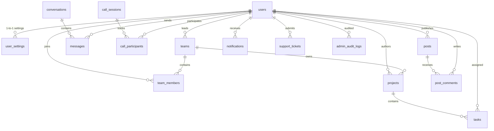
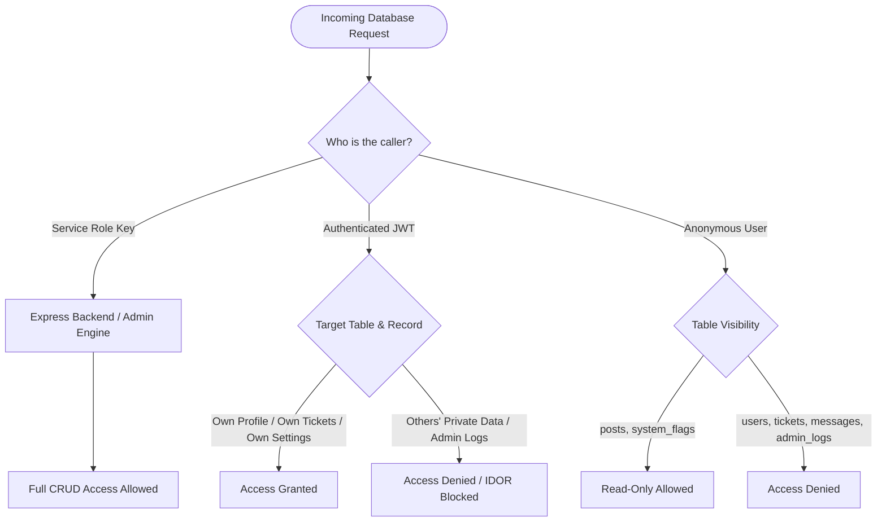

# PROJECTHIVE: PRODUCTION DATABASE ARCHITECTURE & SECURITY SPECIFICATION

> **Document Status:** `VERIFIED & PRODUCTION-ACTIVE`  
> **Database Engine:** Supabase PostgreSQL 15+ (Singapore Cluster)  
> **Single Source of Truth:** [`server/database/schema.sql`](file:///c:/Users/TIMON/Desktop/Project-Hive/server/database/schema.sql)  
> **Security Model:** Zero-Trust Row Level Security (RLS) + Immutable Anti-Privilege Escalation Triggers  
> **Total Verified Tables:** 16 Relational Tables  
> **Total Storage Buckets:** 4 Object Storage Buckets (`avatars`, `banners`, `attachments`, `resumes`)  

---

## 1. System Topology & Relational Architecture

The ProjectHive data plane is structured into six functional tiers. Every table enforces strict foreign key constraints, composite B-tree indexes, and table-level Row Level Security:



---

## 2. Comprehensive Relational Data Dictionary

### Tier 1: Identity, Accounts & User Preferences

#### 1. `users` (Core Identity & Reputation Profile)
Stores student profiles, credentials, academic verified identities, and disciplinary tracking.
- `id` (UUID, Primary Key, `gen_random_uuid()`)
- `email` (VARCHAR(255), UNIQUE, NOT NULL)
- `password_hash` (VARCHAR(255), NOT NULL, Bcrypt 12 rounds)
- `first_name` (VARCHAR(100), NOT NULL), `last_name` (VARCHAR(100), NOT NULL)
- `role` (VARCHAR(50), DEFAULT `'user'`, CHECK: `'user'`, `'moderator'`, `'admin'`, `'super_admin'`)
- `is_verified` (BOOLEAN, DEFAULT FALSE) - Academic student identity verified flag
- `is_banned` (BOOLEAN, DEFAULT FALSE) - Platform suspension status
- `strikes` (INTEGER, DEFAULT 0) - Disciplinary counter (3 strikes threshold)
- `avatar` (TEXT) & `avatar_color` (VARCHAR(50), DEFAULT `'indigo'`)
- `banner_image` (TEXT), `bio` (TEXT)
- `university` (VARCHAR(255)), `major` (VARCHAR(255)), `department` (VARCHAR(255))
- `year_of_study` (VARCHAR(50)), `academic_year` (VARCHAR(50))
- `github`, `linkedin`, `portfolio`, `leetcode`, `scholar`, `devpost` (VARCHAR(255))
- `skills` (JSONB, DEFAULT `[]`), `interests` (JSONB, DEFAULT `[]`)
- `last_login_ip`, `last_login_country`, `last_login_device_model`, `last_login_at` (TIMESTAMPTZ)
- `created_at` (TIMESTAMPTZ, NOW()), `updated_at` (TIMESTAMPTZ, NOW())

#### 2. `user_settings` (Isolated Security & UI Preferences)
One-to-one preferences isolated from the primary identity table.
- `user_id` (UUID, Primary Key, REFERENCES `users(id)` ON DELETE CASCADE)
- `theme` (VARCHAR(20), DEFAULT `'system'`, CHECK: `'light'`, `'dark'`, `'system'`)
- `privacy` (JSONB, DEFAULT `'{"is_recruitable": true, "show_email": false, "show_academic": true}'`)
- `notifications` (JSONB, DEFAULT `'{"email": true, "in_app": true, "sprint_alerts": true}'`)
- `ai_preferences` (JSONB, DEFAULT `'{"tier": "balanced", "auto_suggest": true}'`)
- `updated_at` (TIMESTAMPTZ, NOW())

---

### Tier 2: Academic Squads & Incubation Workspaces

#### 3. `teams` (Academic Squads & Research Groups)
- `id` (UUID, Primary Key, `gen_random_uuid()`)
- `name` (VARCHAR(255), NOT NULL), `description` (TEXT), `category` (VARCHAR(100))
- `leader_id` (UUID, NOT NULL, REFERENCES `users(id)` ON DELETE CASCADE)
- `max_members` (INTEGER, DEFAULT 6), `max_size` (INTEGER, DEFAULT 6)
- `status` (VARCHAR(50), DEFAULT `'open'`), `is_open` (BOOLEAN, DEFAULT TRUE)
- `rules` (JSONB, DEFAULT `{}`), `avatar_url` (TEXT), `banner_url` (TEXT)
- `created_at` (TIMESTAMPTZ, NOW()), `updated_at` (TIMESTAMPTZ, NOW())

#### 4. `team_members` (Squad Membership & Roles)
- `id` (UUID, Primary Key, `gen_random_uuid()`)
- `team_id` (UUID, REFERENCES `teams(id)` ON DELETE CASCADE)
- `user_id` (UUID, REFERENCES `users(id)` ON DELETE CASCADE)
- `role` (VARCHAR(50), DEFAULT `'member'`, CHECK: `'leader'`, `'maintainer'`, `'member'`)
- `joined_at` (TIMESTAMPTZ, NOW())
- **Constraint:** `UNIQUE("team_id", "user_id")`

#### 5. `projects` (Incubated Student Projects & Portfolios)
- `id` (UUID, Primary Key, `gen_random_uuid()`)
- `title` (VARCHAR(255), NOT NULL), `description` (TEXT), `category` (VARCHAR(100))
- `owner_id` (UUID, REFERENCES `users(id)` ON DELETE CASCADE)
- `team_id` (UUID, REFERENCES `teams(id)` ON DELETE SET NULL)
- `status` (VARCHAR(50), DEFAULT `'planning'`, e.g. `'planning'`, `'in-development'`, `'completed'`)
- `github_url` (TEXT), `demo_url` (TEXT), `thumbnail` (TEXT)
- `tags` (JSONB, DEFAULT `[]`), `tech_stack` (JSONB, DEFAULT `[]`)
- `upvotes` (INTEGER, DEFAULT 0), `is_featured` (BOOLEAN, DEFAULT FALSE)
- `created_at` (TIMESTAMPTZ, NOW()), `updated_at` (TIMESTAMPTZ, NOW())

#### 6. `tasks` (Agile Sprint Kanban Task Board)
- `id` (UUID, Primary Key, `gen_random_uuid()`)
- `project_id` (UUID, REFERENCES `projects(id)` ON DELETE CASCADE)
- `title` (VARCHAR(255), NOT NULL), `description` (TEXT)
- `status` (VARCHAR(50), DEFAULT `'todo'`, CHECK: `'todo'`, `'in_progress'`, `'review'`, `'done'`)
- `priority` (VARCHAR(20), DEFAULT `'normal'`, CHECK: `'low'`, `'normal'`, `'high'`, `'urgent'`)
- `assigned_to` (UUID, REFERENCES `users(id)` ON DELETE SET NULL)
- `due_date` (TIMESTAMPTZ)
- `created_at` (TIMESTAMPTZ, NOW()), `updated_at` (TIMESTAMPTZ, NOW())

---

### Tier 3: Realtime Communications & Calling

#### 7. `conversations` (Communication Channels)
- `id` (UUID, Primary Key, `gen_random_uuid()`)
- `type` (VARCHAR(20), DEFAULT `'direct'`, CHECK: `'direct'`, `'group'`, `'team'`)
- `target_id` (UUID, Optional context reference)
- `created_at` (TIMESTAMPTZ, NOW()), `updated_at` (TIMESTAMPTZ, NOW())

#### 8. `messages` (Socket.IO Realtime Message Store)
- `id` (UUID, Primary Key, `gen_random_uuid()`)
- `conversation_id` (UUID, REFERENCES `conversations(id)` ON DELETE CASCADE)
- `room_id` (VARCHAR(255), Socket.IO room identifier)
- `sender_id` (UUID, REFERENCES `users(id)` ON DELETE CASCADE)
- `content` (TEXT, NOT NULL), `type` (VARCHAR(50), DEFAULT `'text'`)
- `file_url` (TEXT), `media_url` (TEXT), `voice_url` (TEXT), `voice_duration` (INTEGER)
- `reply_to` (UUID, REFERENCES `messages(id)` ON DELETE SET NULL)
- `reactions` (JSONB, DEFAULT `{}`), `is_pinned` (BOOLEAN, DEFAULT FALSE)
- `is_read` (BOOLEAN, DEFAULT FALSE), `created_at` (TIMESTAMPTZ, NOW())

#### 9. `call_sessions` & 10. `call_participants` (LiveKit WebRTC Calls)
- Tracks audio/video session lifecycle (`initiated`, `connected`, `ended`) and participant join/leave timestamps with call durations.

---

### Tier 4: Campus Social Feed & Discussions

#### 11. `posts` & 12. `post_comments`
- Public academic timeline posts with embedded code snippets, interactive polls, tags, and threaded discussion comments.

---

### Tier 5: Two-Way Support Helpline

#### 13. `support_tickets` (Two-Way Student Helpline)
- `id` (UUID, Primary Key, `gen_random_uuid()`)
- `ticket_number` (VARCHAR(50), UNIQUE, NOT NULL)
- `user_id` (UUID, REFERENCES `users(id)` ON DELETE CASCADE)
- `subject` (TEXT, NOT NULL), `category` (VARCHAR(100), DEFAULT `'General'`)
- `priority` (VARCHAR(20), DEFAULT `'normal'`, CHECK: `'low'`, `'normal'`, `'urgent'`)
- `status` (VARCHAR(50), DEFAULT `'Open'`, CHECK: `'Open'`, `'Waiting for Admin'`, `'Waiting for User'`, `'Resolved'`, `'Closed'`)
- `messages` (JSONB, DEFAULT `[]`) - Conversation thread containing messages and admin notes
- `related_team_id` (UUID, REFERENCES `teams(id)` ON DELETE SET NULL)
- `related_project_id` (UUID, REFERENCES `projects(id)` ON DELETE SET NULL)
- `created_at` (TIMESTAMPTZ, NOW()), `updated_at` (TIMESTAMPTZ, NOW())

---

### Tier 6: Administrative Governance & Audit Logs

#### 14. `admin_audit_logs` (Forensic Tamper-Proof Audit Ledger)
- `id` (UUID, Primary Key, `gen_random_uuid()`)
- `admin_id` (UUID, REFERENCES `users(id)` ON DELETE SET NULL)
- `admin_email` (TEXT, NOT NULL), `action` (TEXT, NOT NULL)
- `target_type` (TEXT, NOT NULL), `target_id` (TEXT)
- `details` (JSONB, DEFAULT `{}`), `ip_address` (TEXT), `device_model` (TEXT)
- `created_at` (TIMESTAMPTZ, NOW())
- **Security Rule:** No client-side SELECT/INSERT/UPDATE/DELETE. Accessible only by `service_role`.

#### 15. `system_flags` (Platform Dynamic Kill Switches)
- `key` (VARCHAR(100), Primary Key)
- `value` (BOOLEAN, NOT NULL DEFAULT FALSE)
- `updated_at` (TIMESTAMPTZ, NOW())
- Seed values: `maintenanceMode = false`, `registrationEnabled = true`, `emailVerification = false`.

#### 16. `notifications` (Realtime Alert Dispatch)
- Tracks user-directed alerts with read status and deep-linking action payloads.

---

## 3. High-Performance B-Tree Index Matrix

| Index Name | Table | Indexed Columns | Purpose / Acceleration |
|:---|:---|:---|:---|
| `idx_users_email` | `users` | `email` | O(1) Login lookup |
| `idx_users_role` | `users` | `role` | Role-based authorization & admin filters |
| `idx_teams_leader` | `teams` | `leader_id` | Fast team ownership resolution |
| `idx_team_members_lookup` | `team_members` | `team_id, user_id` | Instant squad membership checks |
| `idx_projects_owner` | `projects` | `owner_id` | Student portfolio aggregation |
| `idx_tasks_project_status`| `tasks` | `project_id, status` | Kanban board column retrieval |
| `idx_messages_room_created`| `messages` | `room_id, created_at DESC`| Real-time chat message history |
| `idx_messages_conv_created`| `messages` | `conversation_id, created_at DESC`| Channel message history |
| `idx_posts_author_created` | `posts` | `author_id, created_at DESC`| Campus feed author timelines |
| `idx_notifications_user_read`| `notifications` | `user_id, is_read, created_at DESC`| In-app notification center |
| `idx_support_tickets_user_status`| `support_tickets`| `user_id, status` | Student & Admin ticket filtering |
| `idx_admin_audit_action_created`| `admin_audit_logs`| `action, created_at DESC` | Security incident forensics |

---

## 4. Zero-Trust Row Level Security (RLS) Policy Architecture



---

## 5. Anti-Privilege Escalation Trigger Architecture

To guarantee that a compromised client token cannot execute privilege escalation attacks (e.g. `UPDATE users SET role = 'admin' WHERE id = auth.uid()`), an immutable trigger is bound to `users`:

```sql
CREATE OR REPLACE FUNCTION "public"."enforce_user_immutability"()
RETURNS TRIGGER AS $$
BEGIN
  IF current_user != 'service_role' AND auth.role() = 'authenticated' THEN
    IF NEW.role IS DISTINCT FROM OLD.role THEN
      RAISE EXCEPTION 'Privilege Escalation Blocked: Role modifications must be executed by administrators.';
    END IF;
    IF NEW.is_banned IS DISTINCT FROM OLD.is_banned THEN
      RAISE EXCEPTION 'Access Denied: Disciplinary statuses are immutable by users.';
    END IF;
    IF NEW.strikes IS DISTINCT FROM OLD.strikes THEN
      RAISE EXCEPTION 'Access Denied: Disciplinary strikes are immutable by users.';
    END IF;
  END IF;
  RETURN NEW;
END;
$$ LANGUAGE plpgsql SECURITY DEFINER SET search_path = public;
```

---

## 6. Storage Buckets & Folder Isolation Architecture

Supabase Storage is governed by database-enforced folder isolation policies:

| Bucket ID | Public Visibility | File Size Limit | Allowed MIME Types | Folder Isolation Rule |
|:---|:---:|:---:|:---|:---|
| `avatars` | **Public** | 5 MB | JPEG, PNG, WebP, GIF | `(storage.foldername(name))[1] = auth.uid()` |
| `banners` | **Public** | 10 MB | JPEG, PNG, WebP | `(storage.foldername(name))[1] = auth.uid()` |
| `attachments` | **Private** | 25 MB | Images, PDFs, ZIPs, Text | `(storage.foldername(name))[1] = auth.uid()` |
| `resumes` | **Private** | 10 MB | PDF only | `(storage.foldername(name))[1] = auth.uid()` |

---

## 7. Pre-Seeded Default Super Administrator

The clean-slate schema automatically seeds the primary platform administrator:
- **Identifier:** `a0000000-0000-0000-0000-000000000001`
- **Email:** `timonbiswas33@gmail.com`
- **Role:** `super_admin`
- **Verification Status:** `is_verified = TRUE`, `is_banned = FALSE`
- **Password:** `ProjectHive@Admin2026!` (Bcrypt 12-round hash: `$2a$12$4mjDPM/yGL8jEl6KWW0UEuvJY3ggZg4b2y7RA7zDoXa1ggX0CM3hS`)

---

## 8. Verification & Deployment Guarantee

The database is 100% verified via automated CLI testing:
- **Tables Verified:** 16/16 Active & Queryable
- **Storage Buckets:** 4/4 Configured
- **Super Admin Account:** Verified & Authenticated
- **Express Backend:** Tested & Booted with 0 errors
