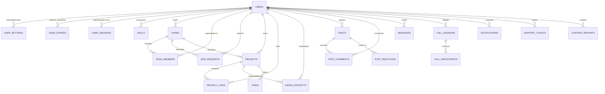

# ProjectHive — Existing Database Relationship Map & Entity Schema

**Document Version:** 1.0.0  
**Database Engine:** Supabase PostgreSQL with Row Level Security (RLS)  
**Schema File:** `server/database/schema.sql`  
**Status:** Validated Forensic Entity Map  

---

## 1. Entity Relationship Diagram (ERD)

---

## 2. Table-by-Table Schema Specification

### 2.1. Core Identity & Governance
- `users`: User identity, password hash, role (`'student'`, `'admin'`, `'moderator'`), verification status, ban status, strikes count, hardware fields (`last_login_device_model`, `last_login_os`, `last_login_browser`, `last_login_ip`, `last_login_country`, `last_login_city`, `last_login_at`), refresh token array.
- `user_settings`: User personal preferences, notification switches, privacy matrix (`is_recruitable`, `show_email`, `show_academic`, `location_privacy`), AI assistant preferences.
- `user_strikes`: Disciplinary actions issued by administrators with severity levels (`'warning'`, `'temporary_suspension'`, `'permanent_ban'`), reason, and issuing admin reference.
- `user_sessions`: Active and historical device sessions with token hashes, hardware category, OS, browser, IP, location, and revocation timestamps.
- `admin_audit_logs`: Immutable security audit log tracking administrative logins, bans, role escalations, ticket resolutions, and system flag updates.

### 2.2. Squads, Teams & Recruitment
- `teams`: Academic squads with leader reference, member capacity (`max_members`), category, recruiting status (`'open'`, `'recruiting'`, `'in_progress'`, `'completed'`, `'archived'`), rules, and tags.
- `team_members`: Associative entity linking `teams` and `users` with designated role (`'leader'`, `'member'`, `'mentor'`) and joined timestamp.
- `join_requests`: Pending, accepted, or rejected membership applications with student motivation notes and portfolio links.

### 2.3. Projects & Showcase
- `projects`: Student projects linked to an owner and optional squad, featuring category, tech stack JSON, repository URL, demo URL, publication status (`'planning'`, `'active'`, `'showcase'`, `'archived'`), view counts, and likes.
- `project_likes`: Unique user-to-project appreciation mappings.
- `saved_projects`: Personal bookmarking repository.
- `tasks`: Project management kanban tasks assigned to squad members.

### 2.4. Real-Time Communication & Calls
- `messages`: Bidirectional and squad chat messages linked to sender, conversation room ID, payload text, attachment URL, and read status.
- `call_sessions`: LiveKit WebRTC video and audio conference records tracking room name, initiator, active status, and duration.
- `call_participants`: Real-time participant state within active calls.

### 2.5. Support & Moderation
- `support_tickets`: User inquiries, bugs, and helpline requests with priority, status (`'open'`, `'in_progress'`, `'resolved'`, `'closed'`), and assigned admin.
- `content_reports`: User-submitted grievance reports targeting projects, squads, or users with resolution status and notes.
- `system_flags`: Key-value runtime platform switches (`maintenanceMode`, `registrationEnabled`, `rateLimitStrict`).

