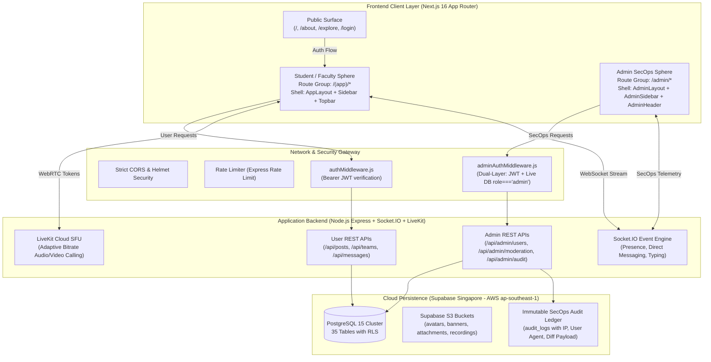

# PROJECTHIVE 🐝 — COMPLETE SYSTEM ARCHITECTURE & DUAL-SPHERE SEPARATION MATRIX

> **Document Version:** 2.0.0  
> **Classification:** Production Architecture Blueprint  
> **Scope:** Full-Stack Repository Deconstruction, User Application vs. Admin SecOps Portal Separation, Database, Real-Time & Security Infrastructure.

---

## 1. EXECUTIVE BLUEPRINT — THE DUAL-SPHERE ISOLATION MODEL

ProjectHive is architected around a strict **Dual-Sphere Isolation Model**. The ecosystem clearly divides end-user student/faculty collaboration workflows from privileged SecOps administration at **every layer of the stack**:



---

## 2. STRUCTURAL SEPARATION: USER APPLICATION VS. ADMIN PORTAL

The fundamental difference between the User Application and the Admin Portal is isolated across five dimensions:

| Dimension | User Application (`/(app)/*`) | Admin Portal (`/admin/*`) |
| :--- | :--- | :--- |
| **Target Audience** | University Students, Researchers, Faculty Members | Platform Engineers, SecOps Officers, Compliance Admins |
| **Primary Theme** | Dark Slate Canvas (`#07090e`), Amber Accents (`#f59e0b`), Warm Glassmorphism | Monospace SecOps HUD (`#0a0d14`), High-Contrast Status Badges, Telemetry Grids |
| **Layout Shell** | `AppLayout.tsx` (collapsible student navigation, search modal, notification popover) | `AdminLayout.tsx` (monitored SecOps frame, live heartbeat, latency counters) |
| **Sidebar** | `Sidebar.tsx` (Feed, Teams, Messages, People, Calls, Profile) | `AdminSidebar.tsx` (Overview, Users, Moderation, Audit Ledger, System Health) |
| **Header** | `Topbar.tsx` (Global command palette `Ctrl+K`, audio alerts, student profile drawer) | `AdminHeader.tsx` (Device fingerprints, live database ping, client IP telemetry) |
| **Backend Gate** | `authMiddleware.js` (validates active session JWT) | `adminAuthMiddleware.js` (validates active JWT **+** real-time Supabase role verification) |
| **Audit Requirement** | Standard user activity logs | **100% immutable audit logging** (every action is logged with IP, actor ID, and payload) |

---

## 3. FRONTEND ARCHITECTURE & DIRECTORY RESTRUCTURING

The frontend directory tree (`frontend/src/`) is cleanly partitioned into domain modules:

```
frontend/src/
├── app/
│   ├── (app)/                          # USER APPLICATION ROUTE GROUP
│   │   ├── layout.tsx                  # Student Shell Layout (Sidebar, Topbar, Modals)
│   │   ├── feed/page.tsx               # Campus Feed (PostCard, PostComposerTrigger)
│   │   ├── messages/page.tsx           # Real-Time Chat (MessageBubble, VoiceMessagePlayer)
│   │   ├── teams/                      # Team Workspaces
│   │   │   ├── page.tsx                # Teams Discovery & Directory
│   │   │   ├── [id]/page.tsx           # Team Dashboard & Workspace Tabs
│   │   │   └── new/page.tsx            # Team Creation Wizard
│   │   ├── people/page.tsx             # Student & Faculty Directory (StudentDirectoryCard)
│   │   ├── profile/page.tsx            # User Profile (ProfileTabs, ProfileEditForm)
│   │   ├── calling/                    # LiveKit Audio/Video Mesh
│   │   ├── developer/page.tsx          # API Sandbox, Webhooks, API Tokens
│   │   └── settings/page.tsx           # Security, Notifications, Sound Customization
│   │
│   ├── admin/                          # ADMIN SECOPS PORTAL ROUTE GROUP
│   │   ├── layout.tsx                  # SecOps Shell (AdminSidebar, AdminHeader, MobileDrawer)
│   │   ├── page.tsx                    # Mission Control & Platform Metrics
│   │   ├── users/page.tsx              # Identity Governance (UserStrikesModal, UserInspectionDrawer)
│   │   ├── moderation/page.tsx         # Content Moderation Queue (ReportResolutionModal)
│   │   ├── audit/page.tsx              # Immutable SecOps Audit Ledger (AuditLogDrawer)
│   │   ├── analytics/page.tsx          # Engagement & Retention Telemetry
│   │   ├── broadcast/page.tsx          # System-Wide Push Announcement Terminal
│   │   └── system/page.tsx             # Live Services Health, Memory & DB Metrics
│   │
│   ├── (auth)/                         # PUBLIC AUTHENTICATION FLOW
│   │   ├── login/page.tsx              # Single Sign-On & Email Credentials
│   │   ├── register/page.tsx           # Multi-Step Student Onboarding Wizard
│   │   ├── forgot-password/page.tsx    # Password Reset Recovery
│   │   └── verify-email/page.tsx       # 6-Digit Email Verification Flow
│   │
│   ├── page.tsx                        # Public Landing Page (Hero, 3D WebGL Canvas, Features)
│   ├── about/page.tsx                  # Public Mission & Architecture Showcase
│   └── explore/page.tsx                # Public Showcase of Verified Campus Projects
│
├── components/                         # MODULAR COMPONENT BOUNDARIES
│   ├── admin/                          # 🛡️ EXCLUSIVELY ADMIN COMPONENTS
│   │   ├── AdminSidebar.tsx            # Monospace SecOps Desktop Navigation
│   │   ├── AdminHeader.tsx             # Telemetry Bar (Latency probe, device fingerprint, IP)
│   │   ├── AdminMobileDrawer.tsx       # Slide-Over Touch Drawer for Mobile Admins
│   │   ├── DesktopGate.tsx             # SecOps Mobile Telemetry & Advisory Wrapper
│   │   ├── UserInspectionDrawer.tsx    # Deep User Security Inspector (Roles, Strikes, Auth)
│   │   ├── UserStrikesModal.tsx        # Disciplinary Strike Assignment Modal
│   │   ├── AuditLogDrawer.tsx          # JSON Payload & SecOps Diff Inspector
│   │   ├── ReportResolutionModal.tsx   # Content Moderation Decision & Action Modal
│   │   └── index.ts                    # Admin Component Barrel Export
│   │
│   ├── feed/                           # 📰 USER FEED COMPONENTS
│   │   ├── PostCard.tsx                # Rich Post Renderer (Reactions, Comments, Media)
│   │   ├── PostComposerTrigger.tsx     # Fast Interactive Post Creation Box
│   │   ├── PostCardSkeleton.tsx        # High-Fidelity Loading Skeleton
│   │   └── index.ts                    # Feed Component Barrel Export
│   │
│   ├── messages/                       # 💬 REAL-TIME MESSAGING COMPONENTS
│   │   ├── MessageBubble.tsx           # Chat Bubble with Markdown, Timestamps & Status
│   │   ├── VoiceMessagePlayer.tsx      # Waveform Audio Player for Voice Clips
│   │   ├── messageUtils.ts             # Date & Grouping Utility Algorithms
│   │   └── index.ts                    # Messaging Component Barrel Export
│   │
│   ├── profile/                        # 👤 USER PROFILE COMPONENTS
│   │   ├── ProfileTabs.tsx             # Tabbed Profile Navigation (Posts, Teams, Badges)
│   │   ├── ProfileEditForm.tsx         # Comprehensive Profile Editor with Form Validation
│   │   ├── ProfileHelpers.tsx          # Academic Major, Avatar & Bio Formatters
│   │   └── index.ts                    # Profile Component Barrel Export
│   │
│   ├── people/                         # 👥 STUDENT & FACULTY DIRECTORY
│   │   ├── StudentDirectoryCard.tsx    # Glassmorphism Student Profile & Skill Badge Card
│   │   └── index.ts                    # Directory Barrel Export
│   │
│   ├── teams/                          # 🏢 COLLABORATIVE TEAM WORKSPACES
│   │   ├── TeamChatTab.tsx             # Real-Time In-Team Threaded Discussion
│   │   └── index.ts                    # Team Component Barrel Export
│   │
│   ├── settings/                       # ⚙️ USER SETTINGS
│   │   ├── NotificationSoundSettings.tsx # Audio Chime Selector & Sound Volume Controls
│   │   └── index.ts                    # Settings Barrel Export
│   │
│   ├── 3d/                             # 🌐 INTERACTIVE WEBGL EXPERIENCES
│   │   └── Hive3DScene.tsx             # Three.js Dynamic Canvas (220 particles, dodecahedron wireframe)
│   │
│   ├── layout/                         # 🧭 APPLICATION SHELL COMPONENTS
│   │   ├── Sidebar.tsx                 # Student Navigation Sidebar
│   │   ├── Topbar.tsx                  # Student Header with Notification Counter
│   │   ├── CommandPaletteModal.tsx     # Keyboard Command Hub (`Ctrl+K`)
│   │   └── NotificationsPopover.tsx    # Dropdown Notification Feed
│   │
│   └── ui/                             # 🎨 ATOMIC DESIGN TOKENS & SYSTEM PRIMITIVES
│       ├── button.tsx, badge.tsx, card.tsx, input.tsx, dialog.tsx, tabs.tsx
│       └── ... (Tailwind-styled Radix primitives)
```

---

## 4. BACKEND API ARCHITECTURE & SECURITY GATES

The backend is built as a hardened Node.js Express service (`server/`):

```
server/
├── server.js                           # Server Entry Point & WebSocket Bootstrapper
├── config/
│   ├── supabase.js                     # Supabase Admin Client (Service Role Key)
│   ├── livekit.js                      # LiveKit WebRTC SFU Client & Token Generator
│   ├── redis.js                        # Cache & Real-Time Adapter Configuration
│   └── email.js                        # Brevo SMTP Transactional Mailer
│
├── middleware/
│   ├── auth.js                         # User Authentication (JWT validation via Supabase)
│   ├── adminAuth.js                    # SecOps Dual-Layer Authentication
│   ├── rateLimiter.js                  # IP-Based Distributed Request Throttling
│   ├── errorHandler.js                 # Unified RFC 7807 Error Response Handler
│   └── auditLogger.js                  # Automated SecOps Event Journaling
│
├── controllers/
│   ├── adminController.js              # Platform Analytics, Broadcasts, Telemetry
│   ├── adminUsersController.js         # User Bans, Strike System, Role Grants
│   ├── adminModerationController.js    # Content Flagging, Takedowns, Quarantine
│   ├── postController.js               # Campus Feed Posts, Likes, Comments
│   ├── teamController.js               # Team Creation, Member Invites, Roles
│   ├── messageController.js            # Direct & Channel Message Dispatching
│   ├── userController.js               # User Profiles, Connections, Badges
│   └── callingController.js            # LiveKit Room Token Generation
│
└── routes/
    ├── admin.routes.js                 # 🛡️ EXCLUSIVELY ADMIN ENDPOINTS (/api/admin/*)
    ├── post.routes.js                  # User Feed Endpoints (/api/posts/*)
    ├── team.routes.js                  # Team Endpoints (/api/teams/*)
    ├── message.routes.js               # Messaging Endpoints (/api/messages/*)
    ├── user.routes.js                  # User Endpoints (/api/users/*)
    ├── calling.routes.js               # LiveKit Calling Endpoints (/api/calling/*)
    ├── ai.routes.js                    # AI Copilot Endpoints (/api/ai/*)
    └── health.routes.js                # Probes (/api/health/ready, /api/health/db)
```

### The Dual-Layer Admin Auth Middleware (`server/middleware/adminAuth.js`)

Unlike standard user endpoints where token validation suffices, admin routes run through a **two-phase verification barrier**:

```javascript
// Step 1: Validate cryptographic signature of incoming Bearer token
const { data: { user }, error } = await supabase.auth.getUser(token);
if (error || !user) return res.status(401).json({ error: 'Unauthorized' });

// Step 2: Query database table directly using elevated Service Role to prevent token spoofing
const { data: profile } = await supabaseAdmin
  .from('profiles')
  .select('role, is_banned')
  .eq('id', user.id)
  .single();

if (!profile || profile.role !== 'admin' || profile.is_banned) {
  // SecOps violation alert logged immediately into audit ledger
  return res.status(403).json({ error: 'Forbidden: Admin access required' });
}
```

---

## 5. DATABASE & ROW LEVEL SECURITY (RLS) MATRIX

The Supabase PostgreSQL cluster (hosted in AWS Singapore `ap-southeast-1`) contains 35 relational tables guarded by Row-Level Security:

```
Database Schema Overview:
├── auth.users (Managed by Supabase Auth)
├── public.profiles (Linked 1:1 with auth.users, holds role: 'student' | 'faculty' | 'admin')
├── public.posts (Public feed items with author foreign key)
├── public.post_reactions (Unique user reaction constraint)
├── public.comments (Threaded comments with parent_id hierarchy)
├── public.teams (Team workspaces with privacy settings)
├── public.team_members (Roles: 'lead' | 'member' | 'viewer')
├── public.messages (Direct and channel messages with encrypted attachments)
├── public.content_reports (Content moderation flags with target polymorphic ID)
├── public.user_strikes (Disciplinary strike records issued by admins)
└── public.admin_audit_logs (Immutable audit ledger with IP, action, and JSON diff)
```

### RLS Policy Rules Summary:
1. **Regular Users:** Can only `INSERT`/`UPDATE` rows matching their own `auth.uid()`. Can `SELECT` public posts, active teams, and peer profiles.
2. **Admin Role Bypass:** Admin controllers use the **Supabase Service Role Key** (`supabaseAdmin`) strictly within verified `adminAuthMiddleware` contexts to execute administrative overrides (suspending accounts, resolving moderation flags, inspecting audit ledgers).
3. **Audit Ledger Immutability:** `admin_audit_logs` has no `UPDATE` or `DELETE` API routes or RLS policies. It is an append-only cryptographic event trail.

---

## 6. COMPLETE REPOSITORY DIRECTORY TREE

```
Project-Hive/
├── .env.example                        # Root Environment Variable Contract
├── package.json                        # Monorepo Scripts & Root Tooling
├── PROJECTHIVE_COMPLETE_ARCHITECTURE.md# Complete Architecture Blueprint (This Document)
├── PROJECTHIVE_FILE_RESTRUCTURING_REPORT.md # File Refactoring & Decomposition Audit
│
├── frontend/                           # CLIENT APPLICATION (Next.js 16.4.5)
│   ├── .env.local                      # Client Environment (API URL, Supabase Public Keys)
│   ├── next.config.ts                  # Next.js Engine Config (Headers, Webpack, Bundler)
│   ├── tailwind.config.ts              # Design Tokens, Color Palettes, Animations
│   ├── tsconfig.json                   # Strict TypeScript Rules & Path Aliases (@/*)
│   ├── public/                         # Static Assets, Favicons, Brand Logos, Audio Files
│   └── src/
│       ├── app/                        # Next.js App Router (Public, (app), admin, (auth))
│       ├── components/                 # Isolated Component Domains (admin, feed, messages, etc.)
│       ├── hooks/                      # Custom React Hooks (useAuth, useSocket, useTheme)
│       ├── lib/                        # Singletons (api.ts, supabase.ts, sound.ts, utils.ts)
│       └── types/                      # TypeScript Contracts (user, team, post, admin, api)
│
├── server/                             # SERVER APPLICATION (Node.js + Express)
│   ├── .env                            # Backend Secrets (Service Role, LiveKit, Brevo SMTP)
│   ├── package.json                    # Backend Dependencies
│   ├── server.js                       # HTTP & Socket.IO Listener Initialization
│   ├── config/                         # Infrastructure Configs (Supabase, LiveKit, Redis, Mailer)
│   ├── controllers/                    # Business Logic Handlers (Split by Domain)
│   ├── middleware/                     # Express Pipelines (Auth, AdminAuth, RateLimit, Audit)
│   ├── routes/                         # Express Route Definitions (Admin vs User APIs)
│   ├── services/                       # Third-Party Integrations (AI, LiveKit, Storage)
│   └── tests/                          # Automated Integration & Unit Tests
│
└── docs/                               # REPOSITORY DOCUMENTATION
    ├── admin/
    │   └── ADMIN_DEPLOYMENT_GUIDE.md   # SecOps Operations & Deployment Handbook
    ├── api/
    │   └── API_SPECIFICATION.md        # Complete OpenAPI / Swagger REST Reference
    └── architecture/
        └── SYSTEM_DESIGN.md            # Legacy Design References & Schemas
```

---

## 7. VERIFICATION MATRIX & HEALTH INDICATORS

The ProjectHive architecture provides automated self-diagnostics:

- **Frontend Compilation:** Verified via `next build` across all 39 App Router endpoints.
- **Backend Service Probe:** `GET /api/health/ready` returns `{ status: "ready", uptime: ... }`.
- **Database Probe:** `GET /api/health/db` checks live PostgreSQL connectivity and verifies the 4 Supabase storage buckets (`avatars`, `banners`, `attachments`, `recordings`).
- **LiveKit Mesh:** Verified through token issue handshake on `/api/calling/token`.
- **Socket.IO Real-Time:** Monitored via connection ping events on WebSocket upgrade.

