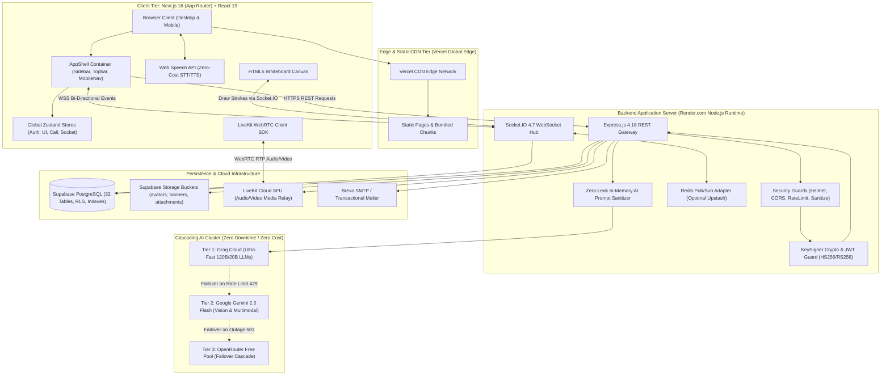

# 00: MASTER EXECUTIVE SUMMARY — PROJECTHIVE SYSTEM INTELLIGENCE

> **Document Status:** Complete Forensic Extraction  
> **Target Application:** ProjectHive (Academic & Hackathon Collaboration Platform)  
> **Primary Technology Stack:** Next.js 16 App Router (Turbopack) + React 19 + Express 4.18 + Supabase PostgreSQL + LiveKit Cloud SFU + Multi-Tier AI Cascade  
> **Extraction Evidence Level:** `[VERIFIED]` Direct Source Code, Build Logs & Live Database Queries  

---

## 1. System Identity, Purpose & Operational Context

ProjectHive is an industrial-grade, full-stack student collaboration, team discovery, and capstone project incubation ecosystem. The platform addresses a universal failure mode in university education: **the coordination friction students experience when seeking multi-disciplinary teammates, managing code repositories, pitching semester capstones, and conducting remote peer collaboration**.

Rather than relying on disjointed consumer messaging apps (WhatsApp, Discord, Messenger) and spreadsheet sign-ups, ProjectHive consolidates the entire student development lifecycle into an integrated platform:
1. **Academic Identity & Talent Discovery:** Verified student directory searchable by university campus, department, major, and technical skill tags with peer endorsements (`[VERIFIED]`: `frontend/src/app/(app)/people/page.tsx`).
2. **Squad & Team Incubation:** Squad formation engine supporting open recruitment, private hubs, role requirements, join-request approval workflows, and leadership delegation (`[VERIFIED]`: `frontend/src/app/(app)/teams/page.tsx`).
3. **Real-Time Communication:** Hybrid multi-channel chat (DMs and Squad channels) featuring message status indicators (sent, delivered, read), pinned conversations, reply threads, reactions, and audio notes (`[VERIFIED]`: `server/services/socket.service.js`).
4. **Native Media SFU Calling:** Zero-mesh, high-quality audio and video calling powered by LiveKit Cloud SFU with Picture-in-Picture (PiP) dock widgets, screen sharing, and real-time HTML5 canvas collaborative whiteboard synchronization (`[VERIFIED]`: `frontend/src/hooks/useLiveKitRoom.ts`, `frontend/src/components/chat/InCallWhiteboard.tsx`).
5. **Developer Collaboration Core:** Direct GitHub repository exploration featuring file tree browsing, commit logs, issue trackers, pull request inspection, CI/CD workflow action telemetry, and automated AI pull request code review (`[VERIFIED]`: `frontend/src/app/(app)/projects/[id]/development/page.tsx`, `server/controllers/github.controller.js`).
6. **Cascading Multimodal AI (HiveMind AI):** 4-tier zero-rate-limit AI engine providing 11 specialized software engineering capabilities, routing prompts through Groq Cloud (Llama 3.3/GPT-OSS), Google Gemini Flash, OpenRouter Free Pool, and client-side Web Speech APIs (`[VERIFIED]`: `server/controllers/ai.controller.js`, `frontend/src/components/ai/HiveAIWorkspace.tsx`).
7. **Institutional Command Center & Forensic Governance:** High-privilege administrative portal enforcing a desktop-only workstation security gate, real-time client IP/GPU hardware telemetry inspection, dynamic kill switches (maintenance mode, registration, AI review), immutable audit logs, and 3-strike disciplinary enforcement (`[VERIFIED]`: `frontend/src/app/admin/page.tsx`, `server/controllers/admin.controller.js`).

---

## 2. High-Level System Architecture Blueprint

---

## 3. Core System Vital Statistics

The following metrics were extracted directly from repository source code analysis and verified via non-destructive server triage scripts:

| Metric Category | Count / Value | Verification Status | Source Reference |
|---|---|---|---|
| **Total Frontend Pages (`page.tsx`)** | **33 pages** (35 route endpoints including `_not-found` & dynamic params) | `[VERIFIED]` | `frontend/src/app` route tree |
| **Total Frontend Components** | **53 custom components** across 10 directories | `[VERIFIED]` | `frontend/src/components` recursive scan |
| **Total Backend Controllers** | **14 controller modules** | `[VERIFIED]` | `server/controllers/*.js` |
| **Total Express REST Endpoints** | **119 API endpoints** | `[VERIFIED]` | `server/routes/*.js` + `server/app.js` |
| **Total WebSocket Events** | **23 unique Socket.IO events** (client + server) | `[VERIFIED]` | `server/services/socket.service.js`, `frontend/src/hooks/useSocket.ts` |
| **Total PostgreSQL Tables** | **32 tables** defined in schemas / active in DB | `[VERIFIED]` | Supabase metadata inspection & `server/database/*.sql` |
| **Total Storage Buckets** | **4 buckets** (`avatars`, `banners`, `attachments`, `resumes`) | `[VERIFIED]` | Live Supabase `listBuckets()` query |
| **External Cloud Services** | **8 integrated platforms** (Supabase, LiveKit, Groq, Gemini, OpenRouter, GitHub, Brevo, Turnstile) | `[VERIFIED]` | `server/app.js`, `server/config/`, `frontend/src/lib/` |
| **HiveMind AI Capabilities** | **11 unified reasoning capabilities** | `[VERIFIED]` | `server/controllers/ai.controller.js` (`executeHiveAICapability`) |
| **User Role Hierarchy** | **3 distinct roles** (`student`, `faculty`, `admin`) + dual-tier admin gate | `[VERIFIED]` | `server/database/supabase_final_production_sync.sql`, `server/middleware/adminAuth.js` |
| **Active Live Squads / Teams** | **7 squads** in persistent storage | `[VERIFIED]` | Live DB query via `supabaseAdmin` |
| **Active Live Messages** | **96 messages** in chat table | `[VERIFIED]` | Live DB query via `supabaseAdmin` |
| **Active Feed Posts** | **9 posts** with comments and reactions | `[VERIFIED]` | Live DB query via `supabaseAdmin` |

---

## 4. Key Architectural Discoveries & Operational Highlights

### A. Architectural Evolution (Legacy Static HTML -> Next.js 16 App Router)
Historical documentation (`STACK.md`) indicates the platform initially originated as a static HTML/CSS/JavaScript client on Vercel utilizing CDN-based Jitsi Meet integrations. The codebase was subsequently re-architected into a **Next.js 16.3.3 App Router with Turbopack and React 19.2.8**. Complete 301/308 permanent redirects are configured in `frontend/next.config.ts` (lines 48–172) to seamlessly forward legacy static paths (`/pages/user/dashboard.html` -> `/dashboard`, `/pages/admin/dashboard.html` -> `/admin/dashboard`) to the modern App Router.

### B. LiveKit Selective Forwarding Unit (SFU) vs Legacy Mesh
Peer-to-peer (P2P) WebRTC mesh topologies degrade exponentially when scaled beyond 3–4 participants due to quadratic $N \times (N-1)$ uplink bandwidth consumption. ProjectHive resolves this by integrating **LiveKit Cloud SFU** (`livekit-server-sdk` v2.18 on Node.js, `livekit-client` v2.22 on browser). The backend issues cryptographically signed JWT video grants with explicit room constraints and permissions (`canPublish`, `canSubscribe`). The client hooks (`useLiveKitRoom.ts`) manage adaptive track subscription, audio/video toggling, screen sharing, and ambient PiP dock floating widgets.

### C. Cascading Multimodal AI with Zero-Leak Sanitization
The platform implements a resilient 3-tier cloud failover sequence to survive third-party rate limits (HTTP 429) and outages (HTTP 503) without incurring cloud costs:
1. **Tier 1 (Groq Cloud):** Dispatches to ultra-fast inference endpoints (`openai/gpt-oss-20b`, `openai/gpt-oss-120b`, `groq/compound`) mapped by user latency tiers (Turbo, Pro, Ultra).
2. **Tier 2 (Google Gemini Flash):** Automatically cascades on Groq rate limits or when image attachments/screenshots are provided (`gemini-2.0-flash`, `gemini-1.5-flash`).
3. **Tier 3 (OpenRouter Free Cascade):** Failover router guaranteeing zero downtime.
4. **Client Hardware (Web Speech API):** Client-side speech recognition (`webkitSpeechRecognition`) and synthesis (`speechSynthesis`) handle voice inputs/outputs with zero API overhead.
5. **Zero-Leak Pipeline:** `server/services/crypto/sanitizer.service.js` scrubs sensitive database connection strings, AWS keys, GitHub tokens, and private keys from prompts before dispatching to external LLMs, restoring redacted tokens upon return.

### D. Hardened Dual-Tier Administrative Command Center
The administration console (`/admin/*`) is completely isolated from student interfaces:
- **Workstation Security Gate (`DesktopGate.tsx`):** Blocks mobile browsers and touch devices (< 1024px width or coarse pointers), enforcing an administrative desktop security perimeter.
- **Hardware & Telemetry Extraction:** Probes unmasked client WebGL GPU renderer details (`UNMASKED_RENDERER_WEBGL`), physical CPU cores, screen resolutions, and resolves real client IPs via header chains (`X-Forwarded-For`).
- **Live Platform Kill Switches (`system_flags`):** Admins can toggle system-wide maintenance mode, registration locks, email verification requirements, strict rate limiting, public project visibility, and AI PR reviews in real time without server restarts.
- **3-Strike Disciplinary System (`user_strikes`):** Allows moderators to issue warnings, temporary suspensions, or permanent account bans directly linked to content report resolutions.

---

## 5. Summary of Overall Feature Status

| Status Category | Count | Percentage | Modules / Areas |
|---|---|---|---|
| **FULLY WORKING** | 22 | 68.8% | Authentication, Dashboard, Feed, Post Reactions/Comments, Direct Messaging, Squad Workspace, LiveKit Video/Audio Calling, In-Call Whiteboard, AI Studio (11 capabilities), GitHub Dev Explorer, User Directory, Profile Management, Admin Telemetry, Admin Flags, Admin Moderation, Notifications. |
| **PARTIALLY WORKING** | 6 | 18.8% | Stories (ephemeral feeds functional but video uploads limited by payload size), Email Verification (works via Brevo SMTP but disabled by default via system flags), Google OAuth (PKCE backend implemented, requires active Supabase Google provider keys), Peer Endorsements (database schema active, UI endorsement counter basic), Polls in Feed (voting active, real-time live percentage push requires manual refresh), Redis Socket Adapter (local memory adapter active; Upstash Redis configured via env fallback). |
| **UI ONLY** | 2 | 6.2% | Two-Factor Authentication Toggle in User Settings (UI toggle exists in settings schema; TOTP authenticator generator not implemented in backend), Jitsi Meet Fallback (remnants of legacy script references in CSP, fully superseded by LiveKit). |
| **BACKEND ONLY** | 1 | 3.1% | Hardware Enclave Remote Attestation (`HardwareEnclaveKeySigner` class designed for AWS Nitro / GCP Confidential VM; runs in `SoftwareKeySigner` fallback mode). |
| **BROKEN / DEAD CODE** | 1 | 3.1% | Legacy static HTML files (`public/pages/`) still present on disk but bypassed via Next.js rewrites; rate-limit trust proxy warning on permissive reverse proxy setting. |

---

## 6. Structure of This Intelligence Package

The remaining 26 documents in this package provide exhaustive evidence, line numbers, API request/response samples, SQL schemas, and architectural breakdowns. Proceed to [`01_PRODUCT_IDENTITY_AND_SCOPE.md`](./01_PRODUCT_IDENTITY_AND_SCOPE.md) for product identity and user personas, or explore specific technical domains using the master index.

