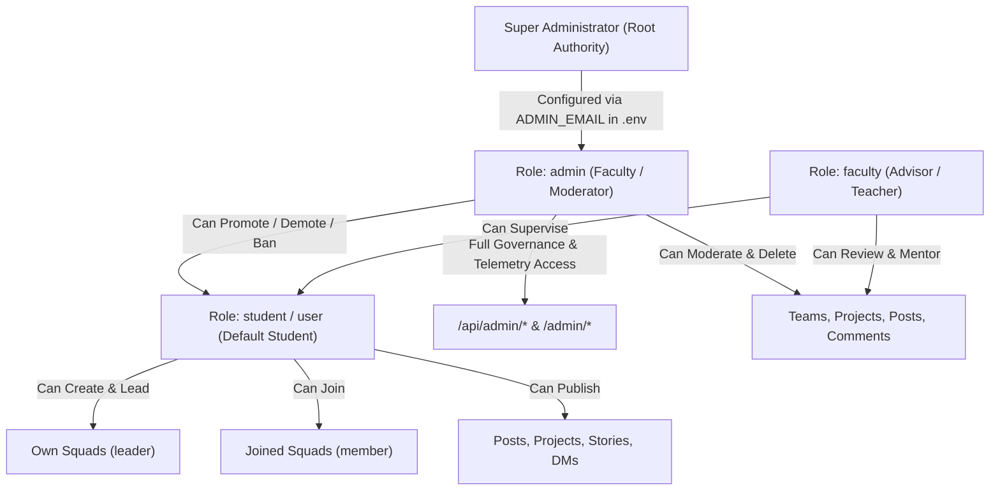

# 01: PRODUCT IDENTITY, SCOPE & USER ROLES

> **Document Classification:** Product Intelligence & Boundary Specification  
> **Target System:** ProjectHive (Academic Team Formation & Project Showcase Platform)  
> **Evidence Level:** `[VERIFIED]` Source Code Analysis & Domain Modeling  

---

## 1. Executive Product Identity

### 1.1 What is ProjectHive?
`[VERIFIED]` ProjectHive is an institutional, full-stack student collaboration, peer discovery, and project incubation platform. It is engineered specifically for university ecosystems, polytechnics, and hackathons, bridging the gap between student software engineers, designers, researchers, and project advisors.

### 1.2 Core Mission & Vision
The core mission of ProjectHive is to **eliminate the friction of student software development**. In conventional academic settings, forming a capstone team, finding a frontend developer or data scientist from another department, pitching an innovative product, tracking repository progress, and conducting remote peer reviews is fragmented across spreadsheets, Discord servers, and informal WhatsApp groups. ProjectHive centralizes this entire pipeline into a single, cohesive academic workspace.

---

## 2. Problems ProjectHive Solves

| Problem in Universities | Legacy Approach | ProjectHive Engineered Solution | Evidence / Source |
|---|---|---|---|
| **Inter-Departmental Silos** | Computer Science students rarely meet Design, Business, or EEE students. Team formation is limited to direct friend circles. | **Campus-Wide Talent Directory:** Searchable filter index categorized by major, campus, technical skills, and availability (`hours_per_week`). | `frontend/src/app/(app)/people/page.tsx` `server/controllers/users.controller.js:listUsers` |
| **Inefficient Squad Recruitment** | Unstructured messaging in WhatsApp groups; no clear role requirements, team limits, or approval mechanics. | **Structured Squad Workspaces:** Team creation with category tagging, target skill sets, max member caps, and join request approval/rejection queues. | `frontend/src/app/(app)/teams/[id]/page.tsx` `server/controllers/teams.controller.js` |
| **Capstone Project Invisibility** | Final-year projects and hackathon submissions sit in private GitHub repos or dusty university portals, never viewed by peers or recruiters. | **ProductHunt-Grade Showcase:** Interactive project showcase with rich media, tags, demo URLs, GitHub links, and peer upvoting (`is_upvoted`). | `frontend/src/app/(app)/projects/page.tsx` `server/controllers/projects.controller.js` |
| **Fragmented Collaboration Tools** | Switching between Google Meet (calling), Slack (messaging), GitHub (code), and Miro (whiteboarding). | **All-in-One Collaborative Shell:** LiveKit WebRTC video/audio calling with synchronized HTML5 canvas whiteboard, screen sharing, and code inspection in one window. | `frontend/src/components/calling/CallManager.tsx` `frontend/src/components/chat/InCallWhiteboard.tsx` |
| **Academic Disillusionment & Burnout** | Students struggle with complex architecture design, database schemas, and debugging during hackathons and capstones. | **HiveMind AI Copilot:** 11 specialized AI modes (Architecture Designer, Project Generator, Code Assistant, PR Reviewer) with zero cloud rate limits. | `server/controllers/ai.controller.js` `frontend/src/components/ai/HiveAIWorkspace.tsx` |
| **Lack of Academic Governance & Safety** | Toxic interactions or spam in informal groups cannot be moderated by faculty. | **Institutional Command Center:** 3-strike disciplinary enforcement, content report queues, and real-time client hardware forensic logging. | `frontend/src/app/admin/page.tsx` `server/controllers/admin.controller.js` |

---

## 3. Target User Personas & Ecosystem Scope

### Persona A: The Capstone Leader / Hackathon Hustler
- **Profile:** Final-year student or active hackathon participant seeking complementary teammates (e.g., an ML engineer seeking a UI/UX designer).
- **Core Workflow:** Creates a Team (`/teams/create`), sets required skills (`React`, `Python`, `Figma`), reviews applicant profiles, accepts members into the squad workspace, launches LiveKit strategy calls, and integrates GitHub repositories for real-time tracking.

### Persona B: The Specialized Contributor / Junior Student
- **Profile:** 1st to 3rd-year student wanting practical team experience or looking to join an established capstone project.
- **Core Workflow:** Completes profile (`/profile`) with university details, major, and technical skills; browses open squads (`/teams`) filtering by "Recruiting"; submits a join request with a motivation pitch; participates in group chats and whiteboard discussions.

### Persona C: The Solo Maker / Open-Source Developer
- **Profile:** Student who built an exceptional project or portfolio library and wants institutional recognition.
- **Core Workflow:** Publishes an entry to the Showcase (`/projects`), adds interactive demo URLs and GitHub repo links, collects peer upvotes and feedback, and posts development milestones to the campus social feed (`/feed`).

### Persona D: Academic Moderator / Department Administrator
- **Profile:** Faculty advisor, department head, or campus hackathon organizer responsible for safety, integrity, and platform uptime.
- **Core Workflow:** Logs into the Administrative Command Center (`/admin/login`) on a secured desktop workstation; monitors live server telemetry, database latency, and active WebSocket connections; resolves content violation reports; manages disciplinary strikes; toggles system-wide feature flags.

---

## 4. Geographic & Institutional Targeting

`[VERIFIED]` The codebase exhibits explicit architectural specialization for **Bangladeshi University Ecosystems**, with cross-campus interoperability:
- **Preset University Dictionary (`frontend/src/lib/universities.ts`):** Includes explicit definitions for major institutions:
  - *Public Engineering & General Universities:* BUET (Bangladesh University of Engineering and Technology), DU (University of Dhaka), JU (Jahangirnagar University), CUET, KUET, RUET, IUT.
  - *Private Academic Campuses:* SMUCT (Shanto-Mariam University of Creative Technology), NSU (North South University), BRAC University, AIUB, AUST, UIU, Daffodil International University, East West University, ULAB.
- **Campus-Wide Metrics:** The public stats engine (`/api/stats`) explicitly groups students by distinct university affiliations to foster inter-university hackathon squads (`server/app.js:280`).

---

## 5. Complete User Role Hierarchy

`[VERIFIED]` The system implements a hierarchical 3-role permission model defined in database constraints (`users_role_check`) and middleware guards:

### Role Specifications

#### 1. `student` (Default User Role)
- **Registration Default:** Every new account registered via `/api/auth/register` is assigned `role = 'student'` (`server/database/supabase_final_production_sync.sql:22`).
- **Capabilities:**
  - Create and edit personal profile, upload avatar and banner images.
  - Create up to arbitrary teams; automatically granted `leader` status on owned teams.
  - Apply to join open teams; send and receive friend requests.
  - Publish feed posts (updates, achievements, code snippets, polls).
  - Submit showcase projects; upvote, like, and bookmark projects.
  - Send direct messages and group messages; react to messages with emojis.
  - Initiate and participate in LiveKit WebRTC audio/video calls with whiteboard collaboration.
  - Execute HiveMind AI capabilities (up to 60 operations/hour).
  - Connect personal GitHub account; inspect repository tree and commit history.
- **Restrictions:**
  - Cannot access `/admin/*` routes (enforced by `AdminLayout.tsx` redirect and `adminAuth.js`).
  - Cannot ban users, resolve moderation reports, or toggle platform system flags.
  - Cannot kick members or transfer leadership in teams where they are not the leader.

#### 2. `faculty` (Institutional Advisor)
- **Target Persona:** Professors, department heads, and capstone mentors.
- **Capabilities:** Possesses all `student` capabilities plus priority visibility in academic discovery directories.
- **Restrictions:** Governed by student-level data access rules unless explicitly granted administrative delegation.

#### 3. `admin` (System Administrator / Campus Moderator)
- **Assignment Mechanism:**
  - Evaluated on login: if user's email matches `process.env.ADMIN_EMAIL`, the account is automatically promoted to `role = 'admin'` (`server/controllers/admin.auth.controller.js:63`).
  - Can also be assigned by an existing admin via `PATCH /api/admin/users/:id/role`.
  - Non-production helper `POST /api/admin/promote-me` enables local developer privilege elevation.
- **Capabilities:**
  - Complete access to `/admin` dashboard, telemetry, moderation queues, squads, and audit ledgers.
  - Disciplinary enforcement: ban/unban users, issue warnings and strikes.
  - Content moderation: resolve or dismiss abuse reports, delete abusive posts/comments/projects/teams.
  - Platform operations: toggle maintenance mode, registration locks, strict rate limits, and AI review flags.
  - Forensic inspection: view unmasked client hardware telemetry (IP, GPU renderer, OS, CPU cores).
- **Restrictions:**
  - Admin dashboard access is restricted to desktop workstations (>= 1024px width, non-touch devices).

---

## 6. Boundary Conditions & Non-Goals

To prevent scope creep and maintain architectural discipline, the platform explicitly enforces the following boundary conditions:

1. **Not a General Social Network:** ProjectHive is strictly oriented around academic collaboration, software engineering, design, and capstone delivery. Features like feed posts and stories are engineered around project milestones, code snippets, and team formation, not generic social media consumption.
2. **Not a Code Repository Host:** ProjectHive does not host Git repositories directly. Instead, it integrates seamlessly with GitHub via API v3 / Octokit pipelines (`server/services/github.service.js`), acting as an intelligence overlay for existing repositories.
3. **No Commercial Course Marketplace:** ProjectHive does not sell courses, process tuition, or issue commercial certifications. Peer skill endorsements (`skill_endorsements`) serve as social proof of technical ability within student cohorts.
4. **No Unbounded Cloud Ingestion Costs:** All real-time media uses LiveKit Cloud SFU with strict track lifecycle teardown (`useLiveKitRoom.ts:stopAllLocalTracks`), and all AI features route through a 4-tier cascade designed to run 100% within free-tier quotas.

