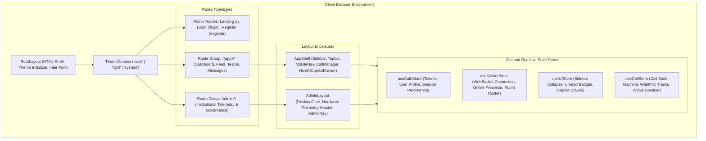

# 04: FRONTEND ARCHITECTURE & CLIENT-SIDE DESIGN

> **Document Classification:** Client-Tier Engineering Blueprint  
> **Framework Base:** Next.js 16.3.3 (Turbopack Engine) + React 19.2.8 + Tailwind CSS v4  
> **Extraction Evidence Level:** `[VERIFIED]` Complete Source Code Analysis  

---

## 1. Architectural Overview & Rendering Model

ProjectHive’s client tier utilizes the **Next.js 16 App Router** powered by the **Turbopack** build engine. The architecture combines server-rendered static shells with rich client-side hydration for real-time collaboration:



---

## 2. Layout Hierarchy & Structural Composition

### 2.1 Root Layout (`frontend/src/app/layout.tsx`)
- **Metadata & Viewport:** Configures mobile-responsive viewport definitions (`width=device-width, initialScale=1, userScalable=false, viewportFit=cover`). Sets theme colors for light (`#ffffff`) and dark (`#0b0d14`) modes.
- **Hydration Safe Theme Injection:** Embeds an inline `<script>` (`themeInitScript`) in the document `<head>` prior to React hydration. This script synchronously inspects `localStorage.getItem('ph-theme')` and matches system media queries (`prefers-color-scheme: dark`), applying the `.dark` class to `<html>` to eliminate white flash on reload.
- **Font Typography:** Utilizes Google's `Inter` font via `next/font/google` (`--font-inter`) with `display: swap`.

### 2.2 Authenticated Shell (`frontend/src/app/(app)/layout.tsx` & `AppShell.tsx`)
- **Auth Guard Enforcement:** `AuthenticatedLayout` verifies `isAuthenticated` and `isLoading` from `useAuthStore`. Unauthenticated users are redirected to `/login` via `router.replace('/login')`.
- **Composition of `AppShell.tsx`:**
  1. `Sidebar`: Desktop collapsible and resizable navigation drawer (supports drag-resize between 200px and 380px, saved in `localStorage`).
  2. `Topbar`: High-altitude command bar featuring breadcrumbs, Cmd+K multi-entity search modal, notification popover, theme switcher, and profile menu.
  3. `MobileNav`: Bottom navigation bar with safe-area insets (`env(safe-area-inset-bottom)`) for mobile screens (< 768px).
  4. `CallManager`: Ambient WebRTC call manager rendering incoming ring modals, outgoing dialing modals, active full-screen video overlay, and PiP floating widgets.
  5. `HiveAICopilotDrawer`: Global sliding copilot drawer accessible from any page via `Ctrl+J`.
  6. `useSocket`: Initializes singleton WebSocket connection and subscribes to personal channel `user_<userId>`.

### 2.3 Administrative Layout (`frontend/src/app/admin/layout.tsx`)
- **Hardware Workstation Security Gate (`DesktopGate.tsx`):**
  - Restricts admin access strictly to desktop environments.
  - Inspects viewport width: requires `window.innerWidth >= 1024`.
  - Inspects pointer coarse media: blocks touch-only environments (`pointer: coarse` && `hover: none`).
  - Displays hardware rejection screen if accessed on a smartphone or tablet.
- **Real-Time Forensic Header:**
  - Displays real client IP resolved from `api.admin.getClientTelemetry()`.
  - Displays unmasked WebGL GPU chipset extracted via `WEBGL_debug_renderer_info`.
  - Displays database roundtrip query latency in milliseconds (`dbLatency`).
  - Live UTC synchronization clock with `ROOT AUTH` clearance badge.

---

## 3. Global State Architecture (Zustand Stores)

ProjectHive implements lightweight, modular **Zustand** stores (`frontend/src/lib/store.ts` and `callStore.ts`) in place of heavy Redux or context boilerplate:

### 3.1 `useAuthStore` (Persistent Authentication)
- **State Fields:** `user: User | null`, `isAuthenticated: boolean`, `isLoading: boolean`.
- **Persistence:** Uses `zustand/middleware/persist` bound to `localStorage` under key `ph-auth-store`.
- **Key Actions:**
  - `login(user, accessToken, refreshToken)`: Stores tokens in `localStorage`, updates user profile, sets `isAuthenticated = true`.
  - `setSessionTokens(accessToken, refreshToken)`: Updates tokens without wiping user state.
  - `logout()`: Clears tokens (`clearTokens()`), resets user to `null`, marks `isAuthenticated = false`.
  - `updateUser(partial)`: Optimistically merges partial user profile updates.

### 3.2 `useSocketStore` (Real-Time Presence & Socket State)
- **State Fields:** `isConnected: boolean`, `activeRoom: string | null`, `onlineUsers: string[]`, `userStatuses: Record<string, UserPresence>`.
- **Key Actions:**
  - `setConnected(bool)`: Synchronizes socket connection status.
  - `addOnlineUser(userId)` / `removeOnlineUser(userId)`: Dynamically mutates online member rosters.
  - `updateUserPresence(userId, status, onlineStatus)`: Updates presence flags (`available`, `away`, `offline`).

### 3.3 `useUIStore` (Layout & Ambient Navigation)
- **State Fields:** `sidebarCollapsed: boolean`, `sidebarWidth: number` (200–380px), `mobileMenuOpen: boolean`, `unreadNotifications: number`, `hiveAiEnabled: boolean`, `copilotOpen: boolean`.
- **Persistence:** Saves sidebar collapse state, width, and AI toggle in `localStorage` under `ph-ui-store`.

### 3.4 `useCallStore` (LiveKit WebRTC Media Call State Machine)
- **State Fields:**
  - `status`: Lifecycle state (`IDLE`, `CALLING`, `RINGING`, `CONNECTING`, `CONNECTED`, `RECONNECTING`, `ENDED`, `REJECTED`, `MISSED`, `FAILED`).
  - `viewMode`: UI presentation mode (`fullscreen`, `modal`, `minimized`).
  - `session`: Active call metadata (LiveKit room token, server URL, roomName, callType, caller, target).
  - `isMuted`, `isVideoOff`, `isScreenSharing`, `isWhiteboardOpen`.
  - `activeSpeakerId`: Participant identity currently triggering audio thresholds.
  - `networkQuality`: Connection health (`excellent`, `good`, `poor`, `reconnecting`).
  - `selectedAudioInput`, `selectedAudioOutput`, `selectedVideoInput`, `availableDevices`.
- **Key Actions:**
  - `startCall({ scope, targetId, callType })`: Contacts `/api/calls/token`, mints LiveKit video grant, and signals peer via Socket.IO `call:initiate`.
  - `handleIncomingCall(event)`: Triggers audio ringtone and mounts `IncomingCallModal`.
  - `acceptCall()`: Issues token request for callee, transitions status to `CONNECTING`, joins LiveKit room, signals caller via `call:accept`.
  - `endCall()`: Terminates tracks, updates call session status via `/api/calls/end`, emits `call:hangup`.

---

## 4. API Client & Mutex Token Refresh Pipeline (`frontend/src/lib/api.ts`)

The client communicates with the backend through a hardened, singleton API client module:

### 4.1 Base URL Auto-Resolution
```typescript
export function getBaseUrl(): string {
  if (process.env.NEXT_PUBLIC_API_URL) return process.env.NEXT_PUBLIC_API_URL.replace(/\/+$/, '');
  if (typeof window !== 'undefined') {
    const { hostname } = window.location;
    if (hostname === 'localhost' || hostname === '127.0.0.1') return 'http://localhost:5000/api';
  }
  return DEFAULT_API_URL.replace(/\/+$/, '');
}
```

### 4.2 Mutex-Locked Token Refresh Mechanism
When multiple concurrent requests encounter an expired access token (HTTP 401), sending multiple refresh requests simultaneously causes race conditions and invalidates rotating refresh tokens. ProjectHive implements a **Promise-based Mutex**:
```typescript
let activeRefreshPromise: Promise<string> | null = null;

async function refreshAccessToken(): Promise<string> {
  if (activeRefreshPromise) return activeRefreshPromise;

  activeRefreshPromise = (async () => {
    try {
      const refresh = getRefreshToken();
      if (!refresh) throw new Error('No refresh token');

      const res = await fetch(`${getBaseUrl()}/auth/refresh`, {
        method: 'POST',
        headers: { 'Content-Type': 'application/json' },
        body: JSON.stringify({ refreshToken: refresh }),
        credentials: 'include',
      });

      if (!res.ok) {
        clearTokens();
        useAuthStore.getState().logout();
        throw new Error('Refresh failed');
      }

      const data = await res.json();
      setTokens(data.accessToken, data.refreshToken || refresh);
      return data.accessToken;
    } finally {
      activeRefreshPromise = null; // Release mutex lock
    }
  })();

  return activeRefreshPromise;
}
```

---

## 5. Form Handling & Client-Side Validation

Forms are implemented using `react-hook-form` paired with `@hookform/resolvers/zod` for type-safe validation:
- **Registration Form (`RegisterPage.tsx`):** Validates names (min 2 chars), university email syntax, password strength (min 6 chars), and password confirmation matching.
- **Login Form (`LoginPage.tsx`):** Validates email format and non-empty password, capturing device hardware metadata for forensic login tracking.
- **Profile Edit Form (`ProfilePage.tsx`):** Enforces 300-character bio maximums, numerical year of study (1–10), and strict URL regex parsing for GitHub, LinkedIn, and personal portfolio links.
- **Team Creation Form (`CreateTeamPage.tsx`):** Enforces team name length (min 2 chars), description length (min 10 chars), and team size caps (2–20 members).

---

## 6. Real-Time WebSocket Client (`useSocket.ts`)

The client maintains a single WebSocket connection across the application lifecycle:
- **Singleton Lifecycle:** A module-level `socketSingleton` ensures only one TCP connection is opened.
- **Dynamic JWT Re-authentication:** The socket authentication payload `auth: (cb) => { cb({ token: getAccessToken() }) }` dynamically re-reads the fresh token from `localStorage` on every reconnection attempt.
- **Dual-Dispatch Personal Channel:** Upon connection, every user is bound to room `user_<userId>`. Direct messages, incoming call invites, and notifications are emitted to this channel, ensuring users receive alerts regardless of what page or chat room they are currently viewing.
- **Auto-Reconnection:** Configured with 25 reconnection attempts, exponential backoff (1000ms to 5000ms), and 20-second timeout.

