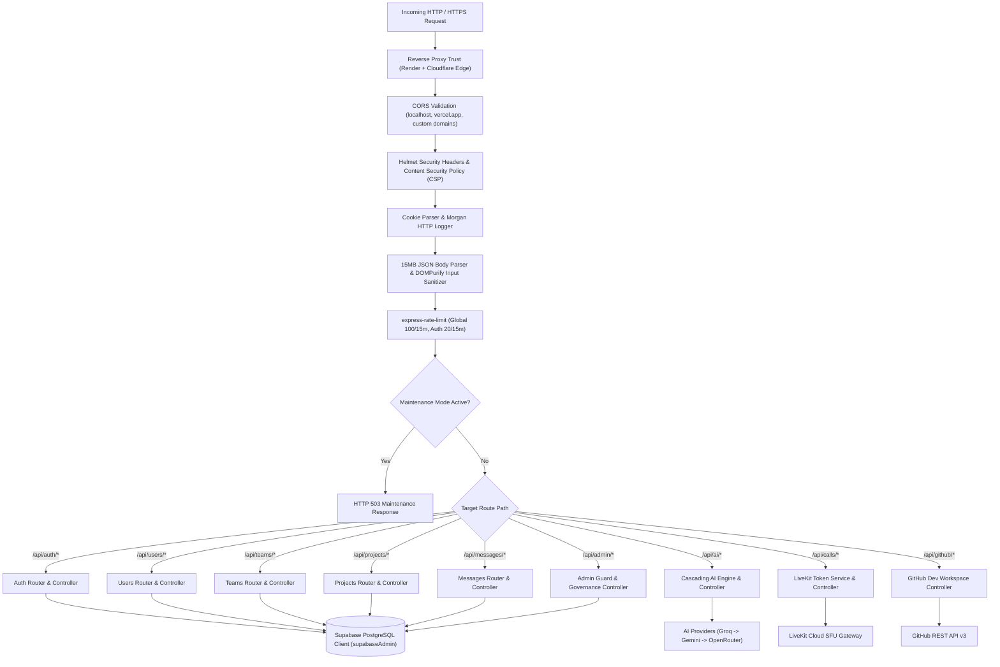
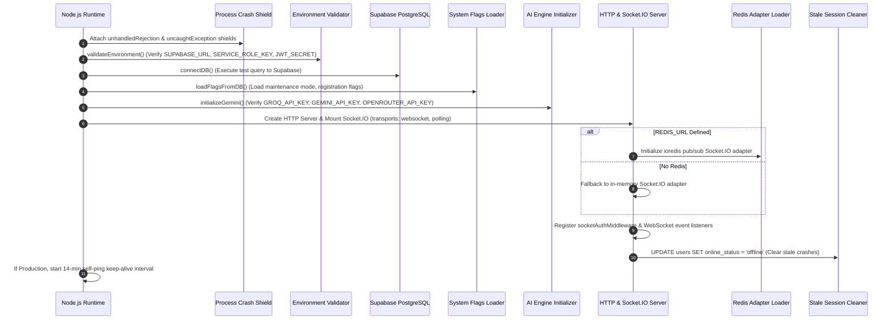

# 06: BACKEND ARCHITECTURE & SERVER-SIDE ENGINE

> **Document Classification:** Backend Infrastructure & API Gateway Architecture  
> **Runtime Environment:** Node.js (>= 18.0.0) + Express 4.18.2 + Socket.IO 4.7.2  
> **Host Environment:** Render.com Web Service (`projecthive-backend`)  
> **Extraction Evidence Level:** `[VERIFIED]` Direct Source Code Inspection  

---

## 1. High-Level Backend Topology & Gateway Pipeline

The ProjectHive backend implements a modular, security-hardened monolith with real-time WebSocket capabilities. Incoming requests pass through an OWASP-aligned security pipeline before reaching domain routers and business controllers:



---

## 2. Server Initialization Sequence (`server/server.js`)

When the backend initializes via `node server.js`, it executes a deterministic 9-step bootstrap lifecycle:



### Detailed Lifecycle Steps:
1. **Process Crash Shield (`server/server.js:33–40`):** Attaches global handlers to `process.on('unhandledRejection')` and `process.on('uncaughtException')` to prevent third-party AI timeouts or sudden socket dropouts from crashing the single-tenant container.
2. **Environment Validation (`server/server.js:44–73`):** Validates the mandatory presence of `SUPABASE_URL`, `SUPABASE_SERVICE_ROLE_KEY`, and `JWT_SECRET`. Halts startup immediately with a formatted ASCII error block if any key is missing.
3. **Database Connection (`server/config/db.js`):** Tests connectivity against the Supabase PostgREST endpoint using the elevated service-role client (`supabaseAdmin`).
4. **System Flags Ingestion (`server/controllers/admin.controller.js:loadFlagsFromDB`):** Fetches persistent configuration flags from the `system_flags` table into server memory.
5. **AI Inference Initialization (`server/config/gemini.js`):** Verifies credentials across the 3 AI providers (Groq, Gemini, OpenRouter) and instantiates the Google GenAI SDK.
6. **Socket.IO Mounting (`server/server.js:107–120`):** Binds Socket.IO to the Node.js HTTP server with CORS validation, 60s ping timeouts, and 25s ping intervals.
7. **Cluster Adapter Resolution (`server/server.js:122–134`):** If `REDIS_URL` is configured (e.g., Upstash Redis), initializes `@socket.io/redis-adapter` for multi-instance horizontal scaling; otherwise defaults to local memory.
8. **Stale Session Cleanup (`server/server.js:183–189`):** Issues a bulk query:
   ```sql
   UPDATE users SET online_status = 'offline' WHERE id != '00000000-0000-0000-0000-000000000000';
   ```
   This ensures users who were abruptly disconnected by a container restart do not remain permanently flagged as online.
9. **Production Keep-Alive Daemon (`server/server.js:192–204`):** If running in production on Render's free tier, fires an HTTP GET self-ping to `/api/health` every 14 minutes to prevent the container from sleeping after 15 minutes of inactivity.

---

## 3. Security Middleware Pipeline (`server/app.js`)

### 3.1 Reverse Proxy Trust
`[VERIFIED]` `app.set('trust proxy', true)` (line 33). Instructs Express to trust reverse proxy headers (`X-Forwarded-For`, `X-Forwarded-Proto`) forwarded by Render’s load balancers and Cloudflare’s CDN.

### 3.2 Dynamic CORS Whitelist
`[VERIFIED]` Lines 38–74 implement a custom CORS validator checking:
- Explicit local origins (`http://localhost:3000`, `http://127.0.0.1:3000`, `http://localhost:5000`, `http://localhost:5500`).
- Configured frontend environments (`process.env.CLIENT_URL`, `process.env.FRONTEND_URL`, `process.env.FRONTEND_URL_PROD`).
- Regex pattern matching: `/\.vercel\.app$/` to dynamically allow all preview and production deployments hosted on Vercel.
- Caches preflight OPTIONS responses for 24 hours (`maxAge: 86400`).

### 3.3 Content Security Policy (Helmet)
`[VERIFIED]` Lines 78–156 configure strict HTTP security headers:
- `scriptSrc`: Allows `'self'`, `'unsafe-inline'`, `'unsafe-eval'`, Cloudflare Turnstile (`challenges.cloudflare.com`), and approved CDNs.
- `connectSrc`: Allows Supabase (`*.supabase.co`, `wss://*.supabase.co`), LiveKit Cloud (`*.livekit.cloud`, `wss://*.livekit.cloud`), Render backend, AI endpoints (Google, Groq, OpenRouter), Brevo/Resend SMTP, and Metered.ca STUN/TURN relays.
- `frameSrc`: Cloudflare Turnstile and Jitsi Meet.
- `hsts`: Enforces HTTP Strict Transport Security with 1-year duration (`maxAge: 31536000`), include subdomains, and preloading.

### 3.4 Rate Limiting Architecture
`[VERIFIED]` Lines 174–198 configure dual rate limiting using `express-rate-limit`:
1. **Global API Limiter:** 100 requests per 15-minute sliding window across all `/api/` endpoints.
2. **Strict Auth Limiter:** 20 requests per 15-minute sliding window with `skipSuccessfulRequests: true` mounted on brute-force attack vectors:
   - `POST /api/auth/login`
   - `POST /api/auth/register`
   - `POST /api/auth/forgot-password`
   - `POST /api/admin/auth/login`

### 3.5 Global XSS Sanitization
`[VERIFIED]` Mounted via `sanitizeInputMiddleware` (`server/middleware/sanitize.js`). Recursively sanitizes strings in `req.body`, `req.query`, and `req.params`, stripping dangerous `<script>` elements, inline JavaScript event handlers (`onload`, `onerror`), and `javascript:` URIs.

---

## 4. Authentication & Authorization Middleware

### 4.1 Student JWT Guard (`server/middleware/auth.js`)
- **Extraction:** Extracts token from `Authorization: Bearer <token>` or HTTP-only cookies.
- **Verification:** Uses `jwt.verify(token, JWT_SECRET)`.
- **Ban Check:** Queries `users` table to verify `is_banned === false`. If banned, returns HTTP 403 Forbidden with strike/ban details.
- **User Attachment:** Attaches sanitized `{ id, email, role, university }` to `req.user`.
- **Optional Mode (`optionalAuthMiddleware`):** If a valid token exists, populates `req.user`; if missing or expired, gracefully allows execution to continue with `req.user = null` (essential for public browsing of feeds and showcases).

### 4.2 Administrative Guard (`server/middleware/adminAuth.js`)
- **Strict Verification:** Enforces that `req.user` possesses `role === 'admin'`.
- **Database Cross-Check:** Re-verifies role against live database records to prevent stale token privilege retention following a demotion.

### 4.3 WebSocket Handshake Auth (`server/middleware/socketAuth.js`)
- Validates JWT token provided in `socket.handshake.auth.token`.
- Binds `socket.userId = decoded.id` to the socket instance.
- Automatically rejects unauthorized connections before socket events can be registered.

---

## 5. Router Architecture & Controller Registry

All application endpoints are modularized across 13 route files mounted in `server/app.js`:

| Route Prefix | Route Module | Primary Controller | Key Responsibilities |
|---|---|---|---|
| `/api/auth` | `routes/auth.routes.js` | `controllers/auth.controller.js` | Register, login, refresh, logout, password recovery, Google OAuth. |
| `/api/users` | `routes/users.routes.js` | `controllers/users.controller.js` | Profiles, directory search, skill endorsements, user settings, support tickets. |
| `/api/teams` | `routes/teams.routes.js` | `controllers/teams.controller.js` | Team formation, membership, recruitment applications, leadership transfer. |
| `/api/projects` | `routes/projects.routes.js` | `controllers/projects.controller.js` | Showcase project submission, ProductHunt upvoting, bookmarking. |
| `/api/messages` | `routes/messages.routes.js` | `controllers/messages.controller.js` | Chat history, DMs with friend-gating, conversation pins, reaction toggles. |
| `/api/notifications` | `routes/notifications.routes.js` | `controllers/notifications.controller.js` | Notification listing, read status updates, bulk deletion. |
| `/api/friends` | `routes/friends.routes.js` | `controllers/friends.controller.js` | Friend requests, follows, blocks, mutual friends engine, relationship status. |
| `/api/stories` | `routes/stories.routes.js` | `controllers/stories.controller.js` | 24-hour ephemeral stories, view tracking, story deletion. |
| `/api/calls` | `routes/calls.routes.js` | `controllers/calls.controller.js` | LiveKit room token generation, session lifecycle tracking, call history. |
| `/api` (posts) | `routes/posts.routes.js` | `controllers/posts.controller.js` | Feed posts, rich code snippets, poll creation/voting, threaded comments. |
| `/api/github` | `routes/github.routes.js` | `controllers/github.controller.js` | GitHub repository explorer, health score, AI PR code review, webhooks. |
| `/api/ai` | `routes/ai.routes.js` | `controllers/ai.controller.js` | Cascading HiveMind AI capability execution (11 modes), prompt sanitization. |
| `/api/admin` | `routes/admin.routes.js` | `controllers/admin.controller.js` | Institutional telemetry, moderation queue, disciplinary strikes, audit ledger. |

---

## 6. Background Tasks & Subsystem Health Monitoring

The backend runs several background tasks and diagnostic health endpoints:

### 6.1 Subsystem Health Check (`GET /api/health/db`)
`[VERIFIED]` Evaluates complete infrastructure health in real time by executing concurrent count queries across `users`, `teams`, `projects`, `posts`, and listing storage buckets. Returns:
```json
{
  "status": "healthy",
  "database": "Supabase PostgreSQL",
  "latencyMs": 14,
  "tables": {
    "users": { "ok": true, "count": 25 },
    "teams": { "ok": true, "count": 7 },
    "projects": { "ok": true, "count": 4 },
    "posts": { "ok": true, "count": 9 }
  },
  "storage": {
    "ok": true,
    "bucketCount": 4,
    "buckets": [
      { "name": "avatars", "public": true },
      { "name": "banners", "public": true },
      { "name": "attachments", "public": true },
      { "name": "resumes", "public": false }
    ]
  }
}
```

### 6.2 TURN Relay Credentials Engine (`GET /api/turn-credentials`)
`[VERIFIED]` Generates dynamic, time-limited HMAC credentials for STUN/TURN relays to ensure WebRTC calls bypass strict corporate and university firewalls:
- Integrates Metered.ca TURN API if `METERED_API_KEY` is present.
- Falls back to RFC 5766 HMAC-SHA1 open relay generation (`staticauth.openrelay.metered.ca`) on ports 80, 443, and TURNS over TLS.

