# 09: COMPLETE ENTITY-RELATIONSHIP (ER) DIAGRAM

> **Document Classification:** Visual Database Entity-Relationship Modeling & Foreign Key Architecture  
> **Target Database Engine:** PostgreSQL 15+ (Hosted on Supabase)  
> **Extraction Evidence Level:** `[VERIFIED]` Foreign Key Constraints & Migration Schemas  

---

## 1. High-Resolution Mermaid ER Diagram

```mermaid
erDiagram
    %% =========================================================================
    %% 1. CORE USER IDENTITY & SOCIAL GRAPH
    %% =========================================================================
    USERS {
        uuid id PK
        varchar email UK
        varchar first_name
        varchar last_name
        varchar role
        varchar university
        varchar major
        varchar department
        varchar student_id
        int year_of_study
        text avatar
        varchar avatar_color
        text banner_image
        text bio
        text github_url
        text linkedin_url
        text portfolio_url
        boolean is_verified
        boolean is_banned
        boolean is_public
        varchar status
        varchar online_status
        timestamptz last_seen
        jsonb skills
        text_array interests
        jsonb settings
        timestamptz created_at
        timestamptz updated_at
    }

    FRIENDS {
        uuid id PK
        uuid user_id FK
        uuid friend_id FK
        timestamptz created_at
    }

    FRIEND_REQUESTS {
        uuid id PK
        uuid sender_id FK
        uuid receiver_id FK
        varchar status
        timestamptz created_at
    }

    FOLLOWS {
        uuid id PK
        uuid follower_id FK
        uuid following_id FK
        timestamptz created_at
    }

    BLOCKS {
        uuid id PK
        uuid blocker_id FK
        uuid blocked_id FK
        timestamptz created_at
    }

    SKILL_ENDORSEMENTS {
        uuid id PK
        uuid endorser_id FK
        uuid endorsed_id FK
        varchar skill_name
        timestamptz created_at
    }

    NOTIFICATIONS {
        uuid id PK
        uuid user_id FK
        varchar type
        text title
        text message
        jsonb data
        boolean is_read
        timestamptz created_at
    }

    %% =========================================================================
    %% 2. SQUADS, TEAMS & RECRUITMENT
    %% =========================================================================
    TEAMS {
        uuid id PK
        varchar name
        text description
        varchar category
        varchar status
        varchar type
        uuid leader_id FK
        int max_members
        text_array required_skills
        text avatar
        varchar avatar_color
        boolean is_private
        timestamptz created_at
        timestamptz updated_at
    }

    TEAM_MEMBERS {
        uuid id PK
        uuid team_id FK
        uuid user_id FK
        varchar role
        timestamptz joined_at
    }

    JOIN_REQUESTS {
        uuid id PK
        uuid team_id FK
        uuid user_id FK
        text message
        text portfolio_url
        varchar status
        timestamptz created_at
    }

    %% =========================================================================
    %% 3. PROJECTS & PORTFOLIO SHOWCASE
    %% =========================================================================
    PROJECTS {
        uuid id PK
        varchar title
        text description
        varchar category
        uuid creator_id FK
        uuid team_id FK
        text_array tech_stack
        text demo_url
        text repo_url
        text image_url
        boolean is_featured
        int likes
        int upvotes
        int views
        timestamptz created_at
    }

    PROJECT_LIKES {
        uuid id PK
        uuid project_id FK
        uuid user_id FK
    }

    SAVED_PROJECTS {
        uuid id PK
        uuid user_id FK
        uuid project_id FK
    }

    %% =========================================================================
    %% 4. SOCIAL FEED, STORIES & ENGAGEMENT
    %% =========================================================================
    POSTS {
        uuid id PK
        uuid author_id FK
        text content
        varchar type
        text_array media_urls
        text image_url
        jsonb code_snippet
        jsonb poll_data
        timestamptz created_at
        timestamptz updated_at
    }

    POST_REACTIONS {
        uuid id PK
        uuid post_id FK
        uuid user_id FK
        varchar type
    }

    POST_COMMENTS {
        uuid id PK
        uuid post_id FK
        uuid user_id FK
        uuid parent_comment_id FK
        text content
        timestamptz created_at
        timestamptz updated_at
    }

    SAVED_POSTS {
        uuid id PK
        uuid user_id FK
        uuid post_id FK
    }

    STORIES {
        uuid id PK
        uuid author_id FK
        text media_url
        varchar media_type
        text caption
        timestamptz expires_at
        timestamptz created_at
    }

    STORY_VIEWS {
        uuid id PK
        uuid story_id FK
        uuid viewer_id FK
        timestamptz viewed_at
    }

    %% =========================================================================
    %% 5. CHAT, CALLING & WHITEBOARD
    %% =========================================================================
    MESSAGES {
        uuid id PK
        varchar room_id
        uuid sender_id FK
        text content
        varchar type
        text media_url
        text voice_url
        numeric voice_duration
        uuid reply_to FK
        text reply_to_content
        text reply_to_sender
        varchar status
        uuid_array read_by
        timestamptz created_at
    }

    CONVERSATION_PINS {
        uuid id PK
        uuid user_id FK
        varchar room_id
        timestamptz pinned_at
    }

    MESSAGE_REACTIONS {
        uuid id PK
        uuid message_id FK
        uuid user_id FK
        varchar emoji
        timestamptz created_at
    }

    DM_REQUESTS {
        uuid id PK
        uuid sender_id FK
        uuid receiver_id FK
        text content
        varchar status
        timestamptz created_at
    }

    CALL_SESSIONS {
        uuid id PK
        varchar room_name UK
        uuid initiator_id FK
        varchar scope
        varchar call_type
        varchar status
        timestamptz started_at
        timestamptz ended_at
        int duration_seconds
        timestamptz updated_at
    }

    CALL_PARTICIPANTS {
        uuid id PK
        uuid session_id FK
        uuid user_id FK
        timestamptz joined_at
        timestamptz left_at
        int duration_seconds
    }

    %% =========================================================================
    %% 6. INSTITUTIONAL GOVERNANCE & AUDIT
    %% =========================================================================
    ADMIN_AUDIT_LOGS {
        uuid id PK
        uuid admin_id FK
        text admin_email
        text action
        text target_type
        text target_id
        jsonb details
        text ip_address
        text device_model
        timestamptz created_at
    }

    CONTENT_REPORTS {
        uuid id PK
        uuid reporter_id FK
        varchar target_type
        uuid target_id
        varchar reason
        text details
        varchar status
        uuid resolved_by FK
        text resolution_notes
        timestamptz created_at
        timestamptz updated_at
    }

    USER_STRIKES {
        uuid id PK
        uuid user_id FK
        varchar reason
        varchar severity
        uuid issued_by FK
        uuid report_id FK
        timestamptz created_at
    }

    SUPPORT_TICKETS {
        uuid id PK
        uuid user_id FK
        varchar subject
        text message
        varchar priority
        varchar status
        uuid assigned_to FK
        timestamptz created_at
        timestamptz updated_at
    }

    SYSTEM_FLAGS {
        varchar key PK
        boolean value
        timestamptz updated_at
    }

    %% =========================================================================
    %% RELATIONSHIP MAPPINGS (CARDINALITY & CONSTRAINTS)
    %% =========================================================================
    USERS ||--o{ FRIENDS : "user"
    USERS ||--o{ FRIENDS : "friend"
    USERS ||--o{ FRIEND_REQUESTS : "sent"
    USERS ||--o{ FRIEND_REQUESTS : "received"
    USERS ||--o{ FOLLOWS : "follower"
    USERS ||--o{ FOLLOWS : "following"
    USERS ||--o{ BLOCKS : "blocker"
    USERS ||--o{ BLOCKS : "blocked"
    USERS ||--o{ SKILL_ENDORSEMENTS : "endorser"
    USERS ||--o{ SKILL_ENDORSEMENTS : "endorsed"
    USERS ||--o{ NOTIFICATIONS : "receives"

    USERS ||--o{ TEAMS : "leads"
    TEAMS ||--|{ TEAM_MEMBERS : "contains"
    USERS ||--o{ TEAM_MEMBERS : "belongs_to"
    TEAMS ||--o{ JOIN_REQUESTS : "receives"
    USERS ||--o{ JOIN_REQUESTS : "applies"

    USERS ||--o{ PROJECTS : "creates"
    TEAMS ||--o{ PROJECTS : "develops"
    PROJECTS ||--o{ PROJECT_LIKES : "receives"
    USERS ||--o{ PROJECT_LIKES : "likes"
    PROJECTS ||--o{ SAVED_PROJECTS : "bookmarked_by"
    USERS ||--o{ SAVED_PROJECTS : "saves"

    USERS ||--o{ POSTS : "authors"
    POSTS ||--o{ POST_REACTIONS : "has"
    USERS ||--o{ POST_REACTIONS : "reacts"
    POSTS ||--o{ POST_COMMENTS : "has"
    USERS ||--o{ POST_COMMENTS : "comments"
    POST_COMMENTS ||--o{ POST_COMMENTS : "replies_to"
    POSTS ||--o{ SAVED_POSTS : "bookmarked_by"
    USERS ||--o{ SAVED_POSTS : "saves"

    USERS ||--o{ STORIES : "publishes"
    STORIES ||--o{ STORY_VIEWS : "tracked_by"
    USERS ||--o{ STORY_VIEWS : "views"

    USERS ||--o{ MESSAGES : "sends"
    MESSAGES ||--o{ MESSAGES : "replies_to"
    MESSAGES ||--o{ MESSAGE_REACTIONS : "has"
    USERS ||--o{ MESSAGE_REACTIONS : "reacts"
    USERS ||--o{ CONVERSATION_PINS : "pins"
    USERS ||--o{ DM_REQUESTS : "initiates"
    USERS ||--o{ DM_REQUESTS : "receives"

    USERS ||--o{ CALL_SESSIONS : "initiates"
    CALL_SESSIONS ||--o{ CALL_PARTICIPANTS : "records"
    USERS ||--o{ CALL_PARTICIPANTS : "attends"

    USERS ||--o{ ADMIN_AUDIT_LOGS : "performed_by"
    USERS ||--o{ CONTENT_REPORTS : "files"
    USERS ||--o{ CONTENT_REPORTS : "resolved_by"
    USERS ||--o{ USER_STRIKES : "penalized"
    USERS ||--o{ USER_STRIKES : "issued_by"
    CONTENT_REPORTS ||--o{ USER_STRIKES : "justifies"
    USERS ||--o{ SUPPORT_TICKETS : "opens"
    USERS ||--o{ SUPPORT_TICKETS : "handled_by"
```

---

## 2. Relational Deletion Cascades & Integrity Rules

1. **User Deletion Cascades:**
   When a user account is deleted (`DELETE FROM users WHERE id = :userId`):
   - *Cascaded Records (`ON DELETE CASCADE`):* Associated rows in `posts`, `post_comments`, `post_reactions`, `team_members`, `join_requests`, `messages`, `friends`, `friend_requests`, `follows`, `blocks`, `stories`, `story_views`, `notifications`, `support_tickets`, `user_strikes`, `project_likes`, and `saved_projects` are automatically deleted by the database engine.
   - *Leadership Safeguard:* If the user is a `leader_id` on a team, the team is dropped via cascade, or ownership must be delegated first via `/api/teams/:id/transfer-leadership`.
2. **Post Deletion Cascades:**
   When a post is deleted (`DELETE FROM posts WHERE id = :postId`):
   - All associated `post_comments`, `post_reactions`, and `saved_posts` are immediately purged via cascading foreign key rules.
3. **Audit Log Immutability:**
   If an administrator account is deleted, foreign keys in `admin_audit_logs` use `ON DELETE SET NULL`. The audit action record, target information, client IP, and parameters remain permanently preserved in the ledger for forensic accountability.

