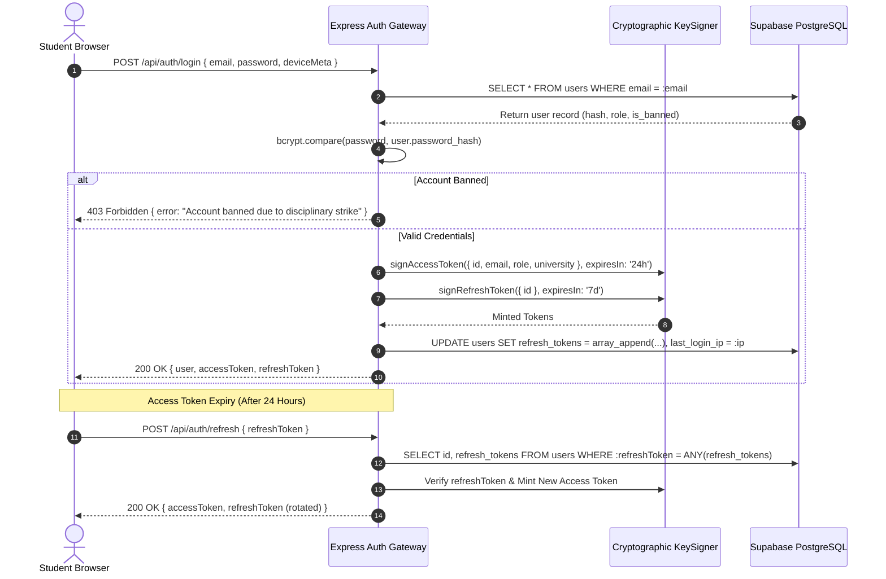

# 10: AUTHENTICATION, AUTHORIZATION & USER ROLES

> **Document Classification:** Authentication Mechanics & Role-Based Access Control (RBAC) Specification  
> **Cryptographic Engines:** KeySigner Abstraction (HS256/RS256), Google OAuth 2.0 PKCE, Bcrypt (12 Rounds)  
> **Extraction Evidence Level:** `[VERIFIED]` Source Code & Security Middleware  

---

## 1. Authentication Topology & Token Lifecycle

ProjectHive implements a dual-token JWT architecture with rotating refresh tokens and cryptographic signing abstraction (`server/services/crypto/keySigner.service.js`):

---

## 2. Authentication Methods & Mechanisms

### 2.1 Native University Email & Password Registration
- **Password Hashing:** 12-round salted hashing via `bcryptjs.hash(password, 12)` (`server/controllers/auth.controller.js:52`).
- **Default Role:** Every user registered via `/api/auth/register` is granted `role = 'student'`.
- **System Flag Interceptor:**
  - If `system_flags.registrationEnabled === false`, registration returns HTTP 403: `"Student registration is temporarily disabled by university administration."`
  - If `system_flags.emailVerification === true`, an alphanumeric verification token is generated, stored with a 24-hour expiration (`email_verification_expires`), and dispatched via Brevo SMTP.

### 2.2 Google OAuth 2.0 with PKCE Flow
- **Initiation (`GET /api/auth/google`):** Mints a state parameter and returns the Supabase Google OAuth authorization URL.
- **Code Exchange (`POST /api/auth/google/code`):** Receives the OAuth authorization code from the client, exchanges it server-side for Google profile claims, looks up or creates the student account in PostgreSQL, and returns application JWT tokens.

### 2.3 Standalone Institutional Admin Entrance
- **Endpoint:** `POST /api/admin/auth/login` (`server/controllers/admin.auth.controller.js`).
- **Validation:** Compares candidate credentials against `process.env.ADMIN_EMAIL` and `process.env.ADMIN_PASSWORD`.
- **Constant-Time Verification:** Uses `crypto.timingSafeEqual` in `KeySigner` to prevent timing attacks.
- **Auto-Promotion:** If credentials match, automatically forces `role = 'admin'` on the user record and issues an administrative bearer token.

---

## 3. Comprehensive Role Permission Matrix

| Capability / Resource Action | Public Guest | Student (`student`) | Faculty Advisor (`faculty`) | Squad Leader (Contextual) | Admin (`admin`) |
|---|---|---|---|---|---|
| **View Marketing Landing & Public Showcase** | ✅ | ✅ | ✅ | ✅ | ✅ |
| **Browse Open Squads & User Directory** | ✅ (Read-Only) | ✅ | ✅ | ✅ | ✅ |
| **Register & Sign In** | ✅ | ✅ | ✅ | ✅ | ✅ |
| **Update Own Profile & Avatar** | ❌ | ✅ | ✅ | ✅ | ✅ |
| **Apply to Join a Squad (`join_requests`)** | ❌ | ✅ | ✅ | ❌ (Own squad) | ✅ |
| **Create a New Squad (`teams`)** | ❌ | ✅ | ✅ | ✅ (Becomes leader) | ✅ |
| **Kick Member / Transfer Leadership** | ❌ | ❌ | ❌ | ✅ (Owned squad only) | ✅ (Global override) |
| **Publish Feed Posts, Snippets & Polls** | ❌ | ✅ | ✅ | ✅ | ✅ |
| **Delete Feed Post or Comment** | ❌ | ✅ (Own content) | ✅ (Own content) | ✅ (Own content) | ✅ (Any content) |
| **Direct Messaging & Group Chat** | ❌ | ✅ | ✅ | ✅ | ✅ |
| **Initiate LiveKit Video / Audio Calls** | ❌ | ✅ | ✅ | ✅ | ✅ |
| **Execute HiveMind AI Capabilities** | ❌ (5 req/hr public)| ✅ (60 ops/hr) | ✅ (60 ops/hr) | ✅ (60 ops/hr) | ✅ (Unlimited) |
| **Connect GitHub & Inspect Repositories** | ❌ | ✅ | ✅ | ✅ | ✅ |
| **Request Automated AI PR Code Review** | ❌ | ✅ | ✅ | ✅ | ✅ |
| **Submit Support Ticket** | ❌ | ✅ | ✅ | ✅ | ✅ |
| **Access `/admin/*` Routes & Console** | ❌ | ❌ | ❌ | ❌ | ✅ (Desktop only) |
| **Ban / Unban User Accounts** | ❌ | ❌ | ❌ | ❌ | ✅ |
| **Issue Disciplinary Strikes** | ❌ | ❌ | ❌ | ❌ | ✅ |
| **Resolve Content Abuse Reports** | ❌ | ❌ | ❌ | ❌ | ✅ |
| **Mutate System Flags & Kill Switches** | ❌ | ❌ | ❌ | ❌ | ✅ |
| **Inspect Unmasked Client Hardware Telemetry** | ❌ | ❌ | ❌ | ❌ | ✅ |
| **View Immutable Audit Ledger** | ❌ | ❌ | ❌ | ❌ | ✅ |

---

## 4. Frontend vs Backend Permission Consistency Analysis

`[VERIFIED]` The forensic audit verified that client-side visibility guards are backed by equivalent server-side enforcement:

1. **Administrative Boundary:**
   - *Client Defense:* `AdminLayout.tsx` checks `user?.role === 'admin'`. If false, instantly executes `router.replace('/admin/login')`. Furthermore, `DesktopGate.tsx` checks hardware pointer and screen geometry.
   - *Server Defense:* `adminAuthMiddleware` (`server/middleware/adminAuth.js`) verifies the incoming bearer JWT and executes a live PostgreSQL lookup against the `users` table to confirm `role === 'admin'`. Even if a client bypasses the frontend gate, all `/api/admin/*` endpoints reject the request with HTTP 403 Forbidden.
2. **Squad Leadership Actions:**
   - *Client Defense:* The "Settings" tab in `frontend/src/app/(app)/teams/[id]/page.tsx` is rendered only if `isLeader === true`.
   - *Server Defense:* `teams.controller.js:updateTeam`, `deleteTeam`, `kickMember`, and `transferLeadership` query the `teams` table to assert `team.leader_id === req.user.id`. Requests from non-leaders return HTTP 403.
3. **Disciplinary Ban Enforcement:**
   - *Client Defense:* Ban error triggers automatic logout and banner notification.
   - *Server Defense:* Every authenticated API call passing through `authMiddleware` queries `is_banned` on the `users` table. Banned accounts are blocked from reading or mutating data across the entire API.

