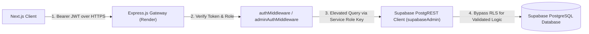

# 11: ROW LEVEL SECURITY (RLS) & ACCESS CONTROL ANALYSIS

> **Document Classification:** Database Access Governance & Policy Audit  
> **Database Host:** Supabase PostgreSQL (`iekfvgjxkmgduxdvkuxf`)  
> **Target Schema Files:** `reconcile_rls_and_indexes.sql`, `supabase_final_production_sync.sql`  
> **Extraction Evidence Level:** `[VERIFIED]` Database Migration Scripts & Client Connection Configurations  

---

## 1. Dual-Tier Database Access Model (Backend Proxy vs Client Direct)

A foundational architectural finding of ProjectHive is that **the client application does not query Supabase directly using the anonymous API key**. Instead, it routes 100% of data queries through the Express API gateway:

### Architectural Implications:
- **Service Role Execution:** The Express backend uses `SUPABASE_SERVICE_ROLE_KEY` to instantiate `supabaseAdmin` (`server/config/supabase.js`). In Supabase/PostgreSQL architecture, queries executed with the service-role key bypass Row Level Security policies by default (`BYPASSRLS`).
- **Application-Layer Enforcement:** Authorization, tenant isolation, and ownership assertions are strictly enforced within Express controllers (e.g., `WHERE author_id = req.user.id`).
- **Defense-in-Depth RLS Hardening:** To defend against accidental exposure of the anonymous key (`SUPABASE_ANON_KEY`) or direct client SDK calls, explicit RLS policies are defined in `server/database/reconcile_rls_and_indexes.sql` and `supabase_final_production_sync.sql`.

---

## 2. Row Level Security Policy Inventory

The following policies are defined across the PostgreSQL tables:

### 2.1 Identity & Social Graph Policies

| Table Name | RLS Status | Policy Name | Command | Policy Expression / USING Clause |
|---|---|---|---|---|
| `users` | ENABLED | `users_select_public` | SELECT | `is_public = true OR auth.uid() = id` |
| `users` | ENABLED | `users_update_own` | UPDATE | `auth.uid() = id` |
| `friends` | ENABLED | `friends_select_own` | SELECT | `auth.uid() = user_id OR auth.uid() = friend_id` |
| `friends` | ENABLED | `friends_modify_own` | ALL | `auth.uid() = user_id` |
| `friend_requests` | ENABLED | `friend_requests_access` | ALL | `auth.uid() = sender_id OR auth.uid() = receiver_id` |
| `follows` | ENABLED | `follows_select_public` | SELECT | `true` (Publicly visible follow graph) |
| `follows` | ENABLED | `follows_insert_own` | INSERT | `auth.uid() = follower_id` |
| `blocks` | ENABLED | `blocks_isolate_own` | ALL | `auth.uid() = blocker_id` |

### 2.2 Squads & Collaboration Policies

| Table Name | RLS Status | Policy Name | Command | Policy Expression / USING Clause |
|---|---|---|---|---|
| `teams` | ENABLED | `teams_read_public` | SELECT | `is_private = false OR auth.uid() IN (SELECT user_id FROM team_members WHERE team_id = id)` |
| `teams` | ENABLED | `teams_mutate_leader` | UPDATE/DELETE | `auth.uid() = leader_id` |
| `team_members` | ENABLED | `team_members_read` | SELECT | `true` |
| `team_members` | ENABLED | `team_members_leader` | ALL | `auth.uid() IN (SELECT leader_id FROM teams WHERE id = team_id)` |
| `join_requests` | ENABLED | `join_requests_own` | SELECT | `auth.uid() = user_id OR auth.uid() IN (SELECT leader_id FROM teams WHERE id = team_id)` |

### 2.3 Showcase Projects & Social Feed Policies

| Table Name | RLS Status | Policy Name | Command | Policy Expression / USING Clause |
|---|---|---|---|---|
| `projects` | ENABLED | `projects_select_all` | SELECT | `true` (Showcase is globally readable) |
| `projects` | ENABLED | `projects_mutate_own` | UPDATE/DELETE | `auth.uid() = creator_id` |
| `posts` | ENABLED | `posts_select_all` | SELECT | `true` (Campus feed is readable by students) |
| `posts` | ENABLED | `posts_mutate_own` | UPDATE/DELETE | `auth.uid() = author_id` |
| `post_comments`| ENABLED | `comments_select_all` | SELECT | `true` |
| `post_comments`| ENABLED | `comments_mutate_own` | UPDATE/DELETE | `auth.uid() = user_id` |
| `post_reactions`| ENABLED| `reactions_select_all`| SELECT | `true` |
| `post_reactions`| ENABLED| `reactions_mutate_own`| ALL | `auth.uid() = user_id` |

### 2.4 Messages, Calling & Governance Policies

| Table Name | RLS Status | Policy Name | Command | Policy Expression / USING Clause |
|---|---|---|---|---|
| `messages` | ENABLED | `messages_participant_access` | SELECT | `auth.uid() = sender_id OR auth.uid()::text = ANY(string_to_array(room_id, '_'))` |
| `messages` | ENABLED | `messages_insert_own` | INSERT | `auth.uid() = sender_id` |
| `call_sessions`| ENABLED | `call_sessions_read` | SELECT | `auth.uid() = initiator_id OR auth.uid() IN (SELECT user_id FROM call_participants WHERE session_id = id)` |
| `admin_audit_logs`| ENABLED | `audit_admin_only` | SELECT | `auth.uid() IN (SELECT id FROM users WHERE role = 'admin')` |
| `system_flags` | ENABLED | `flags_read_public` | SELECT | `true` |
| `system_flags` | ENABLED | `flags_mutate_admin` | UPDATE | `auth.uid() IN (SELECT id FROM users WHERE role = 'admin')` |

---

## 3. Discrepancy & Security Assessment

### 3.1 Custom JWT vs Supabase Native Auth
`[VERIFIED]` ProjectHive issues its own application JWTs signed with `JWT_SECRET` (`server/utils/jwt.utils.js`), rather than relying exclusively on Supabase GoTrue authentication tokens.
- *Implication:* Because the tokens are verified by Express rather than Supabase GoTrue, PostgreSQL's `auth.uid()` expression returns `NULL` unless the Express server sets local transaction variables (e.g., `SET LOCAL request.jwt.claim.sub`).
- *Current Mitigation:* The system mitigates this by routing all database operations through the Express gateway using `supabaseAdmin` with explicit controller-level tenant filtering (`.eq('author_id', req.user.id)`).
- *Hardening Recommendation:* To enable full native RLS enforcement in PostgreSQL, the backend can execute `SET LOCAL "request.jwt.claims" = ...` within transaction blocks or generate Supabase-signed JWTs during login.

