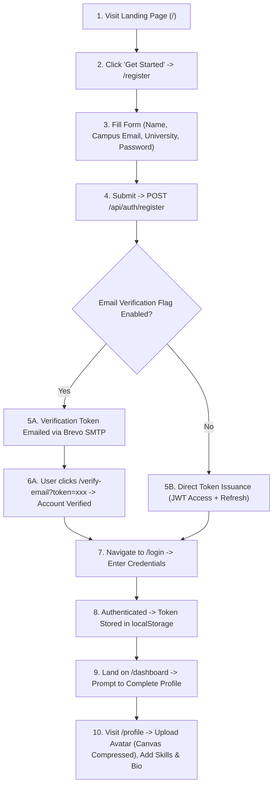
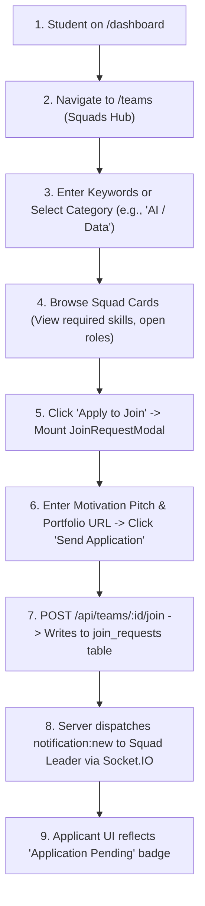
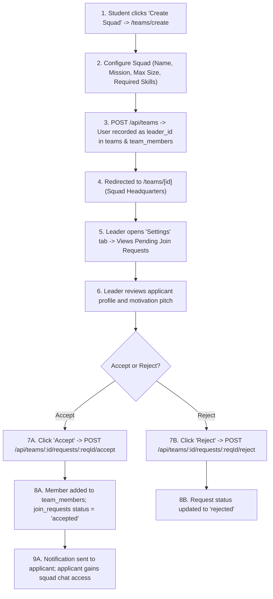
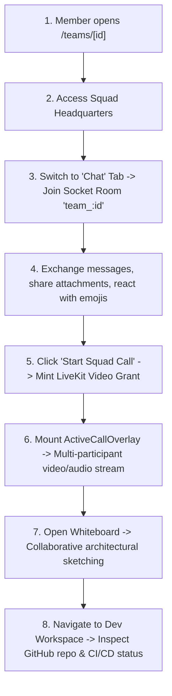
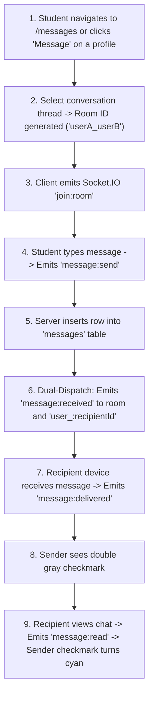
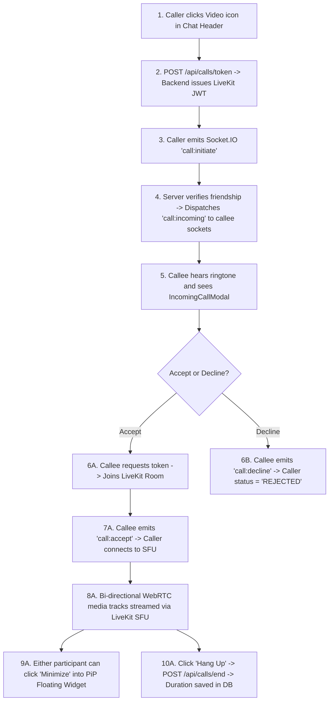
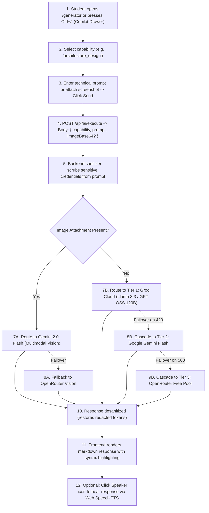
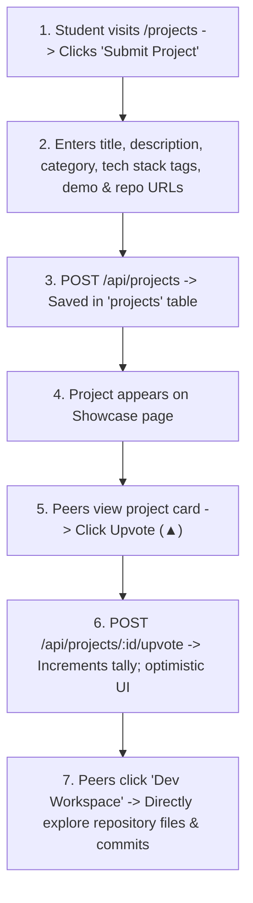
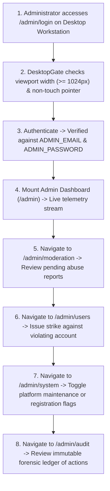

# 13: COMPLETE USER JOURNEY & WORKFLOW RECONSTRUCTION

> **Document Classification:** End-to-End Workflow & User Journey Reconstruction  
> **Target Personas:** New Students, Team Leaders, Team Members, Makers, Administrators  
> **Extraction Evidence Level:** `[VERIFIED]` Verified Code Paths & Route Transitions  

---

## Journey A: New Student Onboarding & Profile Activation

- **Verified Steps:** Landing (`/`), Registration (`/register`), Login (`/login`), Dashboard (`/dashboard`), Profile (`/profile`).
- **Operational Reality:** If `system_flags.emailVerification === false` (default state), students bypass email confirmation and achieve instantaneous activation.

---

## Journey B: Team Discovery & Recruitment Application

---

## Journey C: Squad Leader Recruitment & Management

---

## Journey D: Team Member Workspace Collaboration

---

## Journey E: Real-Time Direct Messaging (DMs)

---

## Journey F: Native WebRTC Video / Voice Calling

---

## Journey G: HiveMind AI Copilot Execution

---

## Journey H: Showcase Project Publishing & Discovery

---

## Journey I: Institutional Administrative Governance

