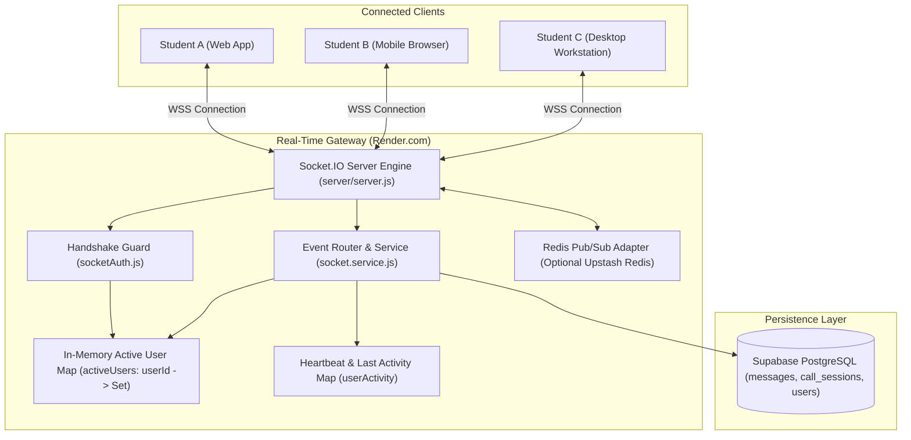
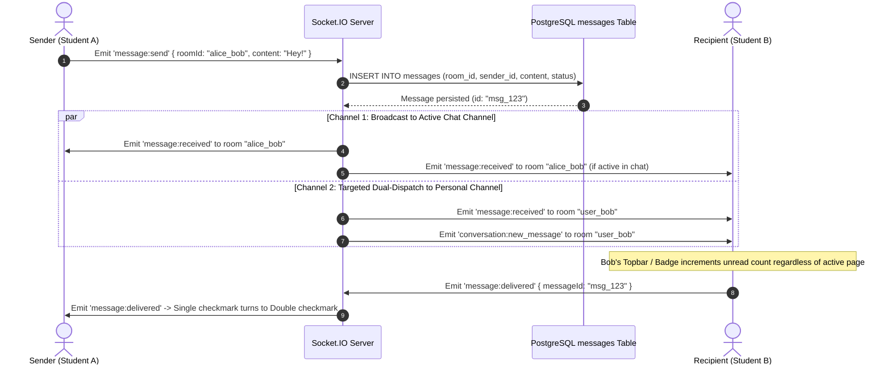

# 14: SOCKET.IO & REAL-TIME WEBSOCKET ARCHITECTURE

> **Document Classification:** Real-Time Signaling & Event-Driven Architecture  
> **Server Runtime:** Socket.IO v4.7.2 (Node.js)  
> **Client Runtime:** Socket.IO Client v4.8.3 (`useSocket.ts`)  
> **Extraction Evidence Level:** `[VERIFIED]` Direct Source Code Inspection  

---

## 1. WebSocket Infrastructure Topology

ProjectHive integrates a low-latency, stateful WebSocket subsystem powered by **Socket.IO** co-located within the Node.js Express process:



---

## 2. Server Configuration & Handshake Protocol

- **Transports Configured:** `['websocket', 'polling']` (prioritizes native WebSocket with fallback to HTTP long-polling).
- **Ping Parameters:** `pingInterval: 25000` (25s heartbeats), `pingTimeout: 60000` (60s disconnect threshold).
- **Handshake Authentication Middleware (`server/middleware/socketAuth.js`):**
  - Reads `socket.handshake.auth.token`.
  - Verifies JWT against `process.env.JWT_SECRET`.
  - Attaches `socket.userId = decoded.id` to the socket instance.
  - Rejects connection if token is absent, expired, or malformed.
- **Dynamic Reconnection Sync (`frontend/src/hooks/useSocket.ts`):**
  - Configures `reconnect_attempt` listener to re-read the fresh token from `localStorage.getItem('access_token')` dynamically before every reconnect attempt.

---

## 3. Room Naming Taxonomy & Routing Architecture

| Room Type | Naming Convention | Description & Access Control |
|---|---|---|
| **Personal User Room** | `user_<userId>` | Automatically joined on connection. Dispatches direct notifications, incoming call alerts, and dual-dispatched incoming DMs. |
| **Direct Message Room** | `<userA_id>_<userB_id>` | Sorted alphabetically by UUIDs (e.g., `sort([userA, userB]).join('_')`). Prevents duplicate rooms for the same pair. |
| **Squad / Team Room** | `team_<teamId>` | Joined by squad members for collaborative text chat and group call announcements. |

---

## 4. Dual-Dispatch Message Delivery Pattern

To eliminate missed messages when a user is browsing another page and has not actively opened the specific chat channel, ProjectHive implements a **Dual-Dispatch Pattern** (`server/services/socket.service.js:145–165`):



---

## 5. Message Lifecycle & Receipt Synchronization

1. **Sent State (`sent`):** Message is written to PostgreSQL with `status = 'sent'`. Sender UI renders single checkmark (`✓`).
2. **Delivered State (`delivered`):** When the recipient’s socket receives the packet, it immediately dispatches `message:delivered` or `message:ack_delivered`. Server updates `messages.status = 'delivered'` and emits `message:delivered` to the sender. Sender UI updates checkmark to double gray check (`✓✓`).
3. **Read / Seen State (`seen`):** When the recipient opens the conversation viewport, client emits `message:read { roomId, friendId }`. Server updates `read_by` array in PostgreSQL and emits `message:read_receipt`. Sender UI checkmark turns double cyan (`✓✓`).

---

## 6. Real-Time Calling & In-Call Canvas Synchronization

### 6.1 Call Signaling Events
- `call:initiate`: Caller emits target ID and room parameters. Server checks friendship status in `friends` table, then emits `call:incoming` to all active sockets of the callee (both PC and mobile ring simultaneously).
- `call:accept` / `call:decline`: Relays acceptance or decline events to caller sockets.
- `call:hangup`: Calculates call duration, terminates session in `call_sessions` table, and notifies peer.
- `call:group`: Broadcasts incoming call alerts to all members of a squad.

### 6.2 Collaborative Whiteboard Synchronization
During active calls, the whiteboard emits vector drawing coordinates:
- **Draw Event:**
  ```javascript
  socket.emit('whiteboard:draw', {
    roomId: 'squad_call_123',
    points: [{ x: 120, y: 340 }, { x: 125, y: 348 }],
    color: '#38bdf8',
    strokeWidth: 3,
    tool: 'pen'
  });
  ```
- **Relay:** The server broadcasts `whiteboard:draw` to `socket.to(roomId)`, rendering strokes on peer canvases without writing to the database (in-memory ephemeral stream).
- **Clear Event:** `whiteboard:clear` resets canvases across all call participants.

---

## 7. Scalability & Redis Adapter Architecture

`[VERIFIED]` `server/server.js:122–134` includes native support for Redis-backed pub/sub clustering:
- If `process.env.REDIS_URL` is provided (e.g. Upstash Redis), the server initializes `@socket.io/redis-adapter` using `ioredis`.
- This enables ProjectHive to scale horizontally across multiple container instances on Render or Kubernetes, synchronizing WebSocket packets across instances via Redis Pub/Sub channels.
- If `REDIS_URL` is omitted, the server gracefully defaults to the built-in single-process memory adapter.

