# 16: EXTERNAL SERVICE INTEGRATIONS INTELLIGENCE

> **Document Classification:** Third-Party Services, Cloud Connectors & API Gateways  
> **Total External Services:** 10 verified integrations  
> **Extraction Evidence Level:** `[VERIFIED]` Direct Configuration & Service Code Inspection  

---

## 1. Cloud Integration Topology

ProjectHive integrates 10 cloud providers across data persistence, real-time media, AI inference, code collaboration, and transactional delivery:

```mermaid
graph TD
    ProjectHiveApp["ProjectHive Application Core"]

    subgraph Persistence_Tier ["Persistence & Edge"]
        Supabase["1. Supabase (PostgreSQL & S3 Storage)"]
        Vercel["2. Vercel (Client Edge CDN & Next.js Runtime)"]
        Render["3. Render.com (Backend Web Service & Process Manager)"]
    end

    subgraph Media_Signaling ["Real-Time Media & Network"]
        LiveKit["4. LiveKit Cloud (WebRTC SFU Media Server)"]
        Metered["5. Metered.ca & Google (RFC 5766 STUN/TURN Relays)"]
    end

    subgraph AI_Inference ["Cascading AI Cluster"]
        Groq["6. Groq Cloud (Ultra-Fast Llama-3.3 & GPT-OSS)"]
        Gemini["7. Google AI Studio (Gemini 2.0 Flash Multimodal)"]
        OpenRouter["8. OpenRouter (Zero-Rate-Limit Failover Pool)"]
    end

    subgraph Communication_Dev ["Developer & Communication"]
        GitHub["9. GitHub REST API v3 (Workspace & AI PR Review)"]
        Brevo["10. Brevo SMTP / HTTP API (Transactional Mailer)"]
    end

    ProjectHiveApp --> Supabase
    ProjectHiveApp --> Vercel
    ProjectHiveApp --> Render
    ProjectHiveApp --> LiveKit
    ProjectHiveApp --> Metered
    ProjectHiveApp --> Groq
    ProjectHiveApp --> Gemini
    ProjectHiveApp --> OpenRouter
    ProjectHiveApp --> GitHub
    ProjectHiveApp --> Brevo
```

---

## 2. Granular Service Integration Inventory

### 1. Supabase (Database & Object Storage)
- **Purpose:** Primary stateful persistence for 32 relational tables and 4 object storage buckets (`avatars`, `banners`, `attachments`, `resumes`).
- **Configuration Location:** `server/config/supabase.js`, `server/.env`.
- **Authentication Mechanism:** Supabase Anonymous Key (public metadata) and Service Role Key (backend root client `supabaseAdmin`).
- **Data Exchanged:** Relational rows, JSONB blobs, and binary image/file streams.
- **Failure Handling:** If the database connection drops, Express returns HTTP 503 `SUPABASE_QUERY_FAILED` and `GET /api/health/db` reports degraded status.
- **Operational Limitations:** Free-tier database pauses after prolonged inactivity; mitigated by server startup query sweeps.

---

### 2. LiveKit Cloud (WebRTC SFU Media Server)
- **Purpose:** Multi-participant audio/video calling, screen sharing, and adaptive track downscaling (simulcast).
- **Configuration Location:** `server/services/livekit.service.js`, `frontend/src/hooks/useLiveKitRoom.ts`.
- **Target URL:** `wss://project-hive-o0q9p17e.livekit.cloud`.
- **Authentication Mechanism:** Short-lived JWT video grants signed with `LIVEKIT_API_KEY` and `LIVEKIT_API_SECRET`.
- **Data Exchanged:** Real-time WebRTC audio/video RTP packets and JSON session metadata.
- **Failure Handling:** On strict firewall blocks, automatically cascades to Coturn / Metered.ca TURN relays over TCP port 443.

---

### 3. Groq Cloud (Tier 1 AI Text & Code)
- **Purpose:** Ultra-low-latency code debugging, architecture design, and capstone idea generation.
- **Configuration Location:** `server/controllers/ai.controller.js:145–210`.
- **Target Endpoint:** `https://api.groq.com/openai/v1/chat/completions`.
- **Authentication Mechanism:** Bearer API key (`GROQ_API_KEY`).
- **Models Utilized:** `openai/gpt-oss-20b`, `openai/gpt-oss-120b`, `groq/compound`.
- **Failure Handling:** Configured with a 12-second abort timeout; automatically catches HTTP 429 (rate limits) and 503 (outages) and cascades to Google Gemini Flash.

---

### 4. Google AI Studio (Tier 2 Multimodal AI & Vision)
- **Purpose:** Analyzing architecture diagrams, reviewing UI screenshots, and serving as the primary failover text model.
- **Configuration Location:** `server/config/gemini.js`, `server/controllers/ai.controller.js:80–140`.
- **Target Endpoint:** `https://generativelanguage.googleapis.com/v1beta/models`.
- **Authentication Mechanism:** Google API Key (`GEMINI_API_KEY`).
- **Models Utilized:** `gemini-2.0-flash`, `gemini-1.5-flash`.
- **Failure Handling:** Cascades to OpenRouter if rate limits or network aborts occur.

---

### 5. OpenRouter (Tier 3 Free Failover AI Pool)
- **Purpose:** Zero-rate-limit failover pool guaranteeing continuous AI availability.
- **Configuration Location:** `server/controllers/ai.controller.js:215–260`.
- **Target Endpoint:** `https://openrouter.ai/api/v1/chat/completions`.
- **Authentication Mechanism:** Bearer API key (`OPENROUTER_API_KEY`).
- **Models Utilized:** `openrouter/free`.

---

### 6. GitHub REST API v3 & Octokit
- **Purpose:** Repository exploration, file tree navigation, commit inspection, pull request reviews, and CI/CD workflow telemetry.
- **Configuration Location:** `server/services/github.service.js`, `server/controllers/github.controller.js`.
- **Target Endpoint:** `https://api.github.com`.
- **Authentication Mechanism:** User-connected GitHub Personal Access Token (PAT) or server fallback.
- **Failure Handling:** Gracefully handles rate limits on unauthenticated queries by prompting users to connect their personal GitHub account.

---

### 7. Brevo / Sendinblue (Transactional Mailer)
- **Purpose:** Dispatching account verification links, password reset tokens, and welcome notifications.
- **Configuration Location:** `server/services/email.service.js`.
- **Target Endpoint:** Brevo HTTP REST v3 API (`https://api.brevo.com/v3/smtp/email`) and SMTP relay (`smtp-relay.brevo.com`).
- **Authentication Mechanism:** Brevo API Key (`BREVO_API_KEY`).
- **Failure Handling:** Falls back to direct Gmail SMTP relay (`nodemailer`) if Brevo HTTP dispatch encounters errors.

---

### 8. Cloudflare Turnstile (Bot & Abuse Prevention)
- **Purpose:** Invisible and lightweight CAPTCHA challenge protecting registration and login endpoints.
- **Configuration Location:** `server/middleware/turnstile.js`.
- **Target Endpoint:** `https://challenges.cloudflare.com/turnstile/v0/siteverify`.
- **Authentication Mechanism:** Cloudflare Secret Key (`TURNSTILE_SECRET_KEY`).
- **Failure Handling:** In development (`NODE_ENV !== 'production'`), bypasses verification automatically to ensure zero developer friction.

---

### 9. Metered.ca & Google STUN/TURN Relays
- **Purpose:** NAT traversal and relay for WebRTC media streams across strict university firewalls.
- **Configuration Location:** `server/app.js:335–385` (`/api/turn-credentials`).
- **Relay Endpoints:** `stun:stun.l.google.com:19302`, `turn:staticauth.openrelay.metered.ca:80`, `turn:staticauth.openrelay.metered.ca:443`, `turns:staticauth.openrelay.metered.ca:443?transport=tcp`.
- **Authentication Mechanism:** Ephemeral HMAC credentials generated dynamically with 24-hour TTL.

