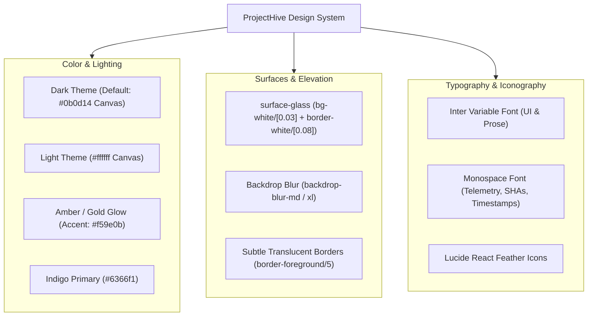

# 17: UI/UX & DESIGN SYSTEM INTELLIGENCE

> **Document Classification:** Visual Design System, Design Tokens & User Experience Architecture  
> **Framework:** Tailwind CSS v4 + Next.js App Router + Framer Motion  
> **Extraction Evidence Level:** `[VERIFIED]` Source Code Inspection (`globals.css`, `ThemeContext.tsx`, Component Files)  

---

## 1. Visual Design Philosophy & Aesthetic Identity

ProjectHive’s design system implements a **studio-grade, dark-first glassmorphic aesthetic** inspired by Linear, Discord, and ProductHunt. The interface balances high information density with clean, modern breathing room, utilizing sub-pixel translucent borders, backdrop blurs, and micro-motion feedback:



---

## 2. Design Tokens & Color Palette

### 2.1 CSS Variables & Semantic Tokens (`globals.css`)

```css
:root {
  --background: #ffffff;
  --foreground: #090d16;
  --card: #f8fafc;
  --card-foreground: #090d16;
  --primary: #4f46e5;
  --primary-foreground: #ffffff;
  --secondary: #f1f5f9;
  --secondary-foreground: #0f172a;
  --muted: #f1f5f9;
  --muted-foreground: #64748b;
  --accent: #f1f5f9;
  --accent-foreground: #0f172a;
  --destructive: #ef4444;
  --destructive-foreground: #ffffff;
  --border: #e2e8f0;
  --input: #e2e8f0;
  --ring: #4f46e5;
  --radius: 0.75rem; /* 12px rounded borders */
}

.dark {
  --background: #07090e; /* Deep Obsidian */
  --foreground: #f8fafc;
  --card: #0d1117;
  --card-foreground: #f8fafc;
  --primary: #6366f1; /* Electric Indigo */
  --primary-foreground: #ffffff;
  --secondary: #161b22;
  --secondary-foreground: #f8fafc;
  --muted: #161b22;
  --muted-foreground: #94a3b8;
  --accent: #1e2530;
  --accent-foreground: #f8fafc;
  --destructive: #f43f5e; /* Rose 500 */
  --destructive-foreground: #ffffff;
  --border: rgba(255, 255, 255, 0.08);
  --input: rgba(255, 255, 255, 0.1);
  --ring: #6366f1;
}
```

### 2.2 Functional Accents
- **Amber Glow (`#f59e0b`):** Reserved for institutional security badges, admin command alerts, and high-visibility live telemetry streams.
- **Emerald Green (`#10b981`):** Indicates active online presence, positive trend metrics, and passing GitHub Actions CI/CD workflows.
- **Cyan / Sky Blue (`#06b6d4` / `#0ea5e9`):** Designates confirmed message read receipts, code snippet syntax highlights, and active WebRTC screen sharing.

---

## 3. Typography & Hierarchy

- **Primary Typeface:** `Inter` (Google Fonts), loaded via `next/font/google` (`--font-inter`) with variable font weights:
  - `font-black` (900): Section hero headings (`tracking-tight`).
  - `font-bold` (700): Card headers, modal titles, student display names.
  - `font-semibold` (600): Navigation labels, form buttons, tab headers.
  - `font-normal` (400): Prose content, chat messages, post descriptions.
- **Monospace Typeface:** System `font-mono` applied selectively for:
  - Commit SHAs and branch names in GitHub workspace (`font-mono text-xs text-muted-foreground`).
  - Real-time client IP and hardware telemetry in the admin header.
  - Quantitative metrics and counters in KPI stat cards.

---

## 4. Component Anatomy & Interaction Patterns

### 4.1 Navigation Systems
1. **Desktop Collapsible & Resizable Sidebar (`Sidebar.tsx`):**
   - Width dynamically drags between 200px and 380px via `GripVertical` handle; collapses to a 72px icon tray on toggle or `Ctrl+B`.
   - Active routes are highlighted with an accent pill and subtle background fill.
2. **Command Search Topbar (`Topbar.tsx`):**
   - Pressing `Cmd+K` or `Ctrl+K` mounts a centered spotlight search modal with 200ms debounced queries across students, squads, and projects.
   - Houses quick notification popovers, light/dark theme toggles, and user profile menus.
3. **Mobile Navigation Dock (`MobileNav.tsx`):**
   - Fixed bottom tab bar for viewports < 768px with safe-area padding (`pb-[env(safe-area-inset-bottom)]`).
   - Quick icons for Dashboard, Feed, Messages, Teams, and More.

### 4.2 Modal & Drawer System
- **Framer Motion Orchestration:** Modals mount with an ease-out spring transition (`initial={{ opacity: 0, scale: 0.95 }} animate={{ opacity: 1, scale: 1 }}`).
- **Backdrop Blur:** Modals and slide-over drawers use dark scrim overlays (`bg-black/60 backdrop-blur-md`).
- **Dismiss Ergonomics:** All dialogs dismiss on Escape key press or backdrop click.

---

## 5. Responsive Breakpoint Matrix

| Viewport Category | Width Range | Layout Adaptation | Tested Behavior |
|---|---|---|---|
| **Mobile** | `< 640px` | Sidebar hidden; `MobileNav` docks to bottom; Topbar renders compact hamburger; Call overlay defaults to full portrait; PiP docks top-right. | FULLY WORKING |
| **Tablet** | `640px – 1023px`| Sidebar collapses to icon-only mode (72px); grid cards reflow to 2 columns; Topbar search becomes compact button. | FULLY WORKING |
| **Desktop** | `1024px – 1439px`| Full resizable sidebar (260px); 3-column dashboard grids; split master-detail view in messages; Admin console unlocked. | FULLY WORKING |
| **Ultra-Wide** | `>= 1440px` | Content bounded to `max-w-7xl` centered; extra telemetry widgets visible in admin header (DB latency, socket counters). | FULLY WORKING |

