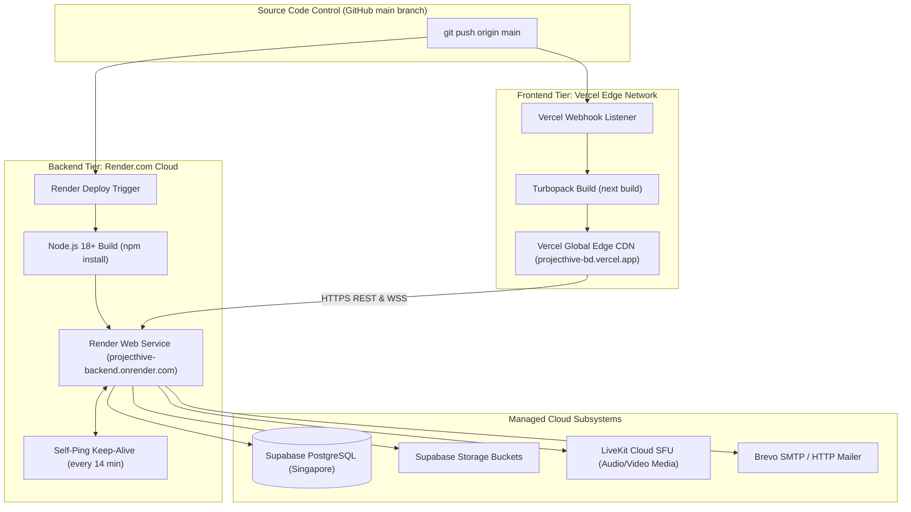

# 20: DEPLOYMENT & INFRASTRUCTURE TOPOLOGY

> **Document Classification:** DevOps, CI/CD & Deployment Blueprint  
> **Production Hosts:** Vercel (Edge Client) + Render.com (Backend Web Service) + Supabase (Database/Storage)  
> **Extraction Evidence Level:** `[VERIFIED]` Configuration Files (`render.yaml`, `vercel.json`, `next.config.ts`)  

---

## 1. Production Deployment Topology

ProjectHive utilizes a decoupled edge-and-cloud architecture deployed across three managed platforms:



---

## 2. Infrastructure Deployment Specifications

### 2.1 Frontend Hosting: Vercel
- **Platform:** Vercel (Hobby / Production Tier)
- **Production URL:** `https://projecthive-bd.vercel.app`
- **Root Directory:** `frontend/`
- **Build Command:** `next build`
- **Output Directory:** `.next`
- **Deployment Trigger:** Automatic on every push to `main` branch.
- **Redirect Engine:** `frontend/next.config.ts` enforces 301 redirects for legacy routes.

### 2.2 Backend Hosting: Render.com
- **Platform:** Render.com (Web Service)
- **Service Name:** `projecthive-backend`
- **Service ID:** `srv-d8mhi8rtqb8s73c3n5qg`
- **Production API Base:** `https://projecthive-backend.onrender.com/api`
- **WebSocket Endpoint:** `wss://projecthive-backend.onrender.com`
- **Root Directory:** `server/`
- **Build Command:** `npm install`
- **Start Command:** `node server.js`
- **Auto-Deploy:** Enabled on push to `main` branch.
- **Health Check Endpoint:** `/health` (returns HTTP 200 `{ status: "ok" }`).

### 2.3 Render IaC Specification (`render.yaml`)
```yaml
services:
  - type: web
    name: projecthive-backend
    env: node
    plan: free
    region: oregon
    rootDir: server
    buildCommand: npm install
    startCommand: node server.js
    healthCheckPath: /health
    autoDeploy: true
    envVars:
      - key: NODE_ENV
        value: production
      - key: PORT
        value: 5000
```

---

## 3. Environment Variable Requirements Matrix

| Variable Name | Required In | Sensitivity | Purpose & Description |
|---|---|---|---|
| `PORT` | Server | Low | Port for Express HTTP and WebSocket server (defaults to 5000). |
| `NODE_ENV` | Client & Server | Low | Environment indicator (`development` or `production`). |
| `NEXT_PUBLIC_API_URL` | Frontend | Low | Production Express API URL (`https://projecthive-backend.onrender.com/api`). |
| `NEXT_PUBLIC_SOCKET_URL` | Frontend | Low | Production WebSocket base URL (`https://projecthive-backend.onrender.com`). |
| `SUPABASE_URL` | Server | Medium | Supabase project URL (`https://iekfvgjxkmgduxdvkuxf.supabase.co`). |
| `SUPABASE_ANON_KEY` | Server | Medium | Supabase anonymous API key. |
| `SUPABASE_SERVICE_ROLE_KEY` | Server | **High (Secret)** | Supabase service-role JWT for administrative database queries. |
| `JWT_SECRET` | Server | **High (Secret)** | Master secret key for HMAC-SHA256 access and refresh token signing. |
| `JWT_EXPIRES_IN` | Server | Low | Access token expiration duration (defaults to `24h`). |
| `REFRESH_TOKEN_EXPIRES_IN` | Server | Low | Refresh token expiration duration (defaults to `7d`). |
| `ADMIN_EMAIL` | Server | Medium | Email address automatically granted `role = 'admin'` upon login. |
| `ADMIN_PASSWORD` | Server | **High (Secret)** | Dedicated password for standalone admin login (`/api/admin/auth/login`). |
| `GROQ_API_KEY` | Server | **High (Secret)** | Groq Cloud API key powering Tier 1 ultra-fast inference. |
| `GEMINI_API_KEY` | Server | **High (Secret)** | Google AI Studio API key powering Tier 2 multimodal vision inference. |
| `OPENROUTER_API_KEY` | Server | **High (Secret)** | OpenRouter API key powering Tier 3 zero-rate-limit fallback pool. |
| `LIVEKIT_URL` | Server & Frontend | Medium | LiveKit Cloud WebSocket URL (`wss://project-hive-o0q9p17e.livekit.cloud`). |
| `LIVEKIT_API_KEY` | Server | **High (Secret)** | LiveKit Cloud API key used for minting video grants. |
| `LIVEKIT_API_SECRET` | Server | **High (Secret)** | LiveKit Cloud secret key used for signing video grant JWTs. |
| `BREVO_API_KEY` | Server | **High (Secret)** | Brevo API key for transactional emails. |
| `BREVO_FROM_EMAIL` | Server | Medium | Verified sender email address in Brevo. |
| `REDIS_URL` | Server | **High (Secret)** | Optional Upstash Redis URL for multi-container Socket.IO clustering. |

---

## 4. Local Development Environment Setup

Local development is coordinated via `start-project.bat` located in the repository root:
1. Opens Terminal 1: Launches Express backend on `http://localhost:5000` via `node server.js`.
2. Opens Terminal 2: Launches Next.js client on `http://localhost:3000` via `npm run dev`.
3. Client automatically resolves local backend URL (`http://localhost:5000/api`) when hostname is `localhost` or `127.0.0.1`.

