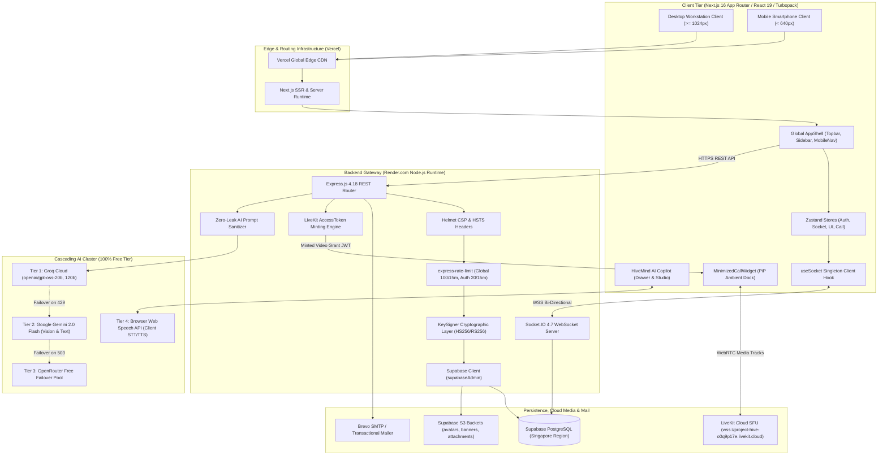
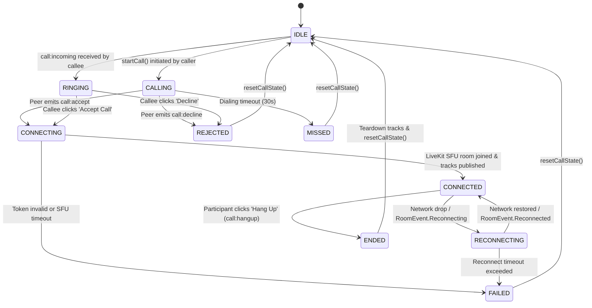
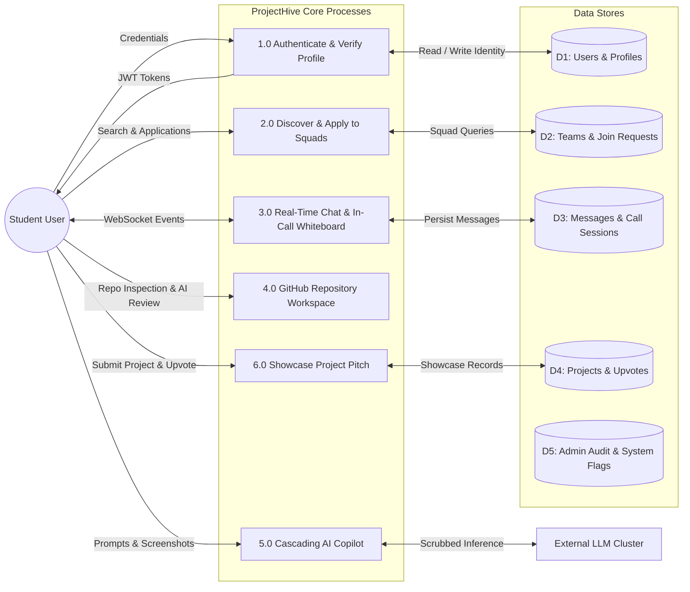
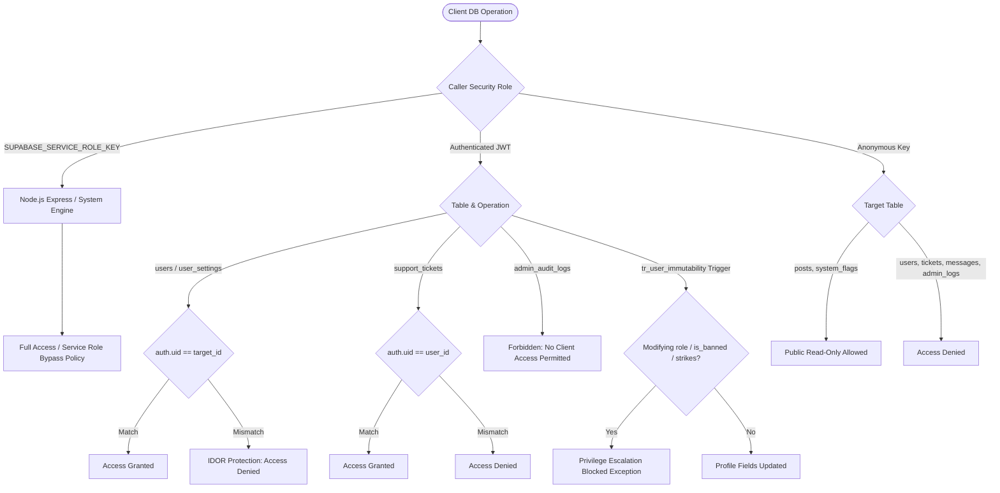

# 23: COMPREHENSIVE SYSTEM ARCHITECTURE DIAGRAMS

> **Document Classification:** Master Visual Architectural Reference & Diagram Repository  
> **Extraction Evidence Level:** `[VERIFIED]` Architecture Specifications & Runtime Models  

---

## 1. Master System Topology

---

## 2. LiveKit WebRTC Call State Machine

---

## 3. Data Flow Diagram: Level 1 (Collaborative Incubation)

---

## 4. Zero-Trust Security & Row Level Security (RLS) Isolation Architecture

