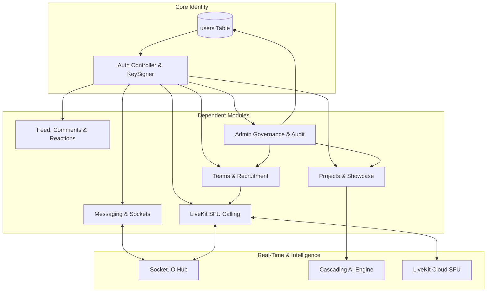

# 24: FEATURE DEPENDENCY & SUBSYSTEM INTERACTION MAP

> **Document Classification:** Cross-Functional Dependency Graph & Subsystem Tracing  
> **Extraction Evidence Level:** `[VERIFIED]` End-to-End Code Trace  

---

## 1. Master Cross-Subsystem Traceability Matrix

The following matrix traces every major feature from user interface components down to persistent database tables and external third-party cloud services:

| Feature Domain | Primary UI Components | Frontend API Methods | Express Routes & Controllers | Persistent Database Tables | External Cloud Dependencies |
|---|---|---|---|---|---|
| **Authentication & Profile** | `LoginPage.tsx` `RegisterPage.tsx` `ProfilePage.tsx` | `api.auth.login` `api.auth.register` `api.users.me` | `/api/auth/login` `/api/auth/register` `auth.controller.js` | `users` | Supabase PostgreSQL Brevo SMTP Cloudflare Turnstile |
| **People Discovery & Endorsements** | `PeoplePage.tsx` `UserProfileHoverCard.tsx` `UserAvatar.tsx` | `api.users.getPeople` `api.users.endorseSkill` `api.friends.sendRequest` | `/api/users/people` `/api/users/:id/skills/:id/endorse` `users.controller.js` | `users` `skills` `skill_endorsements` `friend_requests` | Supabase Storage (`avatars`) |
| **Squad Formation & Recruitment** | `TeamsHubPage.tsx` `CreateTeamPage.tsx` `JoinRequestModal.tsx` | `api.teams.getAll` `api.teams.create` `api.teams.postJoinRequest` | `/api/teams` `/api/teams/:id/join` `teams.controller.js` | `teams` `team_members` `join_requests` `notifications` | Supabase PostgreSQL |
| **Squad Workspace & Management** | `TeamWorkspacePage.tsx` `JoinRequestsDrawer.tsx` | `api.teams.getById` `api.teams.kickMember` `api.teams.transferLeadership`| `/api/teams/:id` `/api/teams/:id/members/:mid` `teams.controller.js` | `teams` `team_members` `messages` | Supabase PostgreSQL |
| **Unified Messaging Studio** | `MessagesPage.tsx` `VoiceMessagePlayer.tsx` | `api.messages.getRoom` `api.messages.getDMs` `api.messages.react` | `/api/messages/conversations` `/api/messages/:id` `messages.controller.js` | `messages` `conversation_pins` `message_reactions` `friends` | Socket.IO Server Supabase Storage (`attachments`) |
| **LiveKit SFU Video Calling** | `CallManager.tsx` `ActiveCallOverlay.tsx` `MinimizedCallWidget.tsx` | `api.calls.getToken` `api.calls.end` `useLiveKitRoom()` | `/api/calls/token` `/api/calls/end` `calls.controller.js` | `call_sessions` `call_participants` | LiveKit Cloud SFU Metered.ca STUN/TURN |
| **In-Call Whiteboard** | `InCallWhiteboard.tsx` | Handled via Socket hook (`socket.emit('whiteboard:draw')`) | Realtime Socket Hub (`socket.service.js`) | Ephemeral (In-Memory Canvas Sync) | Socket.IO Engine |
| **Showcase & Upvoting** | `ProjectsPage.tsx` `SubmitProjectModal.tsx` | `api.projects.list` `api.projects.create` `api.projects.upvote` | `/api/projects` `/api/projects/:id/upvote` `projects.controller.js` | `projects` `project_likes` `saved_projects` | Supabase PostgreSQL |
| **GitHub Dev Workspace** | `ProjectDevelopmentPage.tsx` `ReadmeViewer.tsx` `CodeViewer.tsx` | `api.github.getRepoOverview` `api.github.getRepoTree` `api.github.performAiReview` | `/api/github/repo/*` `/api/github/ai-review` `github.controller.js` | `projects` `users` (reads `github_token`) | GitHub REST API v3 Groq / Gemini AI |
| **HiveMind AI Studio** | `HiveAIWorkspace.tsx` `HiveAICopilotDrawer.tsx` `HiveAIComposer.tsx` | `api.ai.execute` `api.ai.chat` `voiceEngine.startListening` | `/api/ai/execute` `/api/ai/chat` `ai.controller.js` | None (Stateless inference) | Groq Cloud Google AI Studio OpenRouter Web Speech API |
| **Campus Social Feed** | `PostComposerModal.tsx` `PostCard.tsx` `ReactionDock.tsx` | `api.posts.list` `api.posts.create` `api.posts.react` | `/api/posts` `/api/posts/:id/react` `posts.controller.js` | `posts` `post_reactions` `post_comments` `saved_posts` | Supabase Storage (`attachments`) |
| **Institutional Governance** | `AdminOverviewPage.tsx` `AdminUsersPage.tsx` `AdminSystemPage.tsx` | `api.admin.getStats` `api.admin.banUser` `api.admin.updateFlags` | `/api/admin/*` `admin.controller.js` `adminAuthMiddleware` | `system_flags` `admin_audit_logs` `content_reports` `user_strikes` | Supabase PostgreSQL |

---

## 2. Upstream & Downstream Subsystem Dependencies

