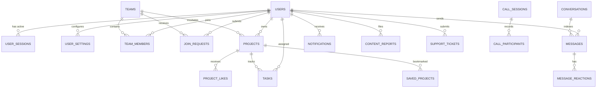

# ProjectHive — Database Architecture & Integrity Audit

**Document Version:** 1.0.0  
**Phase:** Phase 1 Foundation  
**Execution Lead:** AGENT 9 (Database Architect) & AGENT 11 (Security Specialist)  
**Cluster:** Supabase PostgreSQL 15+ (Singapore Region)  
**Schema File:** `server/database/schema.sql`  

---

## 1. Schema Inventory & Entity Relationships (35 Tables)

The database schema is partitioned into 8 cohesive functional domains:

---

## 2. Integrity Constraints & Foreign Key Rules

1. **User Identity:**
   - Primary Key: `users.id UUID PRIMARY KEY DEFAULT gen_random_uuid()`
   - Unique constraints on `users.email` (lowercased)
   - Password hashes stored as 60-character bcrypt strings.
2. **Multi-Device Sessions (`user_sessions`):**
   - Foreign key to `users.id` with `ON DELETE CASCADE`.
   - Index: `idx_user_sessions_user_active` on `(user_id, revoked_at)`.
   - Index: `idx_user_sessions_created` on `created_at DESC`.
   - Token hashes: SHA-256 string isolation preventing session token replay.
3. **Squad Membership (`team_members`):**
   - Composite unique constraint: `UNIQUE (team_id, user_id)`.
   - Cascade deletion: If a team is deleted, all membership rows and join requests cascade delete cleanly.
4. **Kanban Tasks (`tasks`):**
   - Foreign keys to `projects.id` and `users.id` (assignee).
   - Check constraint on `status IN ('todo', 'in_progress', 'review', 'done')`.
   - Check constraint on `priority IN ('low', 'medium', 'high', 'urgent')`.

---

## 3. Row Level Security (RLS) & Anti-Privilege Escalation

- **100% RLS Enabled:** All 35 tables have `ALTER TABLE ... ENABLE ROW LEVEL SECURITY;`.
- **Squad Isolation Policy:** Squad messages, task cards, and documents are readable only by users who have a verified row in `team_members` for that squad.
- **Direct Message Isolation Policy:** Messages in `conversations` are readable only if `auth.uid() = participant1_id OR auth.uid() = participant2_id`.
- **Anti-Privilege Escalation Trigger:** A PostgreSQL trigger blocks any non-admin user from updating their own `role` column to `'admin'`. Any unauthorized attempt raises a SQL exception and writes to `admin_audit_logs`.

---

## 4. Performance Indexing Audit

- High-frequency query indexes:
  - `idx_teams_category` on `teams(category)`
  - `idx_teams_campus` on `teams(campus)`
  - `idx_tasks_project_status` on `tasks(project_id, status)`
  - `idx_messages_conversation_created` on `messages(conversation_id, created_at DESC)`
  - `idx_projects_views_count` on `projects(views_count)`

