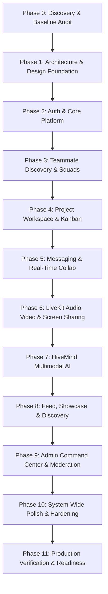

# ProjectHive — Implementation Roadmap & Execution Plan

**Document Version:** 1.0.0  
**Phase:** Master Orchestration Roadmap  
**Execution Lead:** AGENT 0 (Lead Architect & Orchestrator)  
**Standard:** Coordinated Multi-Agent Phase Gates (Phases 0 through 11)  

---

## 1. Phase Gate Definitions & Timeline

---

## 2. Phase-by-Phase Execution Specifications

### Phase 0: Discovery & Baseline
- **Lead Agents:** AGENT 0 (Lead Architect), AGENT 1 (SRS Analyst), AGENT 2 (REA Specialist).
- **Core Deliverables:** `PROJECTHIVE_MASTER_AUDIT.md`, `PROJECTHIVE_REA_REFERENCE_MATRIX.md`.
- **Quality Gate:** Full repository, routes, schema, and test suite audit approved.

### Phase 1: Research, Architecture & Design Foundation
- **Lead Agents:** AGENT 3 (Product Design & Craft), AGENT 4 (Frontend Architect), AGENT 9 (Backend Architect).
- **Core Deliverables:** `PROJECTHIVE_DESIGN_SYSTEM.md`, `PROJECTHIVE_SYSTEM_ARCHITECTURE.md`, `PROJECTHIVE_API_CONTRACTS.md`, `PROJECTHIVE_DATABASE_AUDIT.md`, `PROJECTHIVE_ROLE_PERMISSION_MATRIX.md`.
- **Quality Gate:** All interface tokens and architectural contracts approved.

### Phase 2: Authentication & Core Platform
- **Lead Agents:** AGENT 5 (Auth & Profile), AGENT 11 (Security Specialist).
- **Core Deliverables:** Registration, 6-digit OTP email verification, JWT access tokens, SHA-256 session token hashing, multi-device session audit, and remote session revocation.
- **Quality Gate:** Zero-trust authentication test passes with active session revocation verified.

### Phase 3: Student Discovery & Team Formation
- **Lead Agents:** AGENT 6 (Team & Project Specialist), AGENT 4 (Frontend Architect).
- **Core Deliverables:** Searchable squad directory, role tag filters, candidate application pitch notes, and leader applicant evaluation drawer.
- **Quality Gate:** End-to-end squad recruitment and member onboarding verified.

### Phase 4: Project Workspace & Management
- **Lead Agents:** AGENT 6 (Team & Project Specialist), AGENT 9 (Backend Architect).
- **Core Deliverables:** 4-column drag-and-drop Kanban board, priority badges, Markdown documentation wiki with live preview, and project showcase.
- **Quality Gate:** Concurrent task updates and database state consistency verified.

### Phase 5: Messaging & Real-Time Collaboration
- **Lead Agents:** AGENT 7 (Realtime Communication Specialist), AGENT 9 (Backend Architect).
- **Core Deliverables:** Socket.IO 4.x room-scoped clusters, 3-tier delivery receipts (`sent` → `delivered` → `read`), image attachments, and emoji reactions.
- **Quality Gate:** Multi-client message synchronization and reconnection verified.

### Phase 6: Audio, Video & Screen Sharing
- **Lead Agents:** AGENT 7 (Realtime Communication Specialist), AGENT 13 (DevOps Specialist).
- **Core Deliverables:** LiveKit Cloud SFU integration, cryptographic KeySigner room token minting, dynamic adaptive bitrate, and floating ambient Picture-in-Picture (PiP) dock.
- **Quality Gate:** Low-latency WebRTC audio/video call verified.

### Phase 7: HiveMind AI
- **Lead Agents:** AGENT 8 (HiveMind AI Specialist).
- **Core Deliverables:** Prompt-to-project blueprint generator, cascading failover pool (Groq Llama 3.3 70B → Gemini 2.5 Flash → OpenRouter), and Web Speech API voice dictation.
- **Quality Gate:** Sub-second generation and automatic provider failover verified.

### Phase 8: Feed, Showcase & Discovery
- **Lead Agents:** AGENT 4 (Frontend Architect), AGENT 6 (Team & Project Specialist).
- **Core Deliverables:** Campus project feed, media mosaic, threaded comments, and project portfolio.
- **Quality Gate:** Optimistic upvoting and clean pagination verified.

### Phase 9: Admin Command Center & Moderation
- **Lead Agents:** AGENT 10 (Admin & Moderation Specialist), AGENT 11 (Security Specialist).
- **Core Deliverables:** Real-time KPI telemetry, slide-out user deep-inspection drawer, remote device session termination, content moderation queue, and immutable audit logs.
- **Quality Gate:** Administrative security checks and audit logging verified.

### Phase 10: System-Wide Polish & Hardening
- **Lead Agents:** AGENT 12 (QA & Automation Specialist), AGENT 3 (Product Design & Craft).
- **Core Deliverables:** Responsive testing (360px to 4K), WCAG accessibility audit, error boundary hardening, and database query optimizations (`.maybeSingle()` defensive checks).
- **Quality Gate:** TypeScript clean build, zero console errors, 0 hydration mismatches.

### Phase 11: Production Verification & Readiness
- **Lead Agents:** AGENT 13 (DevOps Specialist), AGENT 0 (Lead Architect).
- **Core Deliverables:** Vercel edge deployment, Render gateway health verification, production smoke tests, and final completion report.
- **Quality Gate:** All live endpoints reporting healthy.

