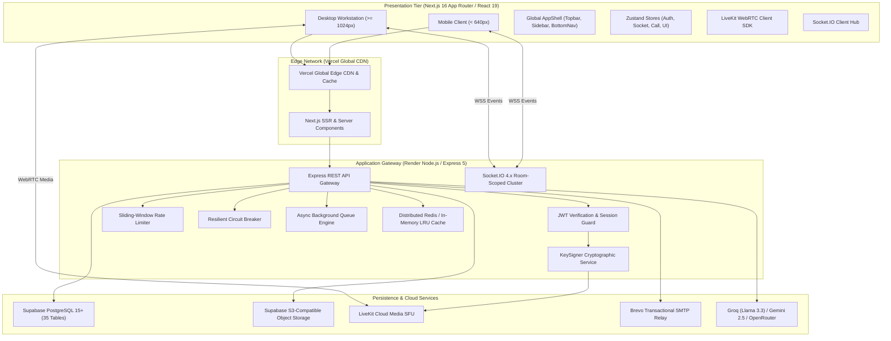

# ProjectHive — System Architecture Specification

**Document Version:** 1.0.0  
**Phase:** Phase 1 Foundation  
**Execution Lead:** AGENT 0 (Lead Architect) & AGENT 9 (Backend Architect)  
**System Topology:** Three-Tier Distributed Client-Server with Real-Time Event Bus and Managed Cloud Persistence  

---

## 1. Architectural Blueprint & Topology

---

## 2. Frontend Subsystem Architecture
- **Framework:** Next.js 16.3.3 utilizing App Router and React 19.2.8.
- **Rendering Model:** Server Components for initial static/public routes (`/`, `/showcase`, `/feed`) combined with Client Components for dynamic workspaces (`/dashboard`, `/teams/[id]`, `/messages`).
- **State Management:** Domain-isolated Zustand stores:
  - `useAuthStore`: Authenticated user session, tokens, and active profile.
  - `useSocketStore`: Socket.IO connection status, online user registry, and typing states.
  - `useCallStore`: LiveKit room credentials, audio/video track states, and PiP widget.
  - `useUIStore`: Sidebar toggles, modal dialogs, and toast queues.

---

## 3. Backend Subsystem Architecture
- **Runtime:** Node.js 20+ LTS with Express 4.18.2 / 5-compatible non-blocking asynchronous event loop.
- **RESTful Endpoints:** 14 modular routers:
  - `/api/auth`: Registration, login, verification, password reset, Google OAuth.
  - `/api/users`: Profile editing, multi-device sessions, location privacy.
  - `/api/teams`: Squad creation, discovery, join requests, member management.
  - `/api/projects`: Project workspaces, Kanban tasks, Markdown wikis.
  - `/api/messages`: Direct messaging, squad chat, message delivery receipts.
  - `/api/calls`: Cryptographic LiveKit room token generation.
  - `/api/ai`: Cascading LLM prompt-to-blueprint generation.
  - `/api/admin`: Administrative metrics, user inspection drawer, moderation.
  - `/api/support`: Student helpline ticketing and two-way status tracking.
  - `/api/posts`, `/api/friends`, `/api/notifications`, `/api/github`, `/api/stories`.

---

## 4. Real-Time Event Architecture (Socket.IO 4.7.2)
- Room-scoped clustering isolates squad chat from direct user-to-user messaging.
- Delivery state tracking dispatches events:
  - `message:sent`: Server persists message to PostgreSQL.
  - `message:delivered`: Client acknowledges delivery.
  - `message:read`: Recipient opens conversation pane.
- WebRTC call signaling dispatches:
  - `call:initiated`, `call:accepted`, `call:rejected`, `call:ended`.

---

## 5. Security & High-Availability Architecture
- **Zero-Trust Persistence:** 100% PostgreSQL Row Level Security (RLS) enforcement.
- **Cryptographic KeySigner:** Isolates `LIVEKIT_API_SECRET` from web controllers.
- **Session Token Hashing:** User session tokens are hashed via SHA-256 before storage in `user_sessions`.
- **Circuit Breaker:** Fails fast after 5 consecutive external API timeouts to prevent thread starvation.
- **Multi-Level Cache:** Redis distributed cache with transparent in-memory LRU fallback.

