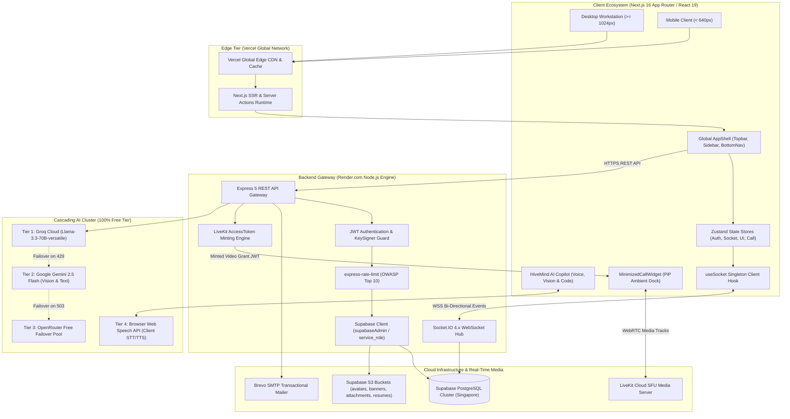
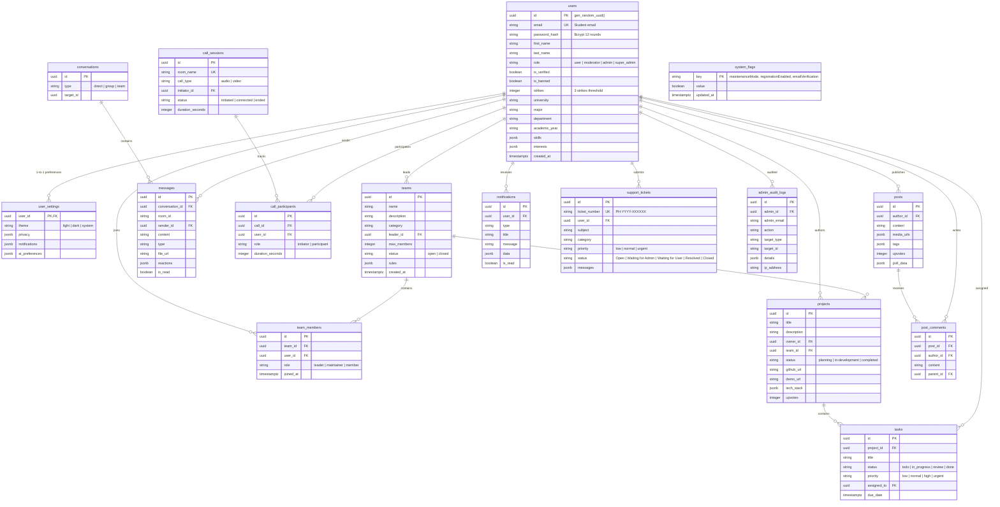
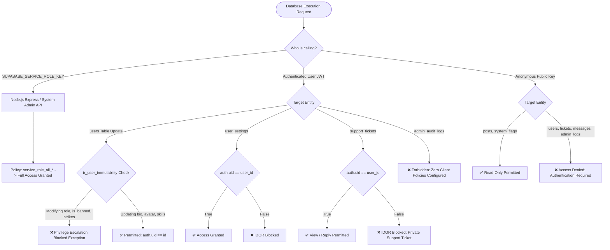
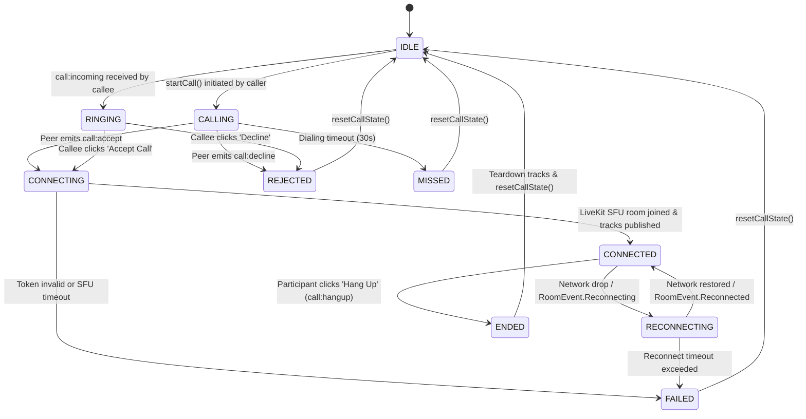
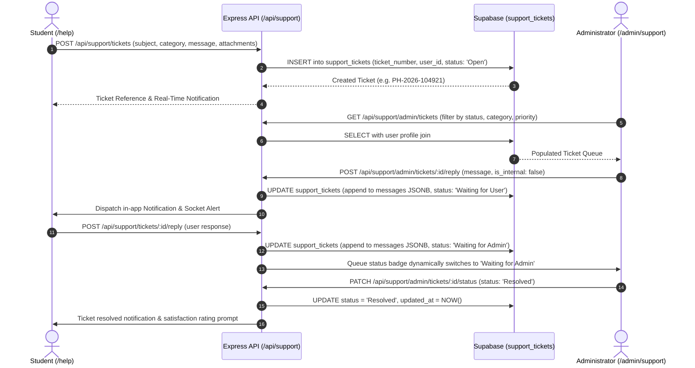

<p align="center">
  
</p>

<h1 align="center">ProjectHive 🐝</h1>

<p align="center">
  <strong>The Next-Generation University Project Incubation, Teammate Discovery & Real-Time Collaboration Ecosystem</strong>
</p>

<p align="center">
  <a href="https://projecthive-bd.vercel.app"></a>
  <a href="https://react.dev"></a>
  <a href="https://projecthive-backend.onrender.com"></a>
  <a href="https://supabase.com"></a>
  <a href="https://socket.io"></a>
  <a href="https://livekit.io"></a>
  <a href="https://groq.com"></a>
  <a href="LICENSE"></a>
</p>

---

## 📑 Table of Contents
1. [Documentation Portal & Architecture Specs (`docs/`)](#-documentation-portal--technical-specifications)
2. [Executive Overview](#-executive-overview)
3. [Live Deployments & Infrastructure](#-live-deployments--infrastructure)
4. [Master System Architecture](#-master-system-architecture)
5. [Database Entity-Relationship Architecture (16 Tables)](#-database-entity-relationship-architecture-16-tables)
6. [Zero-Trust Security & Row Level Security (RLS) Flow](#-zero-trust-security--row-level-security-rls-flow)
7. [LiveKit WebRTC Call State Machine](#-livekit-webrtc-call-state-machine)
8. [Cascading Multimodal AI Engine](#-cascading-multimodal-ai-engine)
9. [Two-Way Helpline & Support Management](#-two-way-helpline--support-management)
10. [Frontend Application Map (39 Routes)](#-frontend-application-map-39-routes)
11. [Backend REST & WebSocket API Reference](#-backend-rest--websocket-api-reference)
12. [Quickstart & Local Environment Setup](#-quickstart--local-environment-setup)
13. [Verification & Health Auditing](#-verification--health-auditing)
14. [License](#-license)

---

## 📚 Documentation Portal & Technical Specifications

Detailed engineering blueprints, API references, security threat models, and setup guides are maintained in the [`docs/`](./docs/README.md) directory:

| Section | Focus Area | Master Document |
| :--- | :--- | :--- |
| 🏛️ **Architecture** | Master Topology, 3D WebGL, SFU Calling & Sequence Diagrams | [docs/architecture/SYSTEM_ARCHITECTURE.md](./docs/architecture/SYSTEM_ARCHITECTURE.md) |
| 🗄️ **Database** | PostgreSQL Schemas, RLS Policies, ERD & Indexing | [docs/architecture/DATA_MODELS_AND_ERD.md](./docs/architecture/DATA_MODELS_AND_ERD.md) |
| 🛡️ **Security** | Defense-in-Depth, Admin Isolation, RBAC & Audit Report | [docs/security/SECURITY_ARCHITECTURE.md](./docs/security/SECURITY_ARCHITECTURE.md) |
| 🔌 **REST API** | Endpoint Contracts, JSON Envelope & Error Codes | [docs/api/API_REFERENCE.md](./docs/api/API_REFERENCE.md) |
| ⚡ **WebSockets** | Socket.IO Events, Room Lifecycle & Signaling Protocol | [docs/api/WEBSOCKET_EVENTS.md](./docs/api/WEBSOCKET_EVENTS.md) |
| 🚀 **Deployment** | Vercel, Render, Supabase & Cloudflare Setup | [docs/setup/DEPLOYMENT_AND_SETUP.md](./docs/setup/DEPLOYMENT_AND_SETUP.md) |
| 🎙️ **LiveKit SFU** | Managed WebRTC Calling, Dynacast & NAT Traversal | [docs/setup/LIVEKIT_SFU_GUIDE.md](./docs/setup/LIVEKIT_SFU_GUIDE.md) |
| 🎨 **Design System**| Obsidian Slate & Amber Tokens, 3D Physics & Auto-Sync | [docs/ui-ux/DESIGN_SYSTEM.md](./docs/ui-ux/DESIGN_SYSTEM.md) |
| 🎓 **Academic** | University Presentation Dossier & Defense Scripts | [docs/academic/SYSTEM_ANALYSIS_LAB_MANUAL.md](./docs/academic/SYSTEM_ANALYSIS_LAB_MANUAL.md) |

---

## 🌟 Executive Overview

**ProjectHive** is an industrial-grade collaborative platform designed to transform how university students, researchers, and aspiring founders build teams, manage hackathon sprints, communicate in real time, and incubate technical software.

Engineered to the visual and reliability benchmarks of **Discord, WhatsApp, GitHub, and Linear**, ProjectHive delivers:
- **Discord-Grade Academic Squads (`/teams/[id]`)**: Real-time recruitment status indicators, applicant evaluation drawers, leadership delegation, and room-scoped team chat.
- **WhatsApp-Grade Real-Time Messaging (`/messages`)**: Socket.IO bi-directional communication, delivery state tracking (`sent` → `delivered` → `read`), interactive emoji reactions, and clipboard screenshot pasting (`Ctrl+V`).
- **LiveKit Cloud SFU Audio/Video Calling**: Low-latency multi-peer calling with dynamic bitrate adaptation and a floating Picture-in-Picture (PiP) ambient widget.
- **Google Classroom & Canvas-Grade Academic Mesh**: Sprint milestone countdowns, rubric criteria checklists, and GitHub deliverable turn-ins.
- **Notion-Grade Markdown Project Wikis**: Collaborative documentation boards with persistent real-time database storage.
- **Cascading Multimodal AI ("HiveMind AI")**: Sub-second reasoning via Groq Cloud (Llama 3.3 70B), visual analysis via Google Gemini 2.5 Flash, and free failover pools via OpenRouter, paired with Browser Web Speech API for voice dictation.
- **Two-Way Connected Helpline System (`/help` ↔ `/admin/support`)**: Unified student ticketing interface with real-time status notifications, admin investigation tools, and internal staff notes.
- **Industrial Zero-Trust Security**: 100% Row Level Security (RLS) enforcement, database-level anti-privilege escalation triggers, folder-isolated object storage, and tamper-proof admin audit logging.

---

## 🌐 Live Deployments & Infrastructure

| Tier | Component | Environment | Live Endpoint | Status |
|:---|:---|:---|:---|:---:|
| 🌐 **Client** | Next.js 16 App Router | Vercel Edge | [projecthive-bd.vercel.app](https://projecthive-bd.vercel.app) | `ACTIVE` |
| 👑 **Admin** | Super Admin Command Center | Vercel Edge | [projecthive-bd.vercel.app/admin/login](https://projecthive-bd.vercel.app/admin/login) | `ACTIVE` |
| ⚙️ **API Gateway** | Express 5 REST Engine | Render.com | [projecthive-backend.onrender.com/api](https://projecthive-backend.onrender.com/api) | `ACTIVE` |
| 🔌 **WebSocket** | Socket.IO Event Hub | Render.com | `wss://projecthive-backend.onrender.com` | `ACTIVE` |
| 🗄️ **Database** | Supabase PostgreSQL 15+ | Singapore Cluster | `iekfvgjxkmgduxdvkuxf.supabase.co` | `ACTIVE` |
| 🎙️ **Media SFU** | LiveKit Cloud Media Hub | LiveKit Global | `wss://project-hive-o0q9p17e.livekit.cloud` | `ACTIVE` |
| 📧 **Mail Relay** | Brevo Transactional SMTP | Brevo Cloud | `smtp-relay.brevo.com:587` | `ACTIVE` |

---

## 📐 Master System Architecture

ProjectHive is built on an asynchronous, event-driven topology separating static edge delivery from stateful real-time processing and managed cloud persistence:



---

## 🗄️ Database Entity-Relationship Architecture (16 Tables)

The entire persistent database is consolidated into a **single canonical master file**:  
📁 [`server/database/schema.sql`](file:///c:/Users/TIMON/Desktop/Project-Hive/server/database/schema.sql)



---

## 🔒 Zero-Trust Security & Row Level Security (RLS) Flow

Security is not assumed; it is enforced deterministically at the database kernel level through PostgreSQL Row Level Security (RLS) policies and immutable triggers:



---

## 🎙️ LiveKit WebRTC Call State Machine

Audio and video calls transition through a deterministic lifecycle, guaranteeing automatic reconnection, room cleanup, and zero orphaned sessions:



---

## 🤖 Cascading Multimodal AI Engine

HiveMind AI features sub-second response times and zero-downtime reliability by cascading requests across multiple free-tier model providers:

```mermaid
flowchart LR
    UserInput([User Prompt / Code / Image]) --> ContentType{Payload Type}

    ContentType -->|Image / Screenshot| GeminiTier[Google Gemini 2.5 Flash]
    ContentType -->|Text / Code Debug| GroqTier[Groq Cloud: Llama 3.3 70B]

    GroqTier -->|Success (< 500ms)| Response([Synthesized Response])
    GroqTier -.->|Rate Limit / 429| GeminiTier

    GeminiTier -->|Success| Response
    GeminiTier -.->|Unavailable / 503| OpenRouterTier[OpenRouter Free Tier Failover Pool]

    OpenRouterTier -->|Success| Response
    OpenRouterTier -.->|All Exhausted| LocalFallback[Local Fallback Heuristics]

    Response --> WebSpeech[Browser Web Speech API: Voice Synthesis Readback]
```

---

## 🎫 Two-Way Helpline & Support Management

The helpline links the public student interface (`/help`) with the administrator investigation terminal (`/admin/support`), providing complete two-way resolution workflows:



---

## 📱 Frontend Application Map (39 Routes)

The Next.js 16 App Router application compiles into **39 optimized production routes** categorized into three primary zones:

```text
frontend/src/app/
├── (app)/                          # Authenticated Student Zone
│   ├── dashboard/                  # Personalized student feed, task list, squad status
│   ├── feed/                       # Campus social feed, interactive polls, code snippets
│   ├── friends/                    # Peer connections and collaboration requests
│   ├── generator/                  # AI sprint task and project idea generator
│   ├── help/                       # Two-way student assistance helpline & ticket tracker
│   ├── messages/                   # Socket.IO direct & team chat with delivery receipts
│   ├── notifications/              # In-app real-time notification center
│   ├── people/                     # Student directory and skill-based teammate finder
│   ├── profile/                    # Personal portfolio, verified badges, academic credentials
│   │   ├── [id]/                   # Public peer portfolio inspection
│   │   └── view/                   # Self profile preview mode
│   ├── projects/                   # Incubation project directory & filtering
│   │   └── [id]/development/       # Project sprint Kanban task board & repo workspace
│   ├── saved/                      # Bookmarked projects, squads, and posts
│   ├── settings/                   # Theme toggle, notification channels, privacy controls
│   ├── showcase/                   # University product showcase & hackathon pitches
│   └── teams/                      # Squad discovery & recruitment
│       ├── [id]/                   # Discord-grade squad workspace (roster, chat, applicants)
│       └── create/                 # Squad creation wizard
│
├── admin/                          # Super Admin Control Center
│   ├── login/                      # Dedicated administrative authentication terminal
│   ├── dashboard/                  # Live system telemetry, node ping, server health metrics
│   ├── audit/                      # Terminal-style immutable audit trail viewer
│   ├── moderation/                 # Content moderation (reported posts, attachment scans)
│   ├── support/                    # Helpline administration, ticket queues, investigation
│   ├── system/                     # Feature kill switches (maintenance mode, registration)
│   ├── teams/                      # University-wide squad governance & dispute mediation
│   └── users/                      # User management (disciplinary strikes, bans, role changes)
│
└── public/                         # Public & Authentication Landing Zone
    ├── /                           # High-converting landing page with live statistics
    ├── login/                      # Student authentication (email/password, Google OAuth)
    ├── register/                   # Student registration & university credential intake
    ├── forgot-password/            # Password recovery dispatch
    ├── reset-password/             # Secure token-based password reset
    ├── verify-email/               # Email verification callback handler
    ├── privacy/                    # Platform privacy policy (GDPR & FERPA aligned)
    └── terms/                      # Platform terms of service
```

---

## 🔌 Backend REST & WebSocket API Reference

The Express 5 backend powers **14 modular route controllers** accessible under the `/api` prefix:

| Controller Module | Route Prefix | Primary Endpoints | Access Control |
|:---|:---|:---|:---:|
| **Authentication** | `/api/auth` | `/register`, `/login`, `/google`, `/refresh`, `/logout`, `/verify-email` | Public |
| **Admin Authentication** | `/api/admin/auth` | `/login`, `/me`, `/logout` | Super Admin |
| **Admin Management** | `/api/admin` | `/stats`, `/users`, `/teams`, `/audit-logs`, `/system-flags`, `/ban` | Admin / Super Admin |
| **Users & Profiles** | `/api/users` | `/me`, `/profile/:id`, `/update`, `/skills`, `/badges` | Authenticated |
| **Teams & Squads** | `/api/teams` | `/`, `/:id`, `/create`, `/:id/join`, `/:id/applicants`, `/:id/leave` | Authenticated |
| **Projects & Showcase** | `/api/projects` | `/`, `/:id`, `/create`, `/:id/upvote`, `/showcase` | Authenticated / Public |
| **Kanban Tasks** | `/api/tasks` | `/:projectId`, `/create`, `/:id/status`, `/:id/assign` | Team Members |
| **Conversations** | `/api/conversations`| `/`, `/:id/messages`, `/direct/:userId` | Authenticated |
| **Messages & Chat** | `/api/messages` | `/send`, `/room/:roomId`, `/react`, `/pin`, `/read` | Authenticated |
| **Audio/Video Calls** | `/api/calls` | `/token`, `/room/:roomName`, `/session`, `/end` | Authenticated |
| **Campus Feed** | `/api/posts` | `/`, `/:id`, `/create`, `/:id/comment`, `/:id/upvote` | Authenticated / Public |
| **Notifications** | `/api/notifications`| `/`, `/:id/read`, `/mark-all-read` | Authenticated |
| **Support Helpline** | `/api/support` | `/tickets`, `/tickets/:id`, `/tickets/:id/reply`, `/admin/*` | Authenticated / Admin |
| **HiveMind AI** | `/api/ai` | `/chat`, `/analyze-image`, `/generate-tasks`, `/pitch` | Authenticated |

---

## 🛠️ Quickstart & Local Environment Setup

### Prerequisites
- **Node.js**: v18.17.0 or higher
- **npm**: v9.0.0 or higher
- **Supabase Account**: (Free tier PostgreSQL database & Storage)
- **LiveKit Cloud Account**: (Free tier WebRTC SFU)
- **Groq & Google Gemini API Keys**: (Free tier AI inference)

### 1. Clone & Install
```bash
git clone https://github.com/Ti838/Project-Hive.git
cd Project-Hive
```

### 2. Configure Environment Variables

**Backend (`server/.env`):**
```env
PORT=5000
NODE_ENV=development
SUPABASE_URL=https://your-supabase-project.supabase.co
SUPABASE_SERVICE_ROLE_KEY=your-supabase-service-role-key
JWT_SECRET=your-super-secure-jwt-secret-key-32-chars-min
ADMIN_EMAIL=timonbiswas33@gmail.com
ADMIN_PASSWORD=ProjectHive@Admin2026!
GROQ_API_KEY=your-groq-api-key
GEMINI_API_KEY=your-gemini-api-key
BREVO_API_KEY=your-brevo-api-key
```

**Frontend (`frontend/.env.local`):**
```env
NEXT_PUBLIC_API_URL=http://localhost:5000/api
NEXT_PUBLIC_SOCKET_URL=http://localhost:5000
NEXT_PUBLIC_LIVEKIT_URL=wss://your-livekit-project.livekit.cloud
```

### 3. Deploy Master Database Schema
1. Open the **[Supabase Dashboard](https://supabase.com/dashboard)** $\rightarrow$ **SQL Editor**.
2. Open [`server/database/schema.sql`](file:///c:/Users/TIMON/Desktop/Project-Hive/server/database/schema.sql).
3. Copy all contents, paste into the SQL Editor, and click **Run**.
4. The database is instantly provisioned with all 16 tables, RLS policies, triggers, and the pre-seeded super administrator!

### 4. Start Development Servers

**Start Backend (Terminal 1):**
```bash
cd server
npm install
npm run dev
```

**Start Frontend (Terminal 2):**
```bash
cd frontend
npm install
npm run dev
```

Visit `http://localhost:3000` to access the student platform, or `http://localhost:3000/admin/login` to access the Super Administrator Command Center.

---

## 🧪 Verification & Health Auditing

Automated CLI verification scripts ensure platform health before any deployment:

```bash
# 1. Verify Supabase Database & Security Policies
node --env-file=server/.env -e "import('./server/config/db.js').then(m => m.connectDB())"

# 2. Test Express Backend Application Loading
node --env-file=server/.env -e "import('./server/app.js').then(() => console.log('✅ Backend Loaded'))"

# 3. Test Full Next.js 16 Production Build
npm run build --prefix frontend
```

---

## 📜 License

ProjectHive is licensed under the **[MIT License](LICENSE)**.

Copyright (c) 2025-2026 ProjectHive Contributors. All rights reserved.
