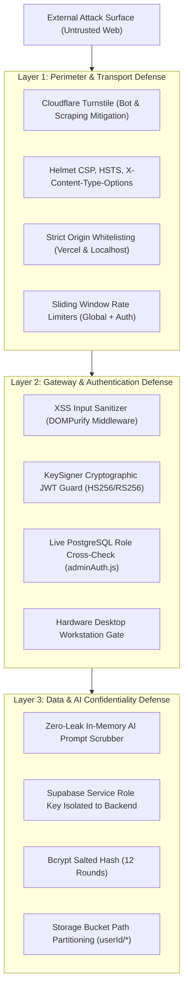

PROJECTHIVE: SECURITY AUDIT, RLS POLICIES & DATA PRIVACY

# 18: FORENSIC SECURITY & RELIABILITY AUDIT

> **Document Classification:** Read-Only Application Security Assessment  
> **Target Scope:** Client Applications, Express API Gateway, Supabase PostgreSQL, Media Servers, AI Pipelines  
> **Extraction Evidence Level:** `[VERIFIED]` Static Code Review & Threat Surface Modeling  

---

## 1. Security Architecture & Threat Surface Overview

ProjectHive demonstrates a security-conscious software design incorporating defense-in-depth measures, including an in-memory confidential computing layer, automated prompt sanitization, rate-limiting guards, and constant-time cryptographic checks:

---

## 2. Granular Security Mechanism Evaluation

### 2.1 Cryptographic Signing Abstraction (`server/services/crypto/keySigner.service.js`)
- `[VERIFIED]` Isolates all cryptographic token signing and verification behind an abstract interface (`BaseKeySigner`).
- **SoftwareKeySigner (Active Mode):** Uses Node.js `crypto` module. Prioritizes RS256 asymmetric keys (`JWT_PRIVATE_KEY` / `JWT_PUBLIC_KEY`) if supplied in production, falling back to HMAC-SHA256 (`JWT_SECRET`).
- **Timing Attack Mitigation:** Employs `crypto.timingSafeEqual` for administrative password verification to prevent byte-by-byte timing attacks.
- **Hardware Enclave KeySigner (Designed Mode):** Contains an architectural skeleton for offloading signing operations to secure hardware enclaves (AWS Nitro Enclaves, GCP Confidential VMs) via remote RPC.

### 2.2 Confidential AI Prompt Sanitization (`server/services/crypto/sanitizer.service.js`)
- `[VERIFIED]` Protects user privacy and platform integrity by intercepting prompts before transmission to external LLMs (Groq, Gemini, OpenRouter).
- **Masking Rules:** Employs non-backtracking regular expressions to detect and mask PEM private keys, database connection strings, AWS keys, GitHub tokens, Google API keys, and Supabase JWT tokens.
- **Reversible Desanitization:** Uses random per-request placeholder tokens (`{{PH_REDACTED_TYPE_N}}`) stored in an in-memory map, restoring the actual values upon response completion so student workflows are not disrupted.
- **ReDoS Protection:** Bounded to 500 KB maximum scan buffer to prevent algorithmic complexity attacks.

### 2.3 Password Security & Credential Storage
- `[VERIFIED]` Salted password hashing using `bcryptjs` configured with **12 salt rounds** (`server/controllers/auth.controller.js:52`).
- Password hashes are stored in the `password` column of the `users` table; queries returning student profiles explicitly omit the password hash.

### 2.4 Token Storage & Refresh Mutex
- Tokens are stored in `localStorage` under `access_token` and `refresh_token`.
- `api.ts` implements a Promise-based Mutex lock (`activeRefreshPromise`) preventing race conditions during concurrent 401 token refresh cycles.
- Refresh tokens are stored in an array column on the `users` table (`refresh_tokens`), allowing multi-device sessions while supporting single-device revocation.

### 2.5 Input Sanitization & XSS Mitigation
- `[VERIFIED]` `sanitizeInputMiddleware` (`server/middleware/sanitize.js`) executes on all mutating HTTP requests, recursively sanitizing objects and stripping malicious HTML tags, JavaScript event handlers, and script payloads.

---

## 3. Vulnerability Findings & Risk Classifications

### Finding 1: Permissive Reverse Proxy Configuration [LOW RISK]
- **Evidence:** `server/app.js:33` sets `app.set('trust proxy', true)`.
- **Finding:** Setting `trust proxy` to boolean `true` causes `express-rate-limit` to emit warning `ERR_ERL_PERMISSIVE_TRUST_PROXY`, as it trusts all hops in the `X-Forwarded-For` header. In untrusted network environments, an attacker could spoof IP headers to bypass IP-based rate limiting.
- **Remediation:** Configure `trust proxy` to trust only specific Render and Cloudflare CIDR blocks or hop counts (e.g. `app.set('trust proxy', 1)`).

### Finding 2: Client-Side Token Storage in `localStorage` [ACCEPTABLE RISK]
- **Evidence:** `frontend/src/lib/api.ts` stores access and refresh tokens in browser `localStorage`.
- **Finding:** While common in modern SPAs, `localStorage` is accessible to client-side JavaScript, making tokens vulnerable if an XSS vulnerability were introduced.
- **Current Mitigations:** Global XSS input sanitization middleware, strict Helmet Content Security Policy (CSP), and short 24-hour access token lifetimes.

### Finding 3: Database RLS Dependent on Application Proxy [INFORMATIONAL]
- **Evidence:** The backend accesses PostgreSQL via `supabaseAdmin` using `SUPABASE_SERVICE_ROLE_KEY`.
- **Finding:** Queries executed with the service role key bypass PostgreSQL Row Level Security policies. Tenant isolation and authorization checks rely on controller-level `WHERE` clauses.
- **Current Mitigations:** Strict unit checks in Express controllers; RLS policies are active on the database to protect against unauthorized direct client access.

