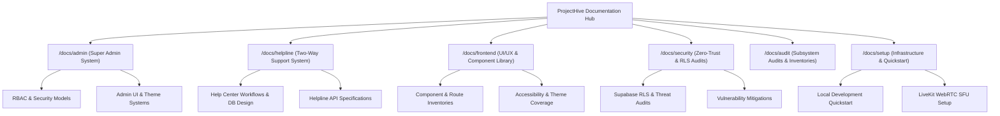

# 📚 ProjectHive Engineering Documentation Hub

> **Central Reference Index for Architecture, Security, Systems Audits & Subsystems**  
> **Repository Single Sources of Truth:**
> - 🌟 [Master Overview (README)](../README.md)
> - 📐 [System Architecture Blueprint (ARCHITECTURE.md)](../ARCHITECTURE.md)
> - 🗄️ [Database Architecture & ER Schema (DATABASE_ARCHITECTURE.md)](../DATABASE_ARCHITECTURE.md)
> - 🔌 [REST API & Real-Time Socket Reference (API_DOCUMENTATION.md)](../API_DOCUMENTATION.md)

---

## 🗺️ Documentation Directory Map

---

## 📂 Subsystem Documentation Index

### 👑 1. Administration & Governance (`docs/admin/`)
Complete architectural specifications, role matrices, and deployment runbooks for the Super Administrator Command Center.
- [`ADMIN_ARCHITECTURE.md`](./admin/ADMIN_ARCHITECTURE.md) — Master Admin Architecture & Controller Topology
- [`ADMIN_RBAC_MATRIX.md`](./admin/ADMIN_RBAC_MATRIX.md) — Role-Based Access Control Matrix (`super_admin`, `admin`, `moderator`, `user`)
- [`ADMIN_SECURITY_MODEL.md`](./admin/ADMIN_SECURITY_MODEL.md) — Defense-in-depth, timing-safe authentication, and audit protection
- [`ADMIN_UI_PATTERN_MATRIX.md`](./admin/ADMIN_UI_PATTERN_MATRIX.md) — Dual desktop/mobile responsive UI patterns
- [`ADMIN_THEME_SYSTEM.md`](./admin/ADMIN_THEME_SYSTEM.md) — 3-Mode Theme Integration in Admin Portal
- [`ADMIN_DEPLOYMENT_GUIDE.md`](./admin/ADMIN_DEPLOYMENT_GUIDE.md) — Zero-downtime deployment instructions
- [`ADMIN_FEATURE_INVENTORY.md`](./admin/ADMIN_FEATURE_INVENTORY.md) — Complete inventory of 14 admin operational features
- [`ADMIN_REFERENCE_RESEARCH.md`](./admin/ADMIN_REFERENCE_RESEARCH.md) — Enterprise admin benchmark analysis (Retool, Supabase Studio, Linear)

---

### 🎫 2. Two-Way Helpline & Support Management (`docs/helpline/`)
Specifications for the bi-directional student helpdesk (`/help`) and administrator investigation center (`/admin/support`).
- [`HELPLINE_ARCHITECTURE.md`](./helpline/HELPLINE_ARCHITECTURE.md) — Two-Way Support System Architecture & Message Flow
- [`HELPLINE_API_SPECIFICATION.md`](./helpline/HELPLINE_API_SPECIFICATION.md) — Endpoints, status transitions, and JSON schemas
- [`HELPLINE_DATABASE_DESIGN.md`](./helpline/HELPLINE_DATABASE_DESIGN.md) — `support_tickets` schema, JSONB message threading, and indexes
- [`HELPLINE_UX_FLOW_ANALYSIS.md`](./helpline/HELPLINE_UX_FLOW_ANALYSIS.md) — Student and admin interaction sequences
- [`HELPLINE_SECURITY_AUDIT.md`](./helpline/HELPLINE_SECURITY_AUDIT.md) — IDOR elimination and private internal notes isolation
- [`HELPLINE_EXISTING_SYSTEM_AUDIT.md`](./helpline/HELPLINE_EXISTING_SYSTEM_AUDIT.md) — Gap analysis and migration history
- [`HELPLINE_REFERENCE_RESEARCH.md`](./helpline/HELPLINE_REFERENCE_RESEARCH.md) — Industry benchmark comparison (Linear, Zendesk, Discord)

---

### 🎨 3. Frontend Architecture & Design System (`docs/frontend/`)
UI/UX patterns, 39 Next.js 16 App Router pages, and responsive design systems.
- [`FRONTEND_ROUTE_INVENTORY.md`](./frontend/FRONTEND_ROUTE_INVENTORY.md) — Exhaustive map of all 39 prerendered and dynamic routes
- [`FRONTEND_COMPONENT_INVENTORY.md`](./frontend/FRONTEND_COMPONENT_INVENTORY.md) — Atomic UI library, layouts, and feature widgets
- [`PROJECTHIVE_DESIGN_SYSTEM.md`](./frontend/PROJECTHIVE_DESIGN_SYSTEM.md) — Tailwind tokens, typography, 100dvh safe areas, and colors
- [`THEME_ARCHITECTURE.md`](./frontend/THEME_ARCHITECTURE.md) — 3-Mode Adaptive Theme Engine (Light, Dark, System Auto)
- [`FRONTEND_ACCESSIBILITY_AUDIT.md`](./frontend/FRONTEND_ACCESSIBILITY_AUDIT.md) — WCAG 2.1 AA touch-target and screen-reader audit
- [`FRONTEND_UX_PATTERN_MATRIX.md`](./frontend/FRONTEND_UX_PATTERN_MATRIX.md) — Linear/Discord-style interaction models
- [`FRONTEND_BACKEND_INTEGRATION_CONTRACT.md`](./frontend/FRONTEND_BACKEND_INTEGRATION_CONTRACT.md) — Typed API Client contract (`api.ts`)

---

### 🛡️ 4. Security, RLS & Threat Audits (`docs/security/`)
Zero-Trust database specifications, vulnerability assessments, and compliance reports.
- [`SUPABASE_SECURITY_AUDIT_REPORT.md`](./security/SUPABASE_SECURITY_AUDIT_REPORT.md) — Comprehensive database security certification
- [`SUPABASE_DATABASE_AUDIT_REPORT.md`](./security/SUPABASE_DATABASE_AUDIT_REPORT.md) — Live CLI verification, RLS policies, and index ledger
- [`SECURITY_AUDIT.md`](./security/SECURITY_AUDIT.md) — OWASP Top 10 web application security review

---

### 🚀 5. Infrastructure & Setup Runbooks (`docs/setup/`)
Setup guides for local development, external services, and production deployment.
- [`QUICKSTART.md`](./setup/QUICKSTART.md) — Step-by-step local development setup guide
- [`LIVEKIT_SETUP.md`](./setup/LIVEKIT_SETUP.md) — LiveKit Cloud SFU WebRTC media server provisioning
- [`STACK.md`](./setup/STACK.md) — Comprehensive technology stack inventory and dependency tree
- [`DEPLOYMENT_READINESS.md`](./setup/DEPLOYMENT_READINESS.md) — Production checklist for Vercel, Render, and Supabase

---

### 🔬 6. Subsystem Audits & Historical Inventories (`docs/audit/`)
Deep-dive feature matrices, reverse engineering reports, and legacy migration history.
- [`EXISTING_FEATURE_INVENTORY.md`](./audit/EXISTING_FEATURE_INVENTORY.md) — Comprehensive platform capability ledger
- [`FEATURE_GAP_MATRIX.md`](./audit/FEATURE_GAP_MATRIX.md) — Target vs actual feature capability mapping
- [`IMPLEMENTATION_TRACKER.md`](./audit/IMPLEMENTATION_TRACKER.md) — Multi-phase engineering roadmap and milestones
- [`PROJECT_AUDIT.md`](./audit/PROJECT_AUDIT.md) — Full repository code health and quality review
- [`TEST_REPORT.md`](./audit/TEST_REPORT.md) — End-to-end integration and smoke test results

---

## 📜 Standards & Contributing

All contributions must adhere to the **Zero-Trust Security Standard**, maintain TypeScript strict-mode compliance, and preserve the single canonical database schema in [`server/database/schema.sql`](../server/database/schema.sql).
