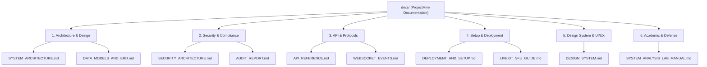

# ProjectHive 🐝 — Documentation Portal & Architectural Index

Welcome to the official technical documentation repository for **ProjectHive**, the university collaboration, squad recruitment, and capstone project incubation operating system.

---

## 📚 Master Documentation Directory

---

## 🗂️ Document Catalog

### 1. Architecture & System Design
- [**System Architecture Blueprint**](./architecture/SYSTEM_ARCHITECTURE.md): Complete system topologies, 3D WebGL canvases, real-time media SFU calling, cascading AI router, and request lifecycle diagrams.
- [**Data Models & ERD Specifications**](./architecture/DATA_MODELS_AND_ERD.md): PostgreSQL entity-relationship diagrams, schema definitions, Row Level Security (RLS) policies, and performance indexes.

### 2. Security & Compliance
- [**Security Architecture & RBAC Matrix**](./security/SECURITY_ARCHITECTURE.md): Defense-in-depth model, administrative physical boundary, live database privilege checks, and STRIDE threat mitigation.
- [**Security Audit & Forensic Report**](./security/AUDIT_REPORT.md): Vulnerability remediation ledger, verification commands, and test pass evidence.

### 3. API & Protocol Specifications
- [**RESTful API Reference**](./api/API_REFERENCE.md): Comprehensive request and response contracts for Auth, Users, Teams, Calls, AI, and Admin operations.
- [**WebSocket & Real-Time Event Protocol**](./api/WEBSOCKET_EVENTS.md): Socket.IO event directory, connection handshakes, messaging rooms, and incoming call signaling.

### 4. Setup, Deployment & Infrastructure
- [**Local Development & Cloud Deployment Guide**](./setup/DEPLOYMENT_AND_SETUP.md): Step-by-step installation, environment variables checklist, Vercel frontend and Render backend configuration.
- [**LiveKit Cloud SFU Setup Guide**](./setup/LIVEKIT_SFU_GUIDE.md): Managed WebRTC SFU configuration, token minting implementation, dynacast, and NAT traversal.

### 5. Design System & Visual Experience
- [**Design System & 3D WebGL Specifications**](./ui-ux/DESIGN_SYSTEM.md): Obsidian dark slate and amber color tokens, 3D canvas physics, and zero-FOUC theme auto-sync mechanics.

### 6. Academic Research & Defense
- [**System Analysis & Design Lab Manual**](./academic/SYSTEM_ANALYSIS_LAB_MANUAL.md): Complete academic presentation slides, defense scripts in English & Bengali, competitor breakdown, and Work Breakdown Structure (WBS).
