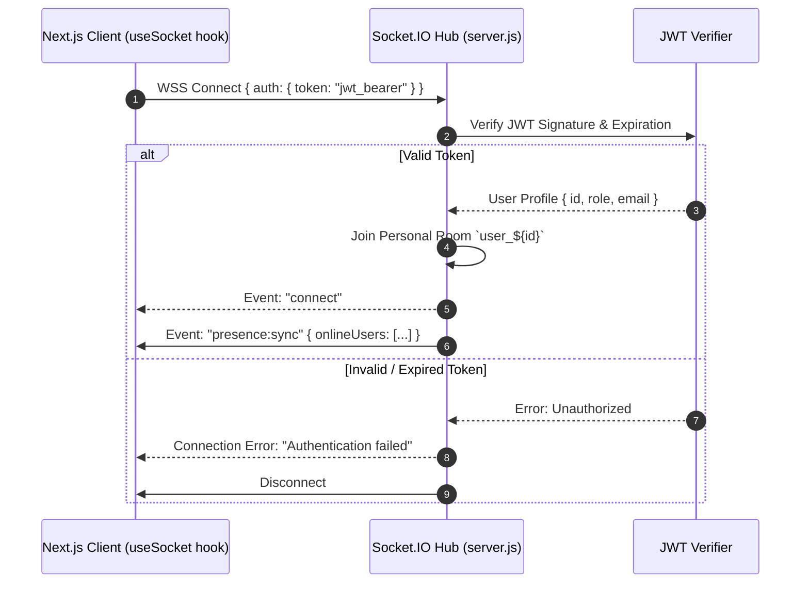

# ProjectHive 🐝 — WebSocket & Real-Time Event Protocol Specification

> **Engine:** Socket.IO v4.7 (Engine.IO v4 protocol)  
> **Transport:** WebSocket (`wss://`) with fallback to HTTP long-polling  
> **Auth Handshake:** JWT passed via `auth: { token }` connection payload  

---

## 1. Connection & Authentication Handshake



---

## 2. Real-Time Chat & Messaging Events

### `message:send` (Client $\rightarrow$ Server)
Dispatched when a student posts a message to a team channel or direct conversation.
```json
{
  "channel_id": "uuid",
  "content": "Updated the circuit diagram in our wiki!",
  "attachments": ["https://..."]
}
```

### `message:receive` (Server $\rightarrow$ Client)
Broadcast to all sockets currently joined to `channel_${channel_id}`.
```json
{
  "id": "uuid",
  "channel_id": "uuid",
  "sender_id": "uuid",
  "sender_name": "Rahim Chowdhury",
  "content": "Updated the circuit diagram in our wiki!",
  "attachments": ["https://..."],
  "created_at": "2026-11-14T01:20:00Z"
}
```

### `message:read` (Client $\rightarrow$ Server $\rightarrow$ Client)
Notifies sender that their message was viewed by a peer.
```json
{
  "channel_id": "uuid",
  "message_id": "uuid",
  "reader_id": "uuid"
}
```

---

## 3. Squad Calling & SFU Signaling Events

### `call:initiate` (Client $\rightarrow$ Server)
Caller triggers a notification to squad members when opening a LiveKit room.
```json
{
  "team_id": "uuid",
  "room_name": "squad_orbit_49",
  "call_type": "video"
}
```

### `call:incoming` (Server $\rightarrow$ Client)
Sent to all online team members in `team_${team_id}`.
```json
{
  "room_name": "squad_orbit_49",
  "caller": {
    "id": "uuid",
    "name": "Rahim Chowdhury",
    "avatar_url": "https://..."
  },
  "call_type": "video"
}
```

---

## 4. Administrative Security Telemetry Events

### `admin:notification` (Server $\rightarrow$ Admin Clients)
Dispatched to all sockets in the high-privilege `admin_room`.
```json
{
  "type": "SECURITY_ALERT",
  "title": "Unusual Authentication Velocity",
  "message": "Multiple failed attempts from IP 198.51.100.42",
  "severity": "high",
  "timestamp": "01:21:40 UTC"
}
```

### `support:new_ticket` (Server $\rightarrow$ Admin Clients)
Signals real-time creation of a student support or moderation inquiry.
```json
{
  "ticket_number": 1042,
  "subject": "Squad ownership transfer dispute",
  "user_id": "uuid"
}
```

