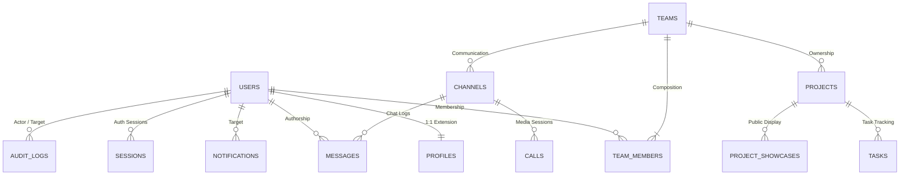

# ProjectHive 🐝 — Database Design, Data Models & RLS Architecture

> **Database Engine:** PostgreSQL 15 (Supabase Cloud)  
> **Security Protocol:** Row Level Security (RLS) Enabled on 100% of Public Tables  
> **Connection Strategy:** Transaction-Mode Connection Pooling via PgBouncer  

---

## 1. Relational Entity Overview



---

## 2. Table Specifications & Column Definitions

### 2.1 `users` (Identity Core)
| Column | Type | Constraints | Description |
| :--- | :--- | :--- | :--- |
| `id` | `UUID` | `PRIMARY KEY, DEFAULT gen_random_uuid()` | Unique user identifier (matches Supabase Auth UID) |
| `email` | `VARCHAR(255)` | `NOT NULL, UNIQUE` | Academic / personal email address |
| `password_hash` | `TEXT` | `NULLABLE` | Bcrypt hash (null if OAuth authentication used) |
| `role` | `VARCHAR(32)` | `DEFAULT 'student'` | Roles: `student`, `moderator`, `admin`, `super_admin` |
| `is_verified` | `BOOLEAN` | `DEFAULT FALSE` | Email verification status |
| `is_banned` | `BOOLEAN` | `DEFAULT FALSE` | Security disciplinary suspension state |
| `settings` | `JSONB` | `DEFAULT '{}'` | Key-value store: theme preference, notifications, sounds |
| `created_at` | `TIMESTAMPTZ` | `DEFAULT NOW()` | Account creation timestamp |
| `updated_at` | `TIMESTAMPTZ` | `DEFAULT NOW()` | Account modification timestamp |

### 2.2 `profiles` (Student Portfolio & Talent Directory)
| Column | Type | Constraints | Description |
| :--- | :--- | :--- | :--- |
| `user_id` | `UUID` | `PRIMARY KEY, REFERENCES users(id) ON DELETE CASCADE` | Linked identity |
| `first_name` | `VARCHAR(64)` | `NOT NULL` | First name |
| `last_name` | `VARCHAR(64)` | `NOT NULL` | Last name |
| `university` | `VARCHAR(128)` | `NULLABLE` | Affiliated university or institution |
| `major` | `VARCHAR(128)` | `NULLABLE` | Field of study (e.g. Computer Science, AI) |
| `year_of_study` | `INTEGER` | `DEFAULT 1` | Current academic year (1 to 5) |
| `hours_per_week`| `INTEGER` | `DEFAULT 10` | Availability for capstone / squad work |
| `bio` | `TEXT` | `NULLABLE` | Student background and technical summary |
| `skills` | `TEXT[]` | `DEFAULT '{}'` | Array of technical tags (`react`, `python`, `solidity`) |
| `github_url` | `TEXT` | `NULLABLE` | GitHub developer profile link |
| `linkedin_url` | `TEXT` | `NULLABLE` | LinkedIn professional profile link |
| `portfolio_url`| `TEXT` | `NULLABLE` | Personal portfolio or project website |
| `avatar_url` | `TEXT` | `NULLABLE` | Supabase Storage public CDN URL |
| `avatar_color` | `VARCHAR(16)` | `DEFAULT 'amber'` | Fallback generative badge color |
| `is_public` | `BOOLEAN` | `DEFAULT TRUE` | Visibility in `/people` talent search |

### 2.3 `teams` (Squad Incubation Core)
| Column | Type | Constraints | Description |
| :--- | :--- | :--- | :--- |
| `id` | `UUID` | `PRIMARY KEY, DEFAULT gen_random_uuid()` | Team ID |
| `name` | `VARCHAR(128)` | `NOT NULL` | Squad display name |
| `slug` | `VARCHAR(128)` | `NOT NULL, UNIQUE` | Clean URL slug |
| `description` | `TEXT` | `NULLABLE` | Mission statement & project scope |
| `leader_id` | `UUID` | `REFERENCES users(id) ON DELETE RESTRICT` | Squad founding lead |
| `status` | `VARCHAR(32)` | `DEFAULT 'recruiting'` | States: `recruiting`, `active`, `completed` |
| `tags` | `TEXT[]` | `DEFAULT '{}'` | Technical domain tags |
| `max_members` | `INTEGER` | `DEFAULT 5` | Maximum team size threshold |
| `created_at` | `TIMESTAMPTZ` | `DEFAULT NOW()` | Team creation timestamp |

### 2.4 `team_members` (Squad Membership & Roles)
| Column | Type | Constraints | Description |
| :--- | :--- | :--- | :--- |
| `team_id` | `UUID` | `REFERENCES teams(id) ON DELETE CASCADE` | Target team |
| `user_id` | `UUID` | `REFERENCES users(id) ON DELETE CASCADE` | Student member |
| `role` | `VARCHAR(32)` | `DEFAULT 'member'` | Roles: `leader`, `member`, `applicant` |
| `joined_at` | `TIMESTAMPTZ` | `DEFAULT NOW()` | Admission timestamp |
| **PRIMARY KEY** | `(team_id, user_id)` | — | Unique membership pair |

### 2.5 `projects` (Development & GitHub Integration)
| Column | Type | Constraints | Description |
| :--- | :--- | :--- | :--- |
| `id` | `UUID` | `PRIMARY KEY, DEFAULT gen_random_uuid()` | Project ID |
| `team_id` | `UUID` | `REFERENCES teams(id) ON DELETE CASCADE` | Associated squad |
| `title` | `VARCHAR(128)` | `NOT NULL` | Project title |
| `description` | `TEXT` | `NULLABLE` | Project overview |
| `repository_url`| `TEXT` | `NULLABLE` | Connected GitHub repository |
| `status` | `VARCHAR(32)` | `DEFAULT 'development'` | `planning`, `development`, `launched` |
| `created_at` | `TIMESTAMPTZ` | `DEFAULT NOW()` | Project timestamp |

### 2.6 `tasks` (Kanban Board)
| Column | Type | Constraints | Description |
| :--- | :--- | :--- | :--- |
| `id` | `UUID` | `PRIMARY KEY, DEFAULT gen_random_uuid()` | Task ID |
| `project_id` | `UUID` | `REFERENCES projects(id) ON DELETE CASCADE` | Associated project |
| `title` | `VARCHAR(255)` | `NOT NULL` | Task title |
| `description` | `TEXT` | `NULLABLE` | Task details / markdown checklist |
| `assignee_id` | `UUID` | `REFERENCES users(id) ON DELETE SET NULL` | Assigned team member |
| `status` | `VARCHAR(32)` | `DEFAULT 'todo'` | `todo`, `in_progress`, `review`, `done` |
| `priority` | `VARCHAR(16)` | `DEFAULT 'medium'` | `low`, `medium`, `high`, `urgent` |
| `due_date` | `TIMESTAMPTZ` | `NULLABLE` | Deadline timestamp |
| `order_index` | `INTEGER` | `DEFAULT 0` | Kanban column ordering sequence |

---

## 3. Row Level Security (RLS) Policies

All tables enforce Postgres RLS to guarantee zero data leakage between unauthorized users.

```sql
-- Enable RLS across all tables
ALTER TABLE users ENABLE ROW LEVEL SECURITY;
ALTER TABLE profiles ENABLE ROW LEVEL SECURITY;
ALTER TABLE teams ENABLE ROW LEVEL SECURITY;
ALTER TABLE team_members ENABLE ROW LEVEL SECURITY;
ALTER TABLE messages ENABLE ROW LEVEL SECURITY;
ALTER TABLE audit_logs ENABLE ROW LEVEL SECURITY;

-- Profiles: Public profiles are visible to all authenticated users
CREATE POLICY "Public profiles are viewable by authenticated users"
ON profiles FOR SELECT
TO authenticated
USING (is_public = true OR auth.uid() = user_id);

-- Profiles: Users can only update their own profile
CREATE POLICY "Users can update their own profile"
ON profiles FOR UPDATE
TO authenticated
USING (auth.uid() = user_id);

-- Messages: Users can only select messages in channels of teams they belong to
CREATE POLICY "Team members can view team messages"
ON messages FOR SELECT
TO authenticated
USING (
  channel_id IN (
    SELECT c.id FROM channels c
    JOIN team_members tm ON tm.team_id = c.team_id
    WHERE tm.user_id = auth.uid()
  )
);

-- Audit Logs: Read-only access restricted strictly to Admin and Super Admin
CREATE POLICY "Admins have full visibility of audit logs"
ON audit_logs FOR SELECT
TO authenticated
USING (
  EXISTS (
    SELECT 1 FROM users
    WHERE id = auth.uid() AND role IN ('admin', 'super_admin')
  )
);
```

---

## 4. Performance Indexing Strategy

```sql
-- User and Profile search indexes
CREATE INDEX idx_users_email ON users(email);
CREATE INDEX idx_users_role ON users(role);
CREATE INDEX idx_profiles_university ON profiles(university);
CREATE INDEX idx_profiles_skills ON profiles USING GIN (skills);

-- Team & Project relations
CREATE INDEX idx_team_members_user ON team_members(user_id);
CREATE INDEX idx_team_members_team ON team_members(team_id);
CREATE INDEX idx_projects_team_id ON projects(team_id);
CREATE INDEX idx_tasks_project_id ON tasks(project_id);
CREATE INDEX idx_tasks_assignee_id ON tasks(assignee_id);

-- Messaging high-throughput ordering
CREATE INDEX idx_messages_channel_created ON messages(channel_id, created_at DESC);
CREATE INDEX idx_notifications_recipient ON notifications(recipient_id, is_read);
```
