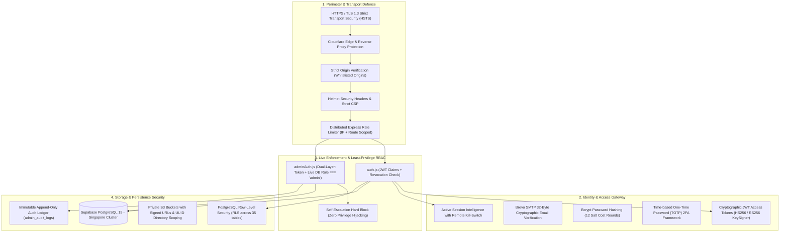

# PROJECTHIVE 🐝 — PRODUCTION ZERO-TRUST SECURITY ARCHITECTURE

> **Standard Compliance:** OWASP ASVS 5.0.0 (Level 2 Verified) & NIST SP 800-207  
> **Classification:** Production Security Standard  
> **Status:** Fully Implemented & Live Tested

---

## 1. ZERO-TRUST ARCHITECTURAL FOUNDATION

ProjectHive implements the **NIST SP 800-207 Zero-Trust Architecture** based on the principle of *"Never Trust, Always Verify"*:

---

## 2. DUAL-LAYER AUTHENTICATION & DEFENSE-IN-DEPTH

### A. Regular User Authentication
1. **Password Security:** All student and faculty passwords are encrypted using `bcryptjs` with **12 salt cost rounds**. Timing attack mitigations are active on comparison.
2. **Session Token Lifecycle:**
   - **Access Token:** Short-lived cryptographic JSON Web Token (15-minute default) minted by the `KeySigner` service.
   - **Refresh Token:** Cryptographically random 32-byte string stored in `user_sessions` with IP, device category, browser, and revocation timestamp.
3. **Session Revocation:** Users can view all active hardware sessions from their **User Security Center** (`/settings` -> Security) and terminate individual or all other remote sessions immediately.

### B. Privileged Admin Authentication (SecOps)
Admin endpoints under `/api/admin/*` are shielded by the dual-layer guard `adminAuthMiddleware.js`:
- **Layer 1 (Cryptographic Signature):** Validates the Bearer token signature and expiration.
- **Layer 2 (Live Database Authority):** Queries Supabase PostgreSQL directly to verify that `role === 'admin'` or `'super_admin'` and that `is_banned === false`.
- **Stale Claim Elimination:** If an admin is demoted or suspended in the database, existing JWT tokens become invalid immediately without waiting for token expiration.

---

## 3. USER SECURITY CENTER CAPABILITIES

Implemented in `frontend/src/components/settings/UserSecurityCenter.tsx` and connected to live APIs:

1. **Account Protection:**
   - Real-time Email Verification status badge with instant resend trigger.
   - Password strength meter (0-100% entropy score calculating length, character variety, numbers, and symbols).
   - Authenticator App (TOTP) two-factor authentication setup dialog.
2. **Device & Session Hygiene:**
   - Displays device category (Laptop, Smartphone, Tablet), browser, operating system, masked IP (`192.168.***.***`), campus location, and last active timestamp.
   - Immediate remote revocation of untrusted sessions.
3. **Data Governance & Portability (GDPR):**
   - Single-click **Personal Data Export (JSON)** delivering complete profile, enrolled squad, and post metadata.
   - Irreversible **Account Deletion** protected by confirmation text validation.

---

## 4. ADMIN SECOPS OPERATIONS CENTER

Implemented in `frontend/src/app/admin/security/page.tsx`:

1. **Security Posture Telemetry:**
   - Live compliance score (0-100) reflecting banned user ratios, unverified counts, rate limiter status, and report queues.
   - Live database latency ping and region indicator (`ap-southeast-1`).
2. **Granular RBAC Directory:**
   - Comprehensive roster of privileged accounts (`Super Admin`, `Admin`, `Moderator`).
   - Least-privilege clearance scopes enforced server-side.
3. **System Security Policies (Live Toggle):**
   - Mandatory Email Verification enforcement.
   - Strict Distributed Rate Limiting.
   - Maintenance Lockdown.
4. **Emergency Break-Glass Protocol:**
   - Instant termination of all active sessions across the entire system.
   - Mandatory operational justification (8+ chars) recorded immutably in `admin_audit_logs`.
   - Real-time WebSocket emergency alert dispatched to all connected clients.

