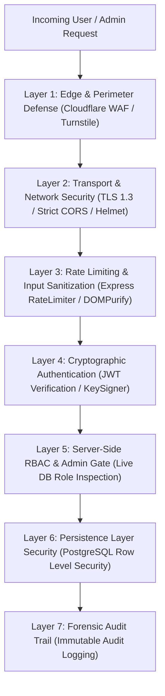
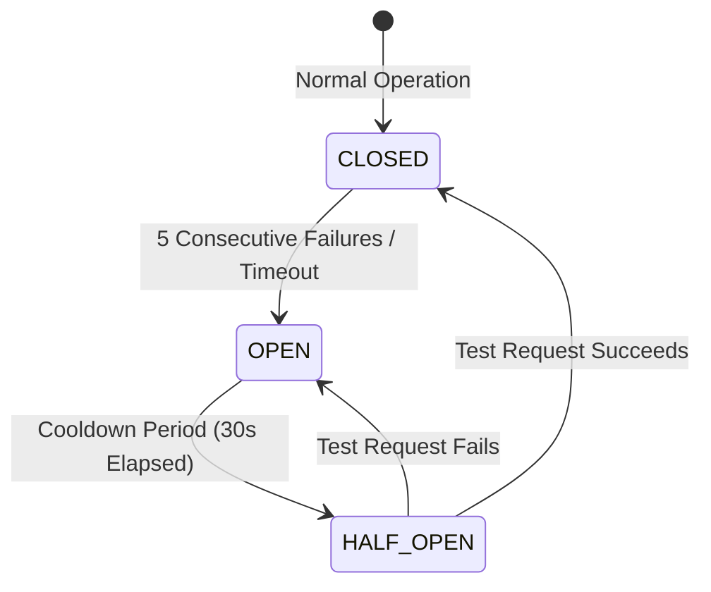

# ProjectHive 🐝 — Security Architecture, Threat Model & RBAC Matrix

> **Security Posture:** Zero-Trust Client Model with Hardened Administrative Isolation  
> **Compliance Standard:** OWASP Top 10 · Strict CORS · RLS Defense-in-Depth · Immutable Audit Trails  

---

## 1. Security Architecture & Defense-in-Depth Layers

ProjectHive implements a layered defense model where each barrier independently enforces access boundaries.



---

## 2. Administrative Isolation & Separation of Concerns

Unlike conventional applications where admin routes share standard user layouts, ProjectHive enforces **complete architectural isolation**:

1. **Dedicated Route Namespace:**
   - Admin routes reside entirely under `/admin/*`.
   - Entry point is strictly `/admin/login`.
   - Student navigation routes (`/dashboard`, `/teams`, `/profile`) contain zero links, buttons, or hints of the admin interface unless the authenticated account has explicit `admin` or `super_admin` status.

2. **Server-Side Live Database Verification:**
   - Tokens alone are never trusted for high-privilege administrative actions.
   - The backend `adminAuth.js` middleware performs an un-cached PostgreSQL lookup on every administrative request:
     ```javascript
     const { data: user, error } = await supabaseAdmin
       .from('users')
       .select('id, role, is_banned')
       .eq('id', req.user.id)
       .single();

     if (!user || !['admin', 'super_admin'].includes(user.role) || user.is_banned) {
       return res.status(403).json({ error: 'Forbidden: Insufficient administrative privileges' });
     }
     ```
   - This eliminates **token staleness attacks** (e.g. revoked admin credentials or demoted users continuing to act using unexpired JWTs).

3. **Desktop Workstation Enclave (`DesktopGate.tsx`):**
   - The administrative command center is optimized for forensic incident response and system telemetry.
   - On screens `< 1024px`, the system displays a controlled SecOps notice informing operators that high-privilege controls are restricted to authenticated desktop workstations.

---

## 3. Role-Based Access Control (RBAC) Matrix

| Resource / Capability | Student | Moderator | Admin | Super Admin | Enforcement Point |
| :--- | :---: | :---: | :---: | :---: | :--- |
| **View Public Landing & Showcases** | ✅ | ✅ | ✅ | ✅ | Public Route |
| **Edit Own Student Profile** | ✅ | ✅ | ✅ | ✅ | RLS + JWT Check |
| **Create & Lead Squad / Team** | ✅ | ✅ | ✅ | ✅ | Team Controller |
| **Create / Update Project Tasks** | Squad Member | Squad Member | ✅ | ✅ | RLS + Membership Check |
| **Join Audio/Video SFU Meetings** | Verified Student | Verified Student | ✅ | ✅ | LiveKit Token Controller |
| **Access HiveMind AI Inference** | 30 req/min | 60 req/min | Unlimited | Unlimited | Express RateLimiter |
| **Access Admin Console (`/admin/*`)**| ❌ | ❌ | ✅ | ✅ | `adminAuth.js` + `DesktopGate` |
| **Review User Reports & Moderation** | ❌ | ✅ | ✅ | ✅ | Moderation Controller |
| **Issue Disciplinary 3-Strike Warning**| ❌ | ✅ | ✅ | ✅ | Moderation Controller |
| **Temporarily Suspend / Ban User** | ❌ | ❌ | ✅ | ✅ | Admin Controller + Audit Log |
| **Toggle System Kill Switches** | ❌ | ❌ | ✅ | ✅ | Admin Settings Controller |
| **Inspect Device & IP Telemetry** | ❌ | ❌ | ✅ | ✅ | SecOps Header Controller |
| **View Immutable Audit Logs** | ❌ | ❌ | ✅ | ✅ | Audit Log Service |
| **Promote User to Admin Role** | ❌ | ❌ | ❌ | ✅ | Super Admin Only |

---

## 4. Threat Model & Mitigation Ledger (STRIDE)

| Threat Category | Description | ProjectHive Countermeasure |
| :--- | :--- | :--- |
| **Spoofing Identity** | Attacker attempts to forge user tokens or impersonate administrators. | HMAC-SHA256 tokens verified against server secret; admin routes require fresh database role lookup. |
| **Tampering with Data** | Attacker modifies task status or messages belonging to other squads. | PostgreSQL Row Level Security (RLS) ensures queries only match records where `team_id IN (user_teams)`. |
| **Repudiation** | Malicious actor denies performing destructive administrative action. | Structured `audit_logs` record `actor_id`, `action`, `target_id`, `client_ip`, and `timestamp`. |
| **Information Disclosure** | Secret keys (LiveKit, Supabase Service Role) leaked via frontend bundles. | Strict separation: frontend utilizes public publishable keys; service role and LiveKit secrets reside solely in backend `.env`. |
| **Denial of Service** | Bot flooding on AI endpoints or authentication endpoints. | Express Rate Limiter tiers: Auth (10 req/15m), AI (20 req/m), General API (100 req/m). Circuit breakers isolate external SFU/AI failures. |
| **Elevation of Privilege** | Student user submits `PUT /api/users/me` with `role: "admin"`. | Controller strips `role` and `is_banned` from student update payloads (`whitelistInputFields`). |

---

## 5. Circuit Breaker Architecture

ProjectHive protects against cascading third-party cloud failures via autonomous Circuit Breakers:



1. **AI Circuit Breaker:** Protects against Groq/Gemini downtime by cascading to alternative models or returning cached assistance.
2. **SMTP Circuit Breaker:** Queues outgoing transactional emails locally in memory if Brevo SMTP exceeds latency thresholds.
3. **LiveKit SFU Circuit Breaker:** Falls back to audio-only or TURN relays if the media server signals connection saturation.
