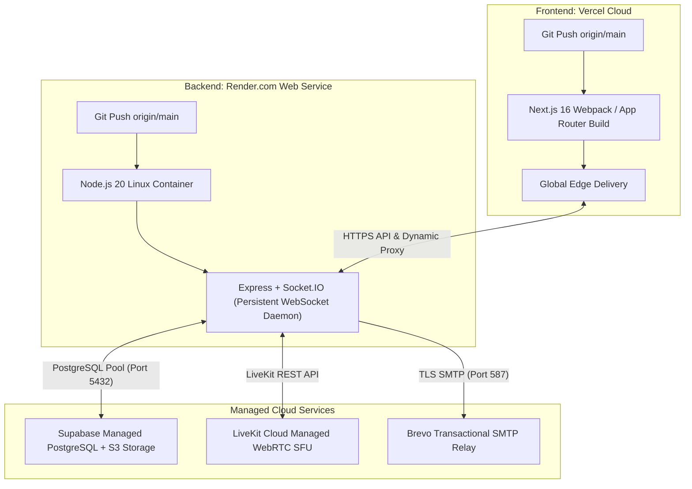

# ProjectHive 🐝 — Local Development & Cloud Deployment Guide

> **Platforms:** Vercel (Frontend Next.js) · Render (Backend Express + WebSockets) · Supabase (PostgreSQL & Storage) · LiveKit Cloud (WebRTC SFU)  

---

## 1. Quickstart (Local Development)

### 1.1 Prerequisites
- **Node.js:** v20.x or higher
- **npm:** v10.x or higher
- **Git**

### 1.2 Repository Setup & Installation
```bash
# Clone the repository
git clone https://github.com/TIMON838/Project-Hive.git
cd Project-Hive

# Install frontend dependencies
npm --prefix frontend install

# Install backend dependencies
npm --prefix server install
```

### 1.3 Environment Configuration
Create local `.env` files based on the project configuration:

1. **Backend Environment (`server/.env`):**
   ```ini
   PORT=5000
   NODE_ENV=development
   CLIENT_URL=http://localhost:3000
   JWT_SECRET=your_super_secret_jwt_key_at_least_32_chars
   
   # Supabase Persistence
   SUPABASE_URL=https://your-project.supabase.co
   SUPABASE_SERVICE_ROLE_KEY=your_service_role_key
   SUPABASE_ANON_KEY=your_anon_key
   
   # LiveKit Real-Time SFU
   LIVEKIT_URL=wss://your-livekit.livekit.cloud
   LIVEKIT_API_KEY=your_livekit_api_key
   LIVEKIT_API_SECRET=your_livekit_api_secret
   
   # AI Cascade Engine
   GROQ_API_KEY=your_groq_api_key
   GEMINI_API_KEY=your_gemini_api_key
   
   # Transactional Email
   SMTP_HOST=smtp-relay.brevo.com
   SMTP_PORT=587
   SMTP_USER=your_brevo_login
   SMTP_PASS=your_brevo_master_smtp_key
   ```

2. **Frontend Environment (`frontend/.env.local`):**
   ```ini
   NEXT_PUBLIC_API_URL=http://localhost:5000
   NEXT_PUBLIC_SOCKET_URL=http://localhost:5000
   NEXT_PUBLIC_SUPABASE_URL=https://your-project.supabase.co
   NEXT_PUBLIC_SUPABASE_ANON_KEY=your_anon_key
   NEXT_PUBLIC_LIVEKIT_URL=wss://your-livekit.livekit.cloud
   ```

### 1.4 Running the Development Servers
In two separate terminal sessions:
```bash
# Terminal 1: Backend Express + Socket.IO Server
npm --prefix server run dev

# Terminal 2: Frontend Next.js Dev Server
npm --prefix frontend run dev
```
Open [http://localhost:3000](http://localhost:3000) to access the application.

---

## 2. Cloud Deployment Architecture



---

## 3. Production Deployment Checklist

1. **Frontend (Vercel):**
   - Root Directory: `frontend`
   - Build Command: `npm run build`
   - Output Directory: `.next`
   - Environment Variables: Add `NEXT_PUBLIC_*` variables from `frontend/.env.local`.

2. **Backend (Render):**
   - Root Directory: `server`
   - Environment: `Node`
   - Build Command: `npm install`
   - Start Command: `node server.js`
   - Health Check Path: `/api/health/ready`

3. **CORS & Cookies:**
   - Ensure backend `CLIENT_URL` is set to the production frontend domain (e.g. `https://projecthive.app`).
