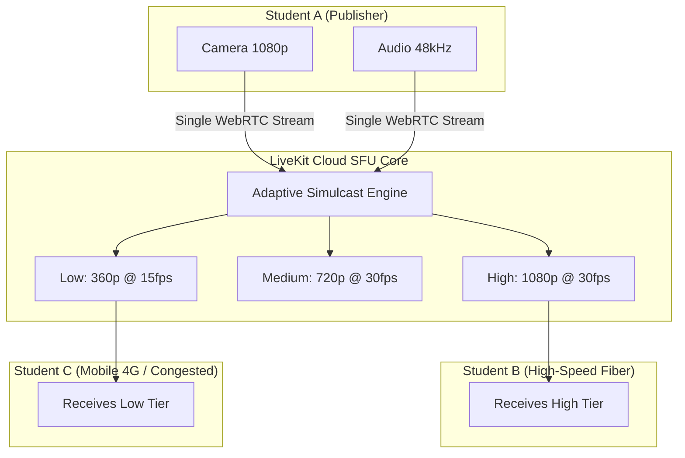

# ProjectHive 🐝 — LiveKit Cloud SFU Setup & Media Troubleshooting

> **Service:** LiveKit Cloud Managed WebRTC Selective Forwarding Unit (SFU)  
> **Server Endpoint:** `wss://projecthive-atoyao1h.livekit.cloud`  

---

## 1. SFU Media Routing Overview

ProjectHive utilizes LiveKit Cloud SFU rather than peer-to-peer mesh. In this architecture:
1. Each client publishes their camera, microphone, or screen share track to the SFU once.
2. The SFU dynamically downsamples and forwards incoming tracks to subscribers based on network conditions (**Dynacast** and **Simulcast**).
3. Bandwidth scaling remains $O(N)$ instead of $O(N^2)$, allowing seamless squad video calls with up to 50 active participants.



---

## 2. Ephemeral Token Minting Implementation

The backend issues short-lived JWT tokens using `livekit-server-sdk`:

```javascript
// server/services/keySigner.service.js
const { AccessToken } = require('livekit-server-sdk');

function generateLiveKitToken(roomName, participantIdentity, participantName) {
  const apiKey = process.env.LIVEKIT_API_KEY;
  const apiSecret = process.env.LIVEKIT_API_SECRET;

  const at = new AccessToken(apiKey, apiSecret, {
    identity: participantIdentity,
    name: participantName,
    ttl: '2h', // Token expires in 2 hours
  });

  at.addGrant({
    roomJoin: true,
    room: roomName,
    canPublish: true,
    canSubscribe: true,
    canPublishData: true,
  });

  return at.toJwt();
}
```

---

## 3. WebRTC Diagnostics & NAT Traversal

If students experience connection timeouts on restricted university firewalls or mobile cellular networks:
1. **STUN Resolution:** Standard Google STUN (`stun:stun.l.google.com:19302`) resolves public IP and UDP port mappings.
2. **TURN Fallback:** If symmetric NAT blocks direct UDP transmission, LiveKit routes encrypted traffic through TLS TURN relay over TCP port 443.

