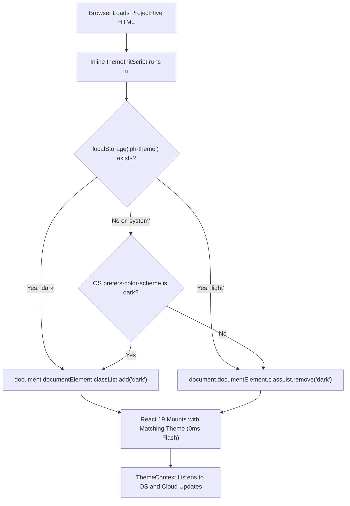

# ProjectHive 🐝 — Design System, 3D WebGL & UI/UX Specifications

> **Aesthetic Philosophy:** Obsidian Dark Slate Foundations with Restrained Amber Precision  
> **Interactive Dimension:** 60 FPS Three.js/WebGL Canvases · Controlled Glassmorphism · Zero-FOUC Auto-Sync  

---

## 1. Brand Identity & Color Token Architecture

ProjectHive is built upon an intentional contrast between ultra-deep obsidian slate surfaces and warm, high-contrast amber highlights, referencing the hive/honeycomb metaphor of collective intelligence.

### 1.1 Core Color Tokens

| Token Name | Hex Code | HSL Equivalent | Role & Application |
| :--- | :---: | :---: | :--- |
| **Obsidian Base** | `#07090e` | `240° 33% 4%` | Dark mode application viewport background |
| **Slate Surface** | `#0d1117` | `216° 28% 7%` | Card containers, sidebar background & popover panels |
| **Amber Primary** | `#f59e0b` | `38° 92% 50%` | Primary action buttons, active tabs, brand badges |
| **Amber Glow** | `#fbbf24` | `43° 96% 56%` | Hover states, glowing accents & 3D mesh highlights |
| **Indigo Accent** | `#6366f1` | `239° 84% 67%` | Inner crystal core of 3D lattice, AI reasoning tags |
| **Emerald Live** | `#10b981` | `142° 71% 45%` | Socket live presence indicator, system operational status |
| **Rose Alert** | `#f43f5e` | `350° 89% 60%` | Destructive actions, urgent task flags, security warnings |

---

## 2. Interactive 3D WebGL Ecosystem

ProjectHive incorporates three custom WebGL components rendered via Three.js and `@react-three/fiber`:

### 2.1 Hero 3D Environment (`Hero3DEnvironment.tsx`)
- **Outer Shell:** Faceted Dodecahedron geodesic wireframe rendered with physical wireframe shading in Amber (`#f59e0b`).
- **Inner Core:** Glowing Icosahedron crystalline core rendered in Indigo (`#6366f1`) with sinusoidal pulse animations.
- **Orbital Squad Rings:** Three concentric Torus geometries representing active collaboration circles tilted along orbital planes.
- **Constellation Cloud:** 260 randomized point particles simulating student talent nodes.
- **Physics:** Inertia-damped pointer tracking responding dynamically to mouse and mobile gyroscope delta.

### 2.2 Auth Gyroscopic Security Core (`Auth3DCanvas.tsx` / `mode='signin'`)
- Dedicated to the `/login` desktop showcase.
- Features a spinning faceted Octahedron enclosed within two concentric gimbal rings, symbolizing cryptographic workstation protection.

### 2.3 Auth Neural Collaboration Mesh (`Auth3DCanvas.tsx` / `mode='signup'`)
- Dedicated to the `/register` desktop showcase.
- Features 9 student node spheres connected by dynamic line filaments with wave-like pulse intensity, representing collective squad formation.

---

## 3. Theme System & Zero-FOUC Auto-Sync

1. **Pre-Hydration Inline Script (`layout.tsx`):**
   - Evaluates before React loads or paints the page.
   - Reads `localStorage('ph-theme')` or system `matchMedia('(prefers-color-scheme: dark)')`.
   - Modifies `document.documentElement` synchronously, preventing any white-screen flashes.

2. **Real-Time Reactive Listener (`ThemeContext.tsx`):**
   - When set to `system`, any change to the operating system's light/dark mode triggers immediate DOM updates without requiring a page refresh.

3. **Cloud Database Synchronization:**
   - Authenticated student selections are saved directly to PostgreSQL (`api.users.updateSettings({ theme })`), maintaining consistency across all authorized devices.

