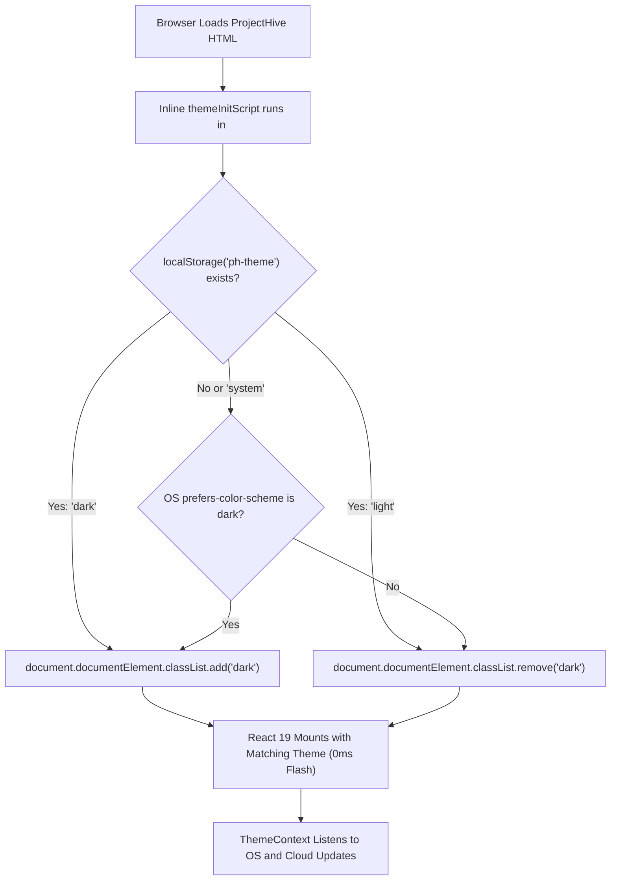

# ProjectHive 🐝 — Design System, 3D WebGL & UI/UX Specifications

> **Aesthetic Philosophy:** Obsidian Dark Slate Foundations with Restrained Amber Precision  
> **Interactive Dimension:** 60 FPS Three.js/WebGL Canvases · Controlled Glassmorphism · Zero-FOUC Auto-Sync  

---

## 1. Brand Identity & Color Token Architecture

ProjectHive is built upon an intentional contrast between ultra-deep obsidian slate surfaces and warm, high-contrast amber highlights, referencing the hive/honeycomb metaphor of collective intelligence.

### 1.1 Core Color Tokens

| Token Name | Hex Code | HSL Equivalent | Role & Application |
| :--- | :---: | :---: | :--- |
| **Obsidian Base** | `#07090e` | `240° 33% 4%` | Dark mode application viewport background |
| **Slate Surface** | `#0d1117` | `216° 28% 7%` | Card containers, sidebar background & popover panels |
| **Amber Primary** | `#f59e0b` | `38° 92% 50%` | Primary action buttons, active tabs, brand badges |
| **Amber Glow** | `#fbbf24` | `43° 96% 56%` | Hover states, glowing accents & 3D mesh highlights |
| **Indigo Accent** | `#6366f1` | `239° 84% 67%` | Inner crystal core of 3D lattice, AI reasoning tags |
| **Emerald Live** | `#10b981` | `142° 71% 45%` | Socket live presence indicator, system operational status |
| **Rose Alert** | `#f43f5e` | `350° 89% 60%` | Destructive actions, urgent task flags, security warnings |

---

## 2. Interactive Workspace & Dynamic Branding Architecture

ProjectHive provides a unified, production-grade collaboration experience grounded in Linear, Slack, LiveKit, and Notion design principles:

### 2.1 Interactive 4-Mode Workspace Preview (`Hero.tsx`)
- **Squad Hub:** Live capstone roster (BUET CSE 499 Autonomous Drone AI), active members, role tags, and an interactive recruitment modal.
- **Sprint Kanban:** Live sprint task board with story points, priority badges, and toggleable checkboxes.
- **LiveKit SFU Stage:** 4K WebRTC video stage with active-speaker glowing borders, audio meters, Gazebo simulation screen share, and call controls.
- **HiveMind AI Copilot:** Technical PRD & Architecture Copilot with contextual action pills.

### 2.2 Centralized Brand Engine & Dynamic Logo Tokens (`brandConfig.ts` & `BrandLogo.tsx`)
- Single source of truth for platform identity tokens: name, highlight, tagline, organization credits (`BITA`), and asset paths.
- Reusable dynamic `<BrandLogo />` component supporting `full`, `mark`, `org`, and `badge` variants with automatic SVG fallbacks and sizing tokens (`xs` to `xl`).
- 100% elimination of hardcoded logo paths or organization strings across all user and admin views.

---

## 3. Theme System & Zero-FOUC Auto-Sync

1. **Pre-Hydration Inline Script (`layout.tsx`):**
   - Evaluates before React loads or paints the page.
   - Reads `localStorage('ph-theme')` or system `matchMedia('(prefers-color-scheme: dark)')`.
   - Modifies `document.documentElement` synchronously, preventing any white-screen flashes.

2. **Real-Time Reactive Listener (`ThemeContext.tsx`):**
   - When set to `system`, any change to the operating system's light/dark mode triggers immediate DOM updates without requiring a page refresh.

3. **Cloud Database Synchronization:**
   - Authenticated student selections are saved directly to PostgreSQL (`api.users.updateSettings({ theme })`), maintaining consistency across all authorized devices.

